<div align="center">

# STATUTE — Structured Translation and Analysis Tool for Undocumented Transactional Engines

**STATUTE is a deterministic pipeline that reverse-engineers Oracle PL/SQL. It takes a folder of `.sql` files through these steps to a traceable Business Requirements Document, diagrams and a knowledge graph:**

`inventory the files` → `parse the code` → `model the data` → `analyse the logic` → `mine the rules` → `draw the diagrams` → `write the BRD` → `build the graph`.


**[Summary](#1-summary)** ·
**[Agents](#21-components)** ·
**[Workflow](#4-the-end-to-end-workflow)** ·
**[Run it](#18-how-to-run-statute)** ·
**[Known problems](#21-known-problems)** ·
**[Glossary](#23-glossary)**

</div>

> [!NOTE]
> This README uses ASD-STE100 Simplified Technical English. The writing rules and the project
> vocabulary are in [`docs/ste-style-guide.md`](docs/ste-style-guide.md). Each term in the
> [Glossary](#23-glossary) has only one meaning.

> [!CAUTION]
> Do not share `brd.md` or the graph export outside the team that owns the source code. These files contain the complete business logic, schema, interfaces and error contracts. STATUTE has no redaction.
> Do not rebuild a system from the BRD without a review by a business expert. On a blind procedure, the rule extraction recall was 0.400.

---

STATUTE reads an Oracle PL/SQL codebase. It writes a specification that a business analyst can review and a development team can rebuild from.
Eight agents run in sequence. Each agent is an independent Python CLI program. It is not an autonomous LLM agent.

**No language model generates, summarises, judges or rewrites any output.**
A formal Oracle PL/SQL grammar gives the structure. sqlglot decomposes the SQL. Rules assemble each sentence from the parse trees.
The same source always gives the same document.
Hallucination is not only reduced. It is structurally impossible, because no model is in the generation path.
Thus, each claim can safely cite a file and a line.

This README is the **one location that explains all of STATUTE**. It gives these topics:

- the general design
- each of the 8 agents: its job, its procedure and its tests
- the formulas, the thresholds and the decision rules
- the data map
- the runbook
- the validation results and the known problems

Each claim in this README comes from a repository file or function, or from a command that was run on the repository.

| If you are… | Read |
|---|---|
| A manager or reviewer | [1](#1-summary), [3](#3-design-rules), [4](#4-the-end-to-end-workflow), [20](#20-validation-results), [22](#22-key-points) |
| A developer who joins the project | All sections, in sequence. Keep [18](#18-how-to-run-statute), [19](#19-how-to-extend-statute) and [21](#21-known-problems) open while you work |
| An operator who runs the pipeline | [18](#18-how-to-run-statute), then the section for the agent that you run (sections [5](#5-agent-1--inventory) to [12](#12-agent-8--knowledge-graph)) |
| A business analyst who reads a BRD | [1](#1-summary), [11](#11-agent-7--synthesis), [14](#14-the-annotation-layer), [21](#21-known-problems) |

---

## Table of contents

1. 🧭 [Summary](#1-summary)
   - 1.1 [The problem](#11-the-problem) · 1.2 [What STATUTE produces](#12-what-statute-produces) · 1.3 [Why STATUTE stops at documentation](#13-why-statute-stops-at-documentation) · 1.4 [Why STATUTE uses no language model](#14-why-statute-uses-no-language-model)
2. 🏗️ [How STATUTE is built](#2-how-statute-is-built)
   - 2.1 [Components](#21-components)
   - 2.2 [Responsibility matrix](#22-responsibility-matrix)
   - 2.3 [Architecture](#23-architecture)
   - 2.4 [System context](#24-system-context)
   - 2.5 [Technology stack](#25-technology-stack)
   - 2.6 [Repository layout](#26-repository-layout)
3. 🛡️ [Design rules](#3-design-rules)
4. 🔄 [The end-to-end workflow](#4-the-end-to-end-workflow)
   - 4.1 [Full flow](#41-full-flow) · 4.2 [Data flow and lineage](#42-data-flow-and-lineage) · 4.3 [Control flow and state](#43-control-flow-and-state) · 4.4 [Errors and recovery](#44-errors-and-recovery) · 4.5 [Who does which step](#45-who-does-which-step)
5. 🗃️ [Agent 1 — Inventory](#5-agent-1--inventory)
6. 🔵 [Agent 2 — Parser](#6-agent-2--parser)
7. 🧱 [Agent 3 — Data](#7-agent-3--data)
8. 🧮 [Agent 4 — Logic](#8-agent-4--logic)
9. ⚖️ [Agent 5 — Rules](#9-agent-5--rules)
10. 🖼️ [Agent 6 — Diagram](#10-agent-6--diagram)
11. 📝 [Agent 7 — Synthesis](#11-agent-7--synthesis)
12. 🕸️ [Agent 8 — Knowledge graph](#12-agent-8--knowledge-graph)
13. 📐 [Formulas, thresholds and algorithms](#13-formulas-thresholds-and-algorithms)
14. ✍️ [The annotation layer](#14-the-annotation-layer)
15. 🔒 [Security and deployment](#15-security-and-deployment)
16. 🏛️ [Architecture decisions and references](#16-architecture-decisions-and-references)
17. 🗂️ [Data and file map](#17-data-and-file-map)
18. ▶️ [How to run STATUTE](#18-how-to-run-statute)
    - 18.1 [Prerequisites](#181-prerequisites) · 18.2 [Installation](#182-installation) · 18.3 [Run the pipeline](#183-run-the-pipeline) · 18.4 [Query the knowledge graph](#184-query-the-knowledge-graph) · 18.5 [Run the tests](#185-run-the-tests) · 18.6 [Configuration and environment variables](#186-configuration-and-environment-variables) · 18.7 [Regenerate the grammar](#187-regenerate-the-grammar) · 18.8 [Fault diagnosis](#188-fault-diagnosis)
19. 🧩 [How to extend STATUTE](#19-how-to-extend-statute)
20. ✅ [Validation results](#20-validation-results)
21. ⚠️ [Known problems](#21-known-problems)
22. 📌 [Key points](#22-key-points)
23. 📖 [Glossary](#23-glossary)
24. 📄 [License](#24-license)

---

## 1. Summary

### 1.1 The problem

An organisation has an Oracle PL/SQL system in service. The system has no reliable documentation, and its authors are not available.
Before the organisation can modernise, replace or audit the system, a person must answer two questions:

- What does the system do?
- Which rules does the system enforce?

The precedent for this project is an industrial **6.4-million-line COBOL system**. Two modernisation attempts failed: one automatic conversion and one package replacement.
After these failures, the team rewrote the system from a specification that they derived from the code.

This sets the main constraint: **builders use the output, not only readers.** Thus, the output is numbered, traceable and verifiable. It states clearly what it does not know.

| Item | Value |
|---|---|
| Input | A folder of Oracle PL/SQL `.sql` files. STATUTE only reads them |
| Output | `brd.md`, `brd_index.json`, `gaps_register.json`, Mermaid diagrams (`*.mmd`), `import.cypher` and CSV files |
| Agents | **8** independent Python CLI programs, run in sequence by a person |
| Orchestrator | None. Versioned JSON artifacts on disk connect the agents |
| Language model calls | **0**. A formal grammar, sqlglot and rules produce all output |
| Reference corpus | `src/`: 7 files, 940 lines, 603 lines of code |
| Reference result | 41 business rules, 21 gaps, 7 diagrams, a graph of 353 nodes and 769 relationships |
| Traceability | Each rule cites a file and a line through its `statement_id` |
| Tests | **414** checks in 8 suites, all passed (see [20](#20-validation-results)) |
| Optional consumer | Neo4j. No agent needs it |

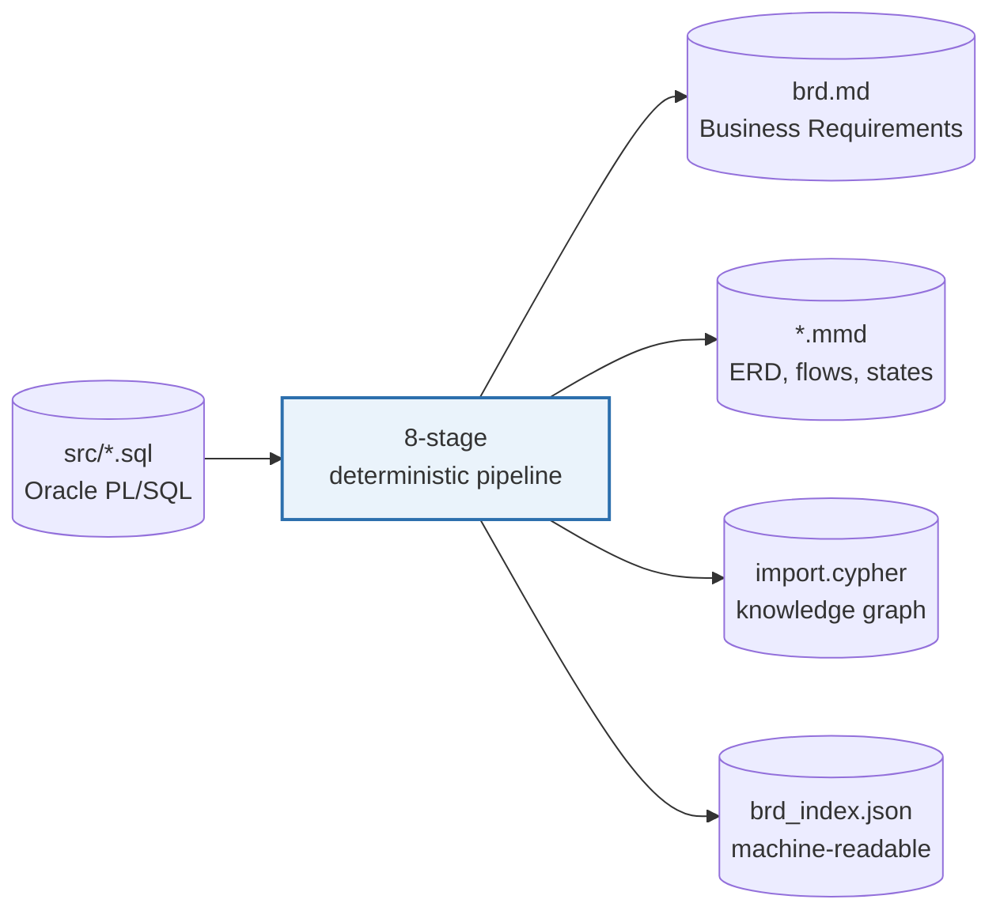

The `.claude/agents/*.md` files are specifications for the development harness. The pipeline never reads them.

### 1.2 What STATUTE produces

These results come from the reference corpus in `src/`:

| Deliverable | Detail |
|---|---|
| **Business Requirements Document** | `brd.md`, 2,549 lines · 41 requirements · 4 parts for 4 audiences · contents with links |
| **Machine-readable index** | `brd_index.json`: the same content as structured data |
| **Gaps register** | `gaps_register.json`: 21 open matters, ranked by severity |
| **Diagrams** | ERD · system data-flow map · entity state model · 5 process flows |
| **Knowledge graph** | 353 nodes and 769 relationships · Cypher with `MERGE` and CSV files |
| **Query interface** | 12 plain-English questions. You can ask them with or without Neo4j |

### 1.3 Why STATUTE stops at documentation

STATUTE does not generate replacement code. Published results show that extraction gets approximately **90 % precision and recall**. End-to-end code generation gets approximately **9 %**.
Extraction is a problem with a sufficient solution. Translation is not. Thus, the pipeline stops where the evidence stops.

### 1.4 Why STATUTE uses no language model

Two findings caused this decision:

1. **Empirical.** No automated metric of documentation quality correlates well with expert judgement. The best reported correlation is *r* = 0.34. On difficult material, the agreement between experts fell to **ICC 0.12**. Thus, "the model checked it" gives no safety.
2. **Practical.** A person who uses a specification cannot detect a fabricated business rule in it.

> A deterministic pipeline that **misses** a rule fails *visibly*.
> A generative pipeline that **invents** a rule fails *invisibly*.

For a document that a team rebuilds from, the first failure mode is better.

---

## 2. How STATUTE is built

### 2.1 Components

| # | Agent | Script (lines) | Job | Dependencies | Detail document |
|---|---|---|---|---|---|
| 1 | Inventory | `01_inventory.py` (724) | Classify the files and give each file a stable `file_id` | none | [agent-01](docs/agents/agent-01-inventory.md) |
| 2 | Parser | `02_parser.py` (858) | ANTLR4 → statements, CFG, `statement_id` | ANTLR4, sqlglot | [agent-02](docs/agents/agent-02-parser.md) |
| 3 | Data | `03_data.py` (1,431) | DDL → schema, **real enforcement state** and ERD | ANTLR4 | [agent-03](docs/agents/agent-03-data.md) |
| 4 | Logic | `04_logic.py` (917) | Pseudocode, complexity, slices, CRUD | none | [agent-04](docs/agents/agent-04-logic.md) |
| 5 | Rules | `05_rules.py` (1,198) | 9 sources → business rules with a confidence | none | [agent-05](docs/agents/agent-05-rules.md) |
| 6 | Diagram | `06_diagram.py` (1,207) | Model that is independent of the renderer → Mermaid | none | [agent-06](docs/agents/agent-06-diagram.md) |
| 7 | Synthesis | `07_synthesis.py` (1,308) | The BRD, the index and the gaps register | none | [agent-07](docs/agents/agent-07-synthesis.md) |
| 8 | Graph | `08_graph.py` (419) | Property graph and questions *(optional)* | none | [agent-08](docs/agents/agent-08-graph.md) |

All scripts are in `.claude/scripts/`. Three libraries support them:

| Library | Lines | Purpose | Used by |
|---|---|---|---|
| `lib_business_language.py` | 271 | Changes identifiers into business language | Agents 7 and 8 |
| `lib_graph_model.py` | 376 | In-memory property graph | Agent 8 |
| `lib_graph_language.py` | 433 | Catalogue of plain-English intents | Agent 8 |

### 2.2 Responsibility matrix

| Capability | 1 | 2 | 3 | 4 | 5 | 6 | 7 | 8 |
|---|:-:|:-:|:-:|:-:|:-:|:-:|:-:|:-:|
| Read the source files | ● | ● | ● | ● | ● | ● | | |
| Classify and route the files | ● | ○ | ○ | | | | | |
| Parse the PL/SQL grammar | | ● | ● | | | | | |
| Statement tree and CFG | | ● | | ○ | ○ | ○ | ○ | ○ |
| Schema and enforcement | | | ● | | ○ | ○ | ○ | ○ |
| Complexity, slices, CRUD | | | | ● | ○ | ○ | ○ | ○ |
| Business rules | | | ○ | ○ | ● | ○ | ○ | ○ |
| Diagrams | | | ● ERD | | | ● | ○ | |
| Document assembly | | | | | | | ● | |
| Graph and questions | | | | | | | | ● |

● owns · ○ uses

### 2.3 Architecture

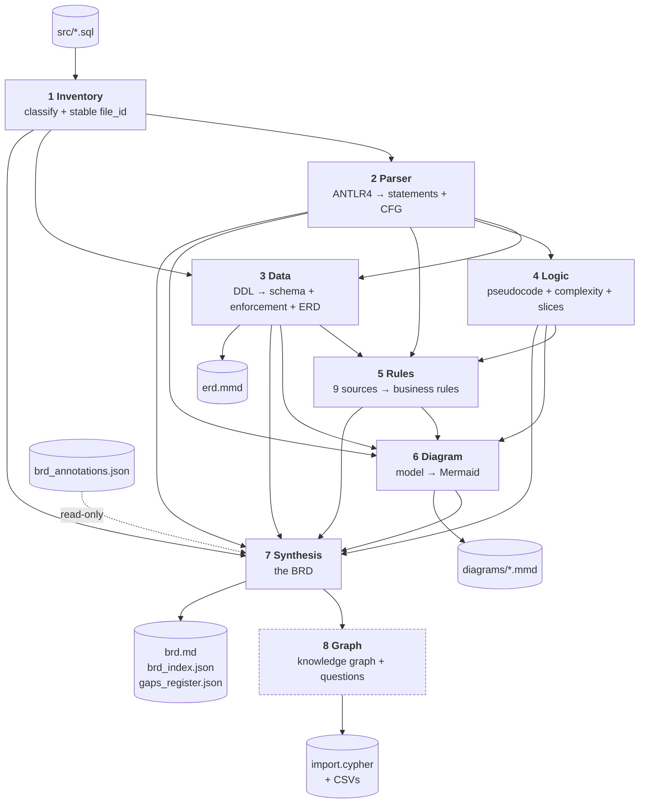

**Eight independent CLI programs. Versioned JSON artifacts on disk connect them.** There is no orchestrator, no shared state object, no service and no database.

### 2.4 System context

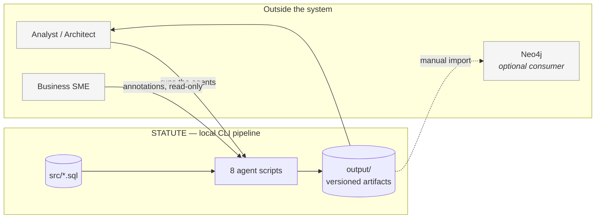

**STATUTE has no inbound interface.** It has no API, no queue and no scheduler integration. Only a person who runs a command starts an agent.

### 2.5 Technology stack

| Layer | Technology | Where | Why |
|---|---|---|---|
| Language | **Python 3.11+** | All agents | The code uses the `X \| Y` type-hint syntax |
| Parse | **ANTLR4** and a vendored Oracle PL/SQL grammar (Apache 2.0) | Agents 2 and 3 | A regex fails on nested blocks, on string literals that contain keywords and on `CASE` inside `CASE` |
| SQL decomposition | **sqlglot** (Oracle dialect) | Agent 2 | It gets the tables and columns from DML at a lower cost than a walk of the ANTLR tree |
| Diagrams | **Mermaid** | Agents 3 and 6 | GitHub, VS Code and most wikis show Mermaid with no extra tools |
| Graph target | **Neo4j** | Agent 8 | Optional consumer. **Never a runtime dependency** |
| All other functions | Python standard library | All agents | No dependency risk |

**Verified as absent from the pipeline scripts:** model calls · network calls · environment variables · database drivers · secrets · `logging` · Dockerfile · CI that runs the tests · dependency manifest.

### 2.6 Repository layout

```
.claude/
  agents/                     8 agent specifications (harness metadata and rationale)
  scripts/
    01_inventory.py    (724)  Agent 1
    02_parser.py       (858)  Agent 2
    03_data.py       (1,431)  Agent 3 (largest)
    04_logic.py        (917)  Agent 4
    05_rules.py      (1,198)  Agent 5
    06_diagram.py    (1,207)  Agent 6
    07_synthesis.py  (1,308)  Agent 7
    08_graph.py        (419)  Agent 8
    lib_business_language.py  (271)  identifier → business language  (Agents 7, 8)
    lib_graph_model.py        (376)  in-memory property graph        (Agent 8)
    lib_graph_language.py     (433)  plain-English intent catalogue  (Agent 8)
    vendor/plsql_grammar/     vendored ANTLR4 grammar and NOTICE.md
    archive/                  old early scripts (not in the pipeline)
  skills/                     2 skill definitions (file-catalog, reference-graph)
src/                          the reference corpus: 7 PL/SQL files
  openwiki/                   OpenWiki pages about the corpus (not pipeline output)
  .github/workflows/          openwiki-update.yml (inside src/, so GitHub does not run it)
  AGENTS.md, CLAUDE.md        OpenWiki context notes
tests/
  test_*.py                   8 suites, 414 checks
  evaluate_rules.py           the only evaluation harness
  fixtures/ground_truth/      4 annotated procedures and BASELINE.json
  fixtures/sample_*/          sample PL/SQL, DDL and logic inputs for the suites
output/                       the latest committed run of each agent
docs/                         15 technical documents and the STE style guide
tools_antlr_build/            grammar regeneration (ANTLR jar, grammar, explore_ddl.py)
reference/                    COBOL reference harness. Git ignores it. Design guidance only
```

---

## 3. Design rules

### 3.1 No language model is in the generation path
The output is a pure function of the input. Rules assemble each sentence from parse trees. Thus, the same source always gives the same document, and no rule is invented.

### 3.2 Each object has a stable identity

| Identifier | Form | Owner |
|---|---|---|
| `file_id` | `SLUG(rel_path) + "__" + SHA256(rel_path)[0:8]` | Agent 1 |
| `object_id` | `TYPE-OWNER.NAME`, with `::` for package members | Agent 2 |
| `statement_id` | `file_id__object_id__STMT_nnnn` | Agent 2 |
| `column_id` | `TABLE.COLUMN` | Agent 3 |
| `rule_id` | `BR-nnn` | Agent 5 |
| `gap_id` | `GAP-nnn` | Agent 7 |

The hash uses the **path**, not the contents. Thus, a file keeps its identity after an edit. This makes the exact traceability matrix and the annotation layer possible.

### 3.3 Each run has a version, and the pointer moves after the write
Each agent writes `output/<stage>/<timestamp>/`. Only after this write does it update `output/<stage>/latest.json`.
If an agent stops during a write, it leaves an orphan directory. The pointer still names the last good run, so the downstream agents are not affected.

### 3.4 Each agent does one kind of work
The parser never interprets meaning. The rules agent never parses again. The diagram agent draws only what earlier agents found. When a defect occurs, only one location can contain it.

### 3.5 Confidence is data, and it is never hidden
STATUTE marks a rule that it infers from structure as `needs review`. It publishes a `DISABLED` database constraint **with a warning that the database does not enforce it**.
When a diagram is too large to read, the diagram states this. All of these items go into the gaps register.

### 3.6 The model is separate from the renderer
Agents 6 and 8 build an in-memory model first and render it last. Thus, the node budget is enforceable, because there is a model to count.
Tests can assert the meaning, not the string format. The local answers of the graph and its Neo4j answers cannot disagree.

---

## 4. The end-to-end workflow

### 4.1 Full flow

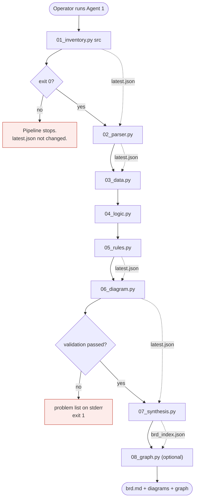

**The operator controls the sequence.** No script starts another script. Each script prints the next command, with the pinned run version.

The committed run (`output/*/latest.json`, 2026-07-29) printed these results:

```
Stage 1  7 files, 940 lines total, 603 code
Stage 2  5 objects, 124 statements, 0 parse errors, 0 unresolved calls
Stage 3  15 tables, 7 FKs + 1 inferred, 1 CHECK, 6 comment-only enums flagged
Stage 4  151 pseudocode lines, 25 slices, 1 over threshold, 1 SAVEPOINT hazard
Stage 5  41 rules — 19 validation, 12 limit-check, 6 calculation, 4 error-handling
Stage 6  7 figures, 100% decision labels, 100% branch traceability
Stage 7  41 requirements, 21 glossary terms, 41 traceability rows, 21 gaps
Stage 8  353 nodes / 769 relationships, 12 questions, 4 blind spots
```

### 4.2 Data flow and lineage

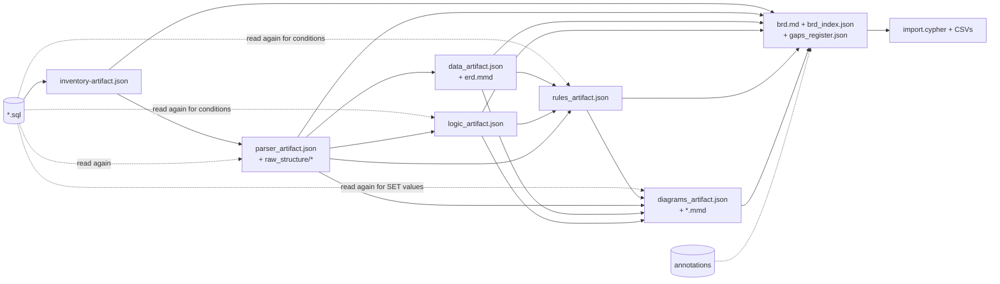

**The lineage of one rule, from end to end:**

```
src/05_medium_fund_transfer_with_validation.sql : line 79
  → Agent 1  file_id     = 05_MEDIUM_FUND_TRANSFER_WITH_VALIDATION__5E3A3BBB
  → Agent 2  statement_id = <file_id>__PROC-.SP_TRANSFER_FUNDS__STMT_00nn
  → Agent 5  BR-002, source.statement_id + line 79
  → Agent 6  decision node + BRANCH edge labelled "BR-002"
  → Agent 7  §5 rule block + §12 traceability row citing file:line
  → Agent 8  (:BusinessRule {rule_id:"BR-002"})-[:IMPLEMENTED_AT]->(:Statement)
```

### 4.3 Control flow and state

**STATUTE has no shared state object, session, thread or checkpointer. The file system holds all state.**

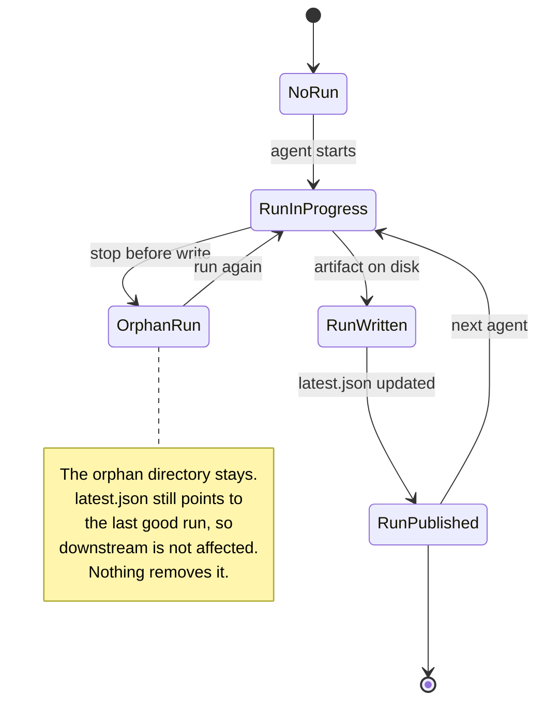

Each agent has the same shape:

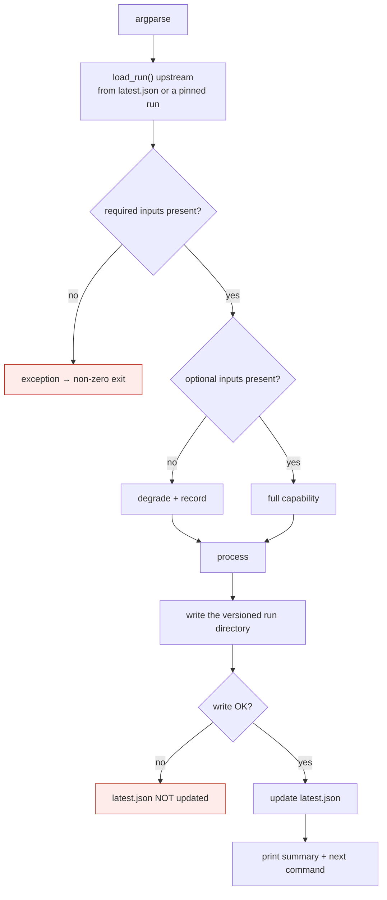

**Graceful degradation** is in Agent 5 (the logic artifact is optional) and in Agents 6 and 8 (many optional inputs). **Agent 7 needs all six upstream artifacts.**

### 4.4 Errors and recovery

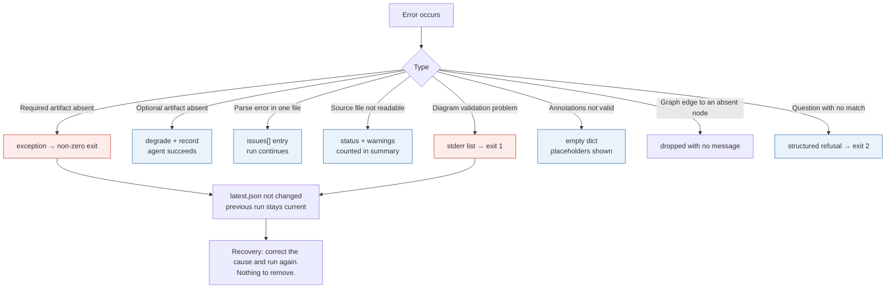

**No agent retries.** There is no backoff, because there is no external service. **All agents are idempotent**, except for the timestamp and the run directory.

### 4.5 Who does which step

The operator starts each agent. The agents communicate only through `output/<stage>/latest.json` and the run directories.

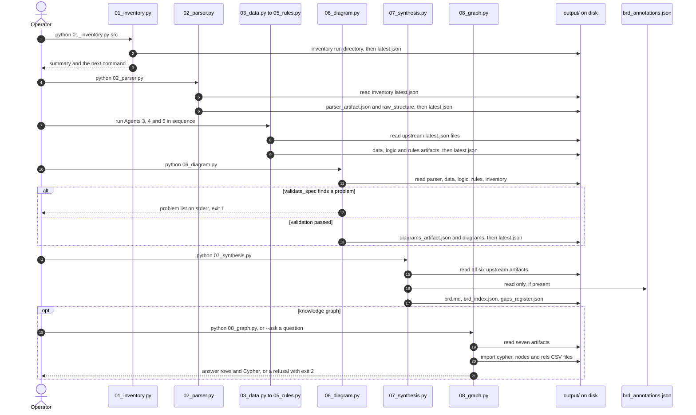

---

## 5. Agent 1 — Inventory

**Purpose.** Examine the source tree, find the role of each file and give each file a stable identity.

| Input | Output |
|---|---|
| A file system directory (positional argument) | `inventory-artifact.json` |

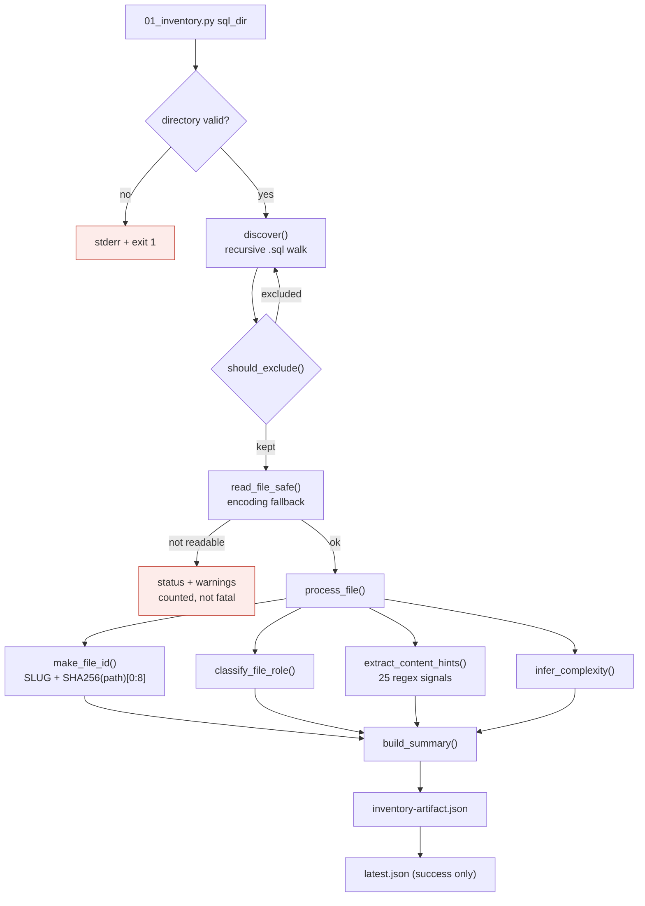

**Options.** `--exclude` (`-e`), `--no-default-excludes`, `--encoding`, `--no-content-hints`, `--verbose` (`-v`), `--output` (`-o`) and `--output-root`.

**Output contents.** `inventory-artifact.json` has three parts:

- `file_index`: the map from `file_id` to the file name
- `file_metadata`: the role, line counts, SHA-256, encoding, status, warnings and complexity of each file
- `summary`: 15 counters

**Why it is important.** Downstream routing uses the file role. Agent 2 parses only files with a role in `PARSE_WORTHY_ROLES`. Agent 3 parses only DDL.

**A real defect occurred here.** Agent 1 classified files that contain `CREATE VIEW` as `mixed`. These files never got to Agent 3, and their tables were not in the data model. Agent 3 now has a `DDL_CONTENT_HINTS` mechanism that compensates for this.

**Rules**

- The classification uses the file content, never the file name. A file with the name `utils.sql` that contains `CREATE TABLE` is DDL.
- An unreadable file is counted with a status and warnings. It does not stop the run.
- `latest.json` changes only after a successful write.

**Tests.** 22 checks and a golden-fixture diff after normalisation.

---

## 6. Agent 2 — Parser

**Purpose.** Change the PL/SQL text into structure. **This is the only agent that reads the source characters for structure.**

| Input | Output |
|---|---|
| `inventory-artifact.json` and the source files | `parser_artifact.json` and `raw_structure/*.json` (one file for each object) |

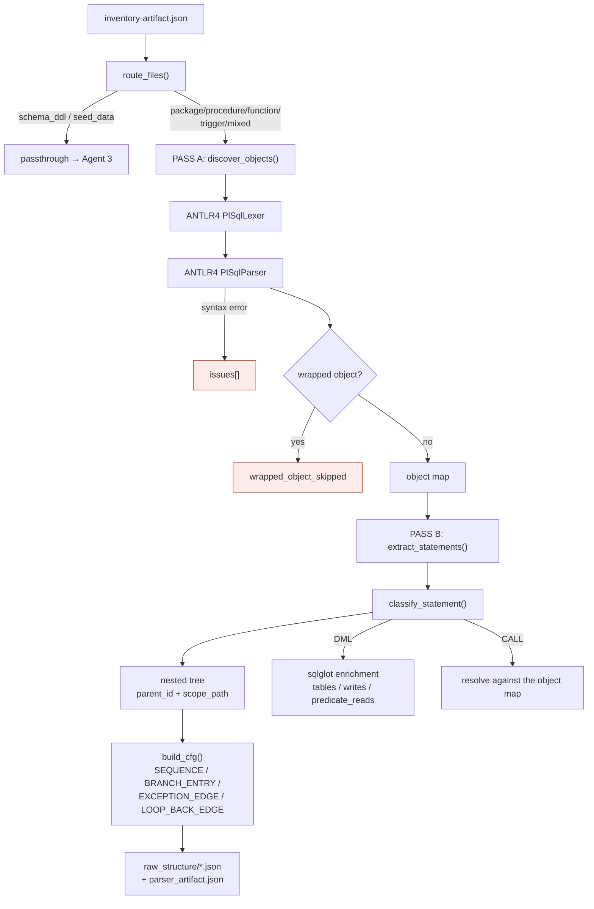

**Why two passes.** A call in file A can go to an object in file B. The agent cannot resolve the call before it knows all objects.
Pass A finds each object in the run. Pass B extracts the statements and resolves the references.

**The statement identifier** is the primary join key of the pipeline:

```
04_MEDIUM_PROCESS_MONTHLY_INTEREST_CREDIT__B115DB87__PROC-.SP_PROCESS_MONTHLY_INTEREST_CREDIT__STMT_0004
```

The sequence number starts with zeros, so a string sort is equal to a numeric sort. The identifier contains the `file_id`, so it has the same path stability.

**Known traps**

1. **`reads[]` contains columns and parameters.** A live `SELECT_INTO` record lists `p_from_account` (a parameter) together with real columns. Consumers must filter the list. Only Agent 8 filters it structurally.
2. **The agent stores no condition text.** An `IF` record has only `nesting_depth`. Agents 4, 5 and 6 each read the source again and cut out the condition. Thus, three implementations do one task.
3. **The generated ANTLR Python uses `this.` in place of `self.`** You must patch it after each regeneration of the grammar (see `vendor/plsql_grammar/NOTICE.md`).

**Past defects that tests now guard**

- `build_cfg` linked only siblings. A decision had no edge to any branch.
- `classify_statement` returned `"IF_STATEMENT"`, but the recursion checked `"IF"`.
- A search of direct children did not find `Into_clauseContext`.
- sqlglot mixed the `UPDATE SET` targets with the `WHERE` columns.

**Tests.** 31 checks.

---

## 7. Agent 3 — Data

**Purpose.** Build the physical data dictionary. Record which rules the database **really enforces**.

| Input | Output |
|---|---|
| The inventory and the parser artifact | `data_artifact.json` and `erd.mmd` |

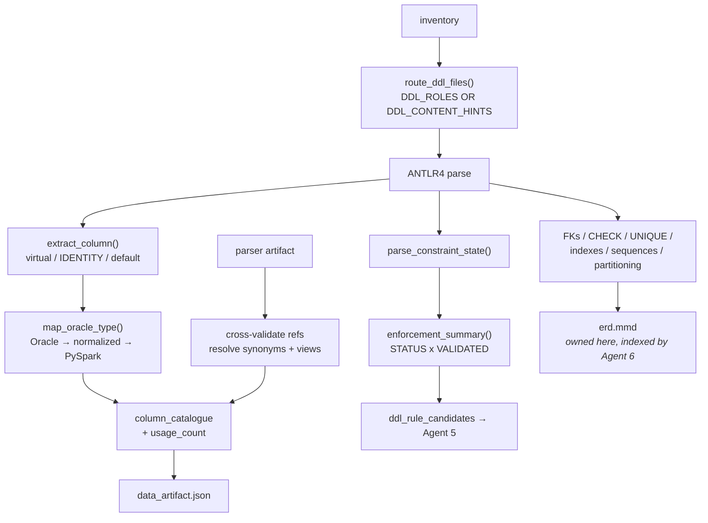

**The two-axis enforcement model (the central idea).** An Oracle constraint has **two independent axes**, not one. A constraint can exist and not be enforced.

| STATUS | VALIDATED | `is_enforced` | `confidence` | Meaning |
|---|---|---|---|---|
| ENABLED | VALIDATED | `true` | `enforced` | Enforced for all data |
| ENABLED | NOT VALIDATED | `true` | `enforced_new_data_only` | New rows only. Old rows can violate it |
| DISABLED | either | `false` | `not_enforced` | Documented intent only |

Agent 5 maps this value to `(signal_strength, confidence, requires_sme_review)`:

```
"enforced"               → (5, "confirmed", False)
"enforced_new_data_only" → (4, "high",      True)
"not_enforced"           → (2, "low",       True)
```

**Design decision.** Agent 3 keeps a `DISABLED` constraint as a rule. A dropped constraint hides documented business intent.
The rule gets a low score and a review flag. Its BRD statement says that the database does not enforce it.

**Whitespace defect, corrected.** The ANTLR `getText()` removes whitespace. It gave `account_statusIN('ACTIVE')` and a rule with the name *"Restrict Account **Statusin**"*. Now `original_text_of()` uses the token stream to keep the source text.

**Name trap.** The foreign-key field is **`references_table`**, not `referenced_table`. A query for the incorrect name returns `None`, and the result looks like absent data.

**Type triple.** `NUMBER(18,2)` → `DECIMAL` → `DecimalType(18,2)`. Agent 7 publishes the third value as the **Target type** column for a rebuild.

**Tests.** 76 checks, the second largest suite.

---

## 8. Agent 4 — Logic

**Purpose.** Make the control flow readable and measurable.

| Input | Output |
|---|---|
| The parser records, and the inventory `abs_path` to read the source again | `logic_artifact.json` and `program_logic/*_logic.json` |

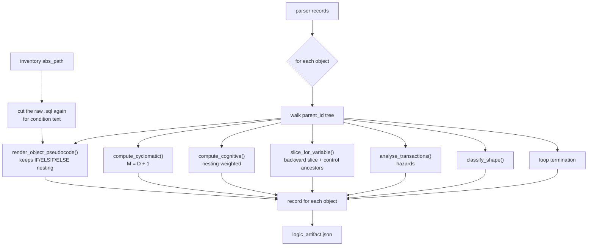

**Cyclomatic complexity** (McCabe 1976): *M = D + 1*, where

$$D = n_{if} + n_{elsif} + n_{case\_when} + n_{loop} + n_{handler} + n_{logical}$$

The threshold is **10**. Live example: the breakdown `if=2, elsif=2, loop=1, exception_handler=2` gives D = 7 and M = 8. The highest value in the corpus is `SP_TRANSFER_FUNDS` with **M = 16**.

**Cognitive complexity** (Campbell): one increment for each break in the flow, plus a nesting increment. The threshold is **15**. No object in the corpus is above it.

**Backward slices** (Weiser 1981): for each variable, each statement that sets its value, with the control ancestors. The corpus has 25 slices. They supply the `variable_derivation` rules of Agent 5.

**Transaction hazards**

| Hazard | Found in the corpus | Severity |
|---|---|---|
| `COMMIT_INSIDE_LOOP` | 0 | — |
| `SAVEPOINT_PARTIAL_ROLLBACK` | 1 | **high** |
| `NO_TRANSACTION_CONTROL` | 2 | info |

**Process shapes.** `BATCH_PROCESSOR`, `SINGLE_RECORD_TRANSACTION`, `CALCULATION` and `QUERY_ONLY`. Each shape has a rationale string.

**Explicit non-goal: dead-code detection.** Schedulers or code outside the repository often call PL/SQL objects. Thus, Agent 4 reports *"no internal callers"* as **information only**, never as a finding.

**Tests.** 46 checks.

---

## 9. Agent 5 — Rules

**Purpose.** Find the business decisions and state them as requirements. **This agent is the intellectual core of the pipeline.** It is also the only agent with a measured accuracy.

| Input | Output |
|---|---|
| `ddl_rule_candidates` (Agent 3), statements and CFG (Agent 2), `variable_slices` (Agent 4, optional) | `rules_artifact.json` with `rule_sets`, `business_rules` and `error_handling_catalogue` |

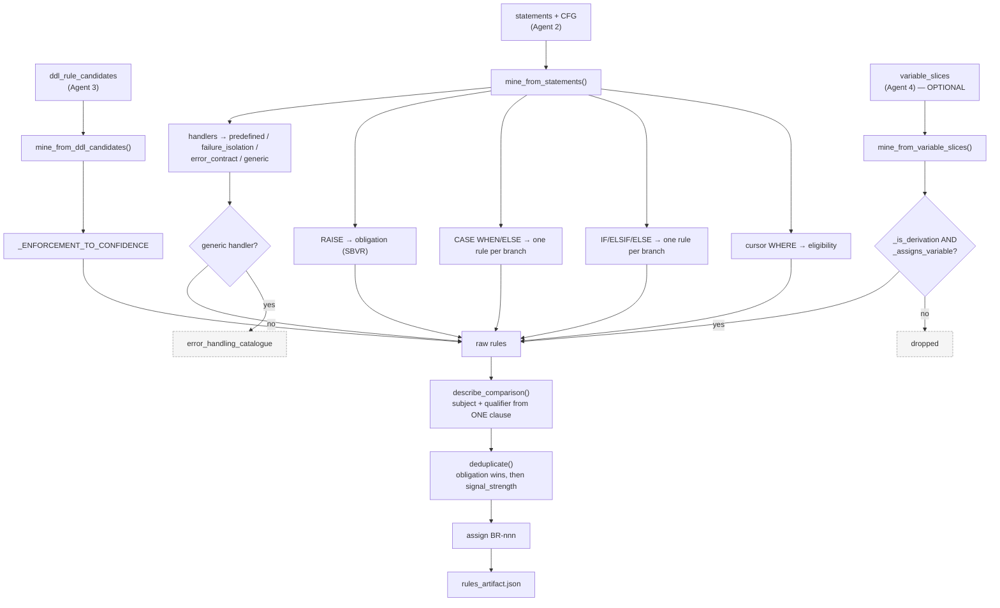

### The nine sources of rules

| Source kind | Trigger |
|---|---|
| `conditional_branch` | Each IF, ELSIF or ELSE branch |
| `case_branch` | Each CASE WHEN or ELSE |
| `cursor_eligibility` | The `WHERE` clause of a cursor: *which records* the process applies to |
| `named_exception` | A guarded `RAISE`, stated again as the obligation that it enforces |
| `predefined_exception` | An Oracle exception that the database found |
| `failure_isolation` | `WHEN OTHERS` that logs and continues: a resilience requirement |
| `error_contract` | `WHEN OTHERS` that raises a specific error that callers depend on |
| `variable_derivation` | Business formulas from backward slices |
| `ddl_*` | CHECK, virtual column, unique constraint or view filter |

The diagram shows which function mines each source kind, and how the category is set.

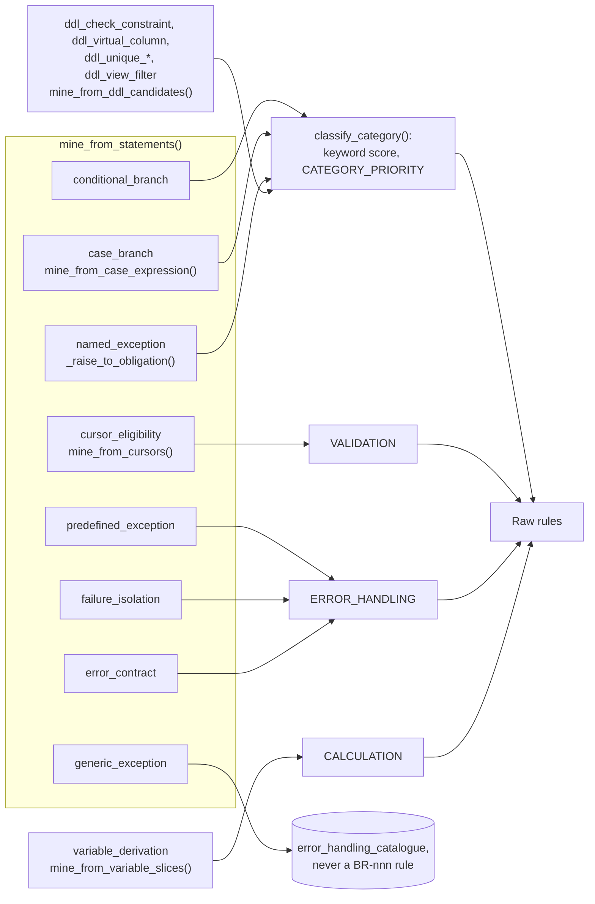

**Live distribution.** VALIDATION 19 · LIMIT_CHECK 12 · CALCULATION 6 · ERROR_HANDLING 4. The committed run also merged 5 duplicates and marked 3 rules for SME review.

### Exceptions become obligations (SBVR)

SBVR states: *"there are no exceptions; instead, there are well stated business rules."*

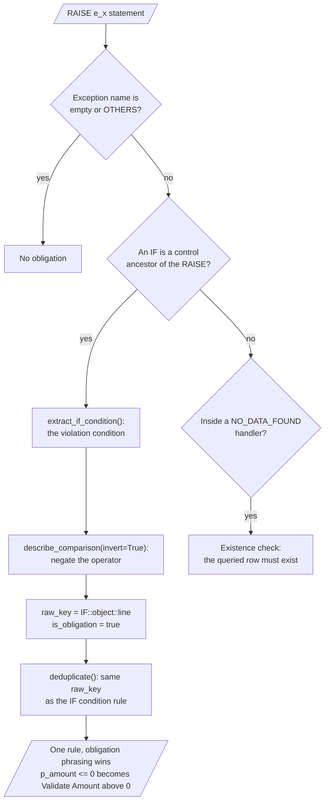

Agent 5 merges a guarded `RAISE` with the `IF` that guards it. It states the rule as the condition that must be true.
The IF condition is the **violation**, so the rule is its negation:

```
p_amount <= 0  →  "Validate Amount above 0"
```

### Measured accuracy

`tests/evaluate_rules.py` compares the extracted rules with 4 hand-annotated procedures. It matches on the source-line distance (`LINE_TOLERANCE = 2`), not on the words.

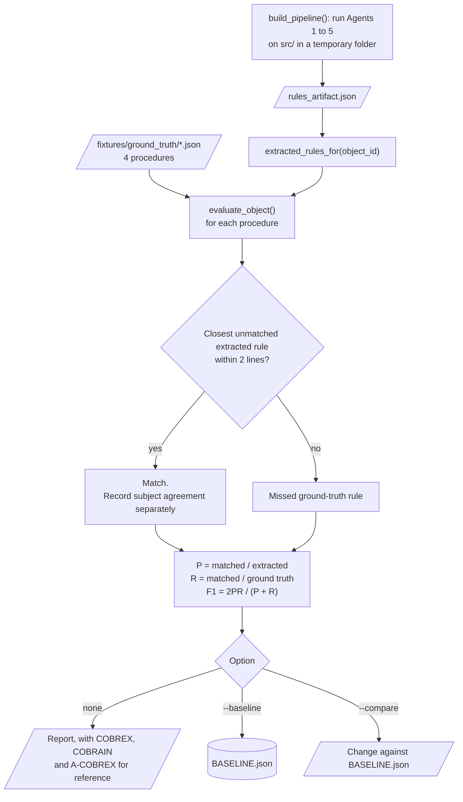

| Measurement | Precision | Recall | F1 |
|---|---|---|---|
| Baseline (before the redesign, `BASELINE.json`) | 0.615 | 0.571 | **0.593** |
| Current (tuned) | 1.000 | 1.000 | **1.000** |
| **First blind held-out procedure** | — | — | **0.588** |
| **Second blind held-out procedure** | 1.000 | **0.400** | 0.571 |

**The 1.000 is contaminated.** The ground truth covers 4 of 5 procedures, and the team used each of them to correct the extractor. **The blind figures are the defensible estimates of generalisation.**

The harness cites these published baselines for comparison: COBREX F1 0.59 · COBRAIN 0.73 · A-COBREX P 0.62 / R 0.74.

### Three guards

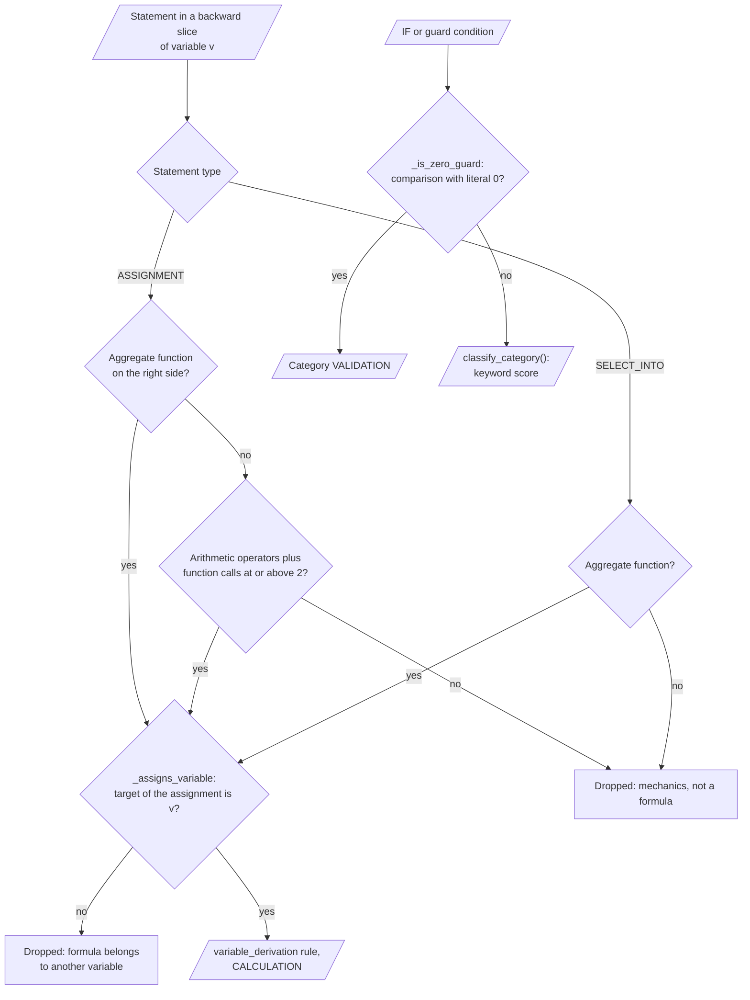

1. **`_is_derivation`.** The score is the number of arithmetic operations plus the number of function calls. A score of 2 or more means a business formula. An assignment with an aggregate function is always a formula. A `SELECT INTO` is a formula only when it has an aggregate function. `ROUND(bal*(rate/100)*(days/365),2)` scores 5 ✅. `rec.balance + v_interest_amount` scores 1 ❌. **Only 2 examples support this threshold.**
2. **`_assigns_variable`.** The statement that derives the value must *assign* the slice variable. Without this guard, `v_new_balance` took the formula that calculates `v_interest_amount`, and one formula became two rules.
3. **`_is_zero_guard`.** A comparison with the literal zero is a sanity guard, not a business tier. Without this guard, `v_interest_amount > 0` matched the CALCULATION keywords and gave *"Calculate Interest Amount above 0"*.

**CASE decomposition.** Agent 5 changes each branch of a CASE expression into one rule. On a blind procedure, a CASE that stayed whole lost 6 of 10 rules (recall 0.400).

**Tests.** 33 checks.

---

## 10. Agent 6 — Diagram

**Purpose.** Make the visual layer. Agent 6 builds a **model that is independent of the renderer**, then writes Mermaid.

| Input | Output |
|---|---|
| The parser artifact (required). The data, logic, rules and inventory artifacts (optional) | `diagrams_artifact.json` and `diagrams/*.mmd` |

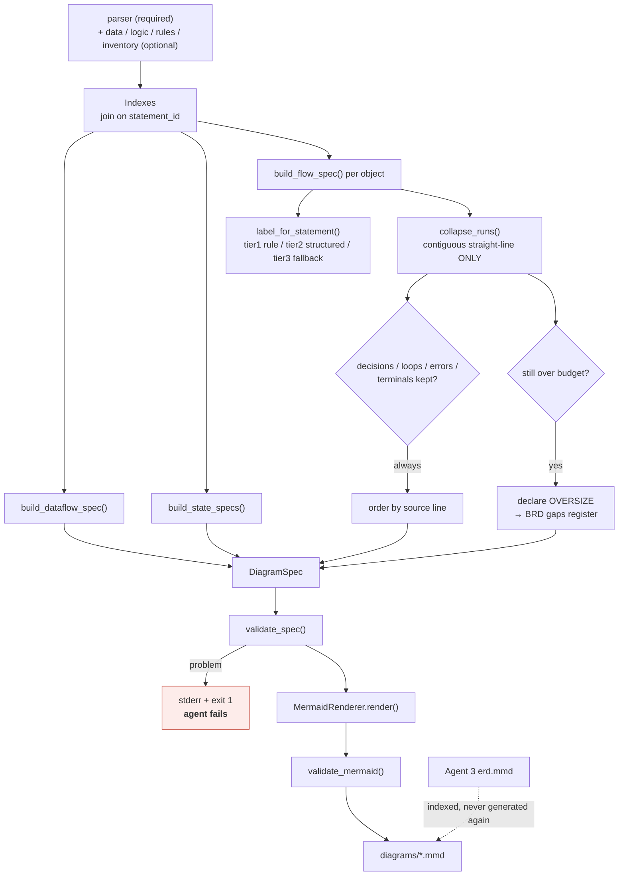

**Procedure.** `LOAD → RESOLVE → MODEL → REDUCE → ORDER → RENDER → VALIDATE → WRITE`. The steps up to ORDER write no Mermaid.

**What Agent 6 draws**

| Diagram | Source |
|---|---|
| ERD | **Agent 3**. Agent 6 indexes it and never generates it again |
| System data-flow map | Agent 4 CRUD, Agent 2 calls, rule counts and complexity |
| Process flow (one for each object) | Agent 2 CFG ⋈ Agent 5 rules on `statement_id` |
| Entity state model | Agent 3 CHECK `IN`-list and the UPDATEs that write that column |
| CRUD matrix | Agent 4. It is a table, because tabular data belongs in a table |

**Labels carry meaning.** A decision reads `Balance below 100,000?`. Each branch carries the rule that it enacts (`BR-041`). **100 % of decisions and 100 % of decision branches** get business text.

**The node budget is real.** `DEFAULT_NODE_BUDGET = 40`. Contiguous straight-line runs collapse. Decisions, loops, error paths and terminals **never** collapse.

**A second collapse tier was built and then removed.** It merged each collapsible child of a parent, also children that were not adjacent. It joined statements at lines 33 and 124 into one node. Thus, the diagram showed that they run together.
*A diagram that meets its budget with a false flow is worse than a large diagram.* When the structure cannot fit, Agent 6 writes the diagram and **declares it oversize**.

**Rules**

- This is the only agent that fails on an internal quality problem. A half-valid diagram must not get to the BRD.
- Agent 6 never draws a fact that an earlier agent did not find.

**Tests.** 52 checks (before: 7). The checks assert the model, not the strings.

---

## 11. Agent 7 — Synthesis

**Purpose.** Assemble the BRD: one document that four different readers can each use.

| Input | Output |
|---|---|
| All six upstream artifacts (required) and `brd_annotations.json` (optional, read-only) | `brd.md`, `brd_index.json` and `gaps_register.json` |

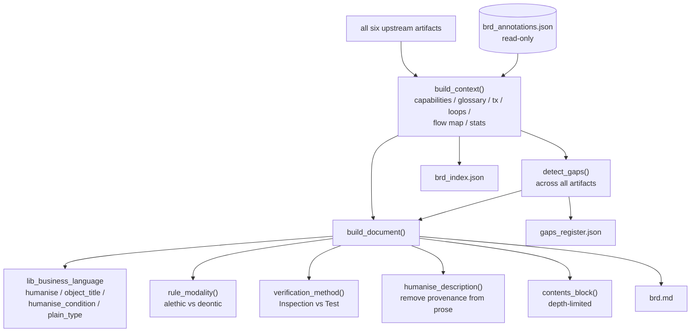

### Business language

| Machine | Business |
|---|---|
| `PROC-.SP_TRANSFER_FUNDS` | **Transfer Funds** |
| `v_from_balance < p_amount` | **From Balance is below Amount** |
| `e_insufficient_balance` | **Insufficient Balance** |
| `LAST_TXN_DATE` | **Last Transaction Date** |
| `NUMBER(18,2)` | **Decimal number (18 digits, 2 decimal places)** |

The BRD shows the machine identifier *together with* the prose. It never replaces the prose with it. The pseudocode and the diagrams stay technical by design.

The diagram shows how `humanise_condition()` in `lib_business_language.py` changes a condition:

```mermaid
flowchart LR
    IN[/"v_from_balance &lt; p_amount"/] --> L["Keep quoted literals aside"]
    L --> ID["For each identifier, humanise():<br/>keep the part after the last dot,<br/>remove P_, V_, L_ and other prefixes,<br/>split on _, expand abbreviations,<br/>title case"]
    ID --> OP["Then replace the operators with words.<br/>IS NULL becomes is missing,<br/>IS NOT NULL becomes is present"]
    OP --> RL["Put the literals back"]
    RL --> OUT[/"From Balance is below Amount"/]
```

**Two defects that a review of the output found**

1. The table mapped `NO` to `Number`. Thus, *"no preceding condition matched"* became *"Number Preceding Condition Matched"*. **Keep ordinary English words out of the abbreviation table.**
2. The operator substitution ran *before* the identifier substitution. The inserted words went through the identifier pass again and gave *"is Below"*.

### Document structure: four parts for four audiences

| Part | Audience | Chapters |
|---|---|---|
| **I — Business View** | Sponsors | Executive summary · Scope (in **and** out) · Glossary · Program units · Data flow · CRUD matrix |
| **II — Rules and Behaviour** | Analysts | Rules catalogue · Entity state models · Error contracts |
| **III — Build Specification** | Developers | Data model with target types · Interface contracts · Process specs · Operational characteristics |
| **IV — Assurance** | Auditors | Traceability matrix · Gaps register · Rebuild checklist |

Each audience needs different documentation for its task. One voice for all readers serves no reader.

```mermaid
flowchart LR
    BD["build_document()"] --> P1["Part I: Business View"]
    BD --> P2["Part II: Rules and Behaviour"]
    BD --> P3["Part III: Build Specification"]
    BD --> P4["Part IV: Assurance"]
    P1 --> R1(["Sponsors"])
    P2 --> R2(["Analysts"])
    P3 --> R3(["Developers"])
    P4 --> R4(["Auditors"])
    RA[/"rules_artifact.json"/] --> P2
    DA[/"data_artifact.json"/] --> P3
    DG[/"diagrams_artifact.json"/] --> P1
    DG --> P2
    GP["detect_gaps()"] --> P4
```

### Each rule in three forms, with SBVR modality

```mermaid
flowchart TD
    R[/"One business rule"/] --> F1["Exact condition in code:<br/>condition_text in a code span"]
    R --> F2["In plain terms:<br/>humanise_condition()"]
    R --> K{"source.kind in _DDL_KINDS?"}
    K -- "yes" --> E{"is_enforced is False?"}
    E -- "yes" --> DIS["Formal statement: INTENDED,<br/>DISABLED, NOT enforced<br/>Verify: Inspection, DISABLED"]
    E -- "no" --> ALE["alethic: It is necessary that...<br/>Verify: Inspection of the schema"]
    K -- "no" --> DEO["deontic: It is obligatory that...<br/>Verify: Test of the code path"]
    DIS --> F3["Formal statement"]
    ALE --> F3
    DEO --> F3
    F1 --> BLK[/"Rule block in brd.md,<br/>Owner and Priority from annotations"/]
    F2 --> BLK
    F3 --> BLK
```

```
BR-002 — Enforce From Balance at or above Amount

| Exact condition in code | `v_from_balance < p_amount` |
| How to verify           | Test (exercise the code path) |
| Owner                   | _to be assigned_ |

In plain terms.  From Balance is below Amount.

Formal statement.  It is obligatory that the operation is rejected
when From Balance is below Amount, raising Insufficient Balance.
```

**SBVR modality** separates two different kinds of truth:

| Modality | Phrasing | Meaning |
|---|---|---|
| **Alethic** | *"It is necessary that…"* | The database makes a violation **impossible** |
| **Deontic** | *"It is obligatory that…"* | A violation is **possible**. This is why the code checks it |

**Agent 7 derives the verification method.** A rule that the schema enforces gets Inspection. A rule that the code enforces gets Test.
These are two of the eleven attributes of ISO/IEC/IEEE 29148. The other attributes (`Owner`, `Priority`) show as **visible blanks**. An empty column is an action item. An absent column is invisible.

**Traceability matrix.** For twenty years, IR-based traceability research got only 19–32 % precision on *inferred* links. STATUTE builds its links from `statement_id`, so they are **exact**.

**Tests.** 86 checks, the largest suite. The checks assert these properties:

- readability (no identifiers in the prose)
- navigation (each contents link resolves)
- completeness and traceability
- honesty
- annotations in both outputs

---

## 12. Agent 8 — Knowledge graph

**Purpose.** Make all results queryable. **Agent 8 is optional and terminal.** No other agent depends on it.

| Input | Output |
|---|---|
| Seven artifacts (the parser artifact is required, six are optional) | `graph_artifact.json`, `import.cypher`, `nodes/*.csv`, `rels/*.csv`, `README.md` |

```mermaid
flowchart TD
    ART["seven artifacts<br/>(parser required, six optional)"] --> BUILD["lib_graph_model.build_graph()<br/>13 labels, 22 relationship types"]
    BUILD --> GUARD["g.rel() endpoint guard<br/>drops edges to absent nodes"]
    GUARD --> BS["BlindSpot nodes<br/>DYNAMIC_SQL / EXTERNAL_CALLERS /<br/>UNRESOLVED_CALLS / TRIGGER_SIDE_EFFECTS"]
    BS --> MODE{"CLI mode"}
    MODE -->|--list-questions| LIST["print 12 intents"]
    MODE -->|--ask| ASK["resolve_entity() → match intent"]
    ASK -->|no match| REFUSE["refusal + suggestions<br/>exit 2"]
    ASK -->|matched| ANSWER["rows + equivalent Cypher<br/>exit 0"]
    MODE -->|default| EXP["import.cypher (MERGE)<br/>nodes/*.csv, rels/*.csv<br/>README with cookbook"]
    classDef refuse fill:#f5f5f5,stroke:#999,stroke-dasharray: 4 2
    class REFUSE refuse
```

### Schema: 353 nodes, 769 relationships

The diagram shows the relationship types that `lib_graph_model.build_graph()` makes. `CALLS`, `POPULATES`, `CONSTRAINS` and `ON_ERROR_REACHES` exist in the code but have no instance in the committed run. `BlindSpot` nodes have no relationships.

```mermaid
erDiagram
    File ||--o{ Object : "CONTAINS"
    Object ||--o{ Parameter : "HAS_PARAMETER"
    Object ||--o{ Statement : "CONTAINS_STATEMENT"
    Statement }o--o{ Statement : "FOLLOWS, BRANCHES_TO, LOOPS_BACK_TO, ON_ERROR_REACHES"
    Statement }o--o{ Object : "DETERMINES"
    Object }o--o{ Object : "CALLS"
    Table ||--o{ Column : "HAS_COLUMN"
    Table }o--o{ Table : "REFERENCES"
    Table }o--o{ Column : "FOREIGN_KEY_ON"
    Index }o--o{ Column : "COVERS"
    Sequence }o--o{ Column : "POPULATES"
    Object }o--o{ Table : "TOUCHES, READS, WRITES"
    Object }o--o{ Column : "READS_COLUMN, WRITES_COLUMN"
    Statement }o--o{ Column : "READS_COLUMN, WRITES_COLUMN"
    BusinessRule }o--|| RuleSet : "BELONGS_TO"
    BusinessRule }o--o{ Object : "ENFORCED_IN"
    BusinessRule }o--o{ Statement : "IMPLEMENTED_AT"
    BusinessRule }o--o{ Table : "CONSTRAINS_TABLE"
    BusinessRule }o--o{ Column : "CONSTRAINS"
    Column ||--o{ State : "HAS_STATE"
    Gap }o--o{ BusinessRule : "AFFECTS"
```

| Node label | Count | | Relationship | Count | | Relationship | Count |
|---|---:|---|---|---:|---|---|---:|
| Statement | 124 | | CONTAINS_STATEMENT | 124 | | HAS_PARAMETER | 20 |
| Column | 105 | | DETERMINES | 119 | | AFFECTS | 7 |
| BusinessRule | 41 | | HAS_COLUMN | 105 | | FOREIGN_KEY_ON | 7 |
| Gap | 21 | | FOLLOWS | 86 | | REFERENCES | 7 |
| Parameter | 20 | | WRITES_COLUMN | 69 | | TOUCHES | 7 |
| Table | 15 | | BELONGS_TO | 41 | | WRITES | 6 |
| File | 7 | | ENFORCED_IN | 40 | | CONTAINS | 5 |
| Object | 5 | | BRANCHES_TO | 40 | | READS | 4 |
| RuleSet | 4 | | IMPLEMENTED_AT | 39 | | HAS_STATE | 3 |
| BlindSpot | 4 | | READS_COLUMN | 36 | | COVERS | 2 |
| State | 3 | | | | | CONSTRAINS_TABLE | 1 |
| Sequence | 3 | | | | | LOOPS_BACK_TO | 1 |
| Index | 1 | | | | | | |

**Three modelling decisions**

1. **`Column` is a node**, not a property of `Table`. Code reads, writes, constrains and indexes a column: four independent relationships. A column property cannot answer an impact question.
2. **`Statement` is a node.** This gives a **Code Property Graph** layer (Yamaguchi et al., IEEE S&P 2014). The statement tree of Agent 2 is an AST. Its `control_flow_graph` is a CFG. The slices of Agent 4 are dependence facts. Together, they answer questions that no single source can answer.
3. **`BlindSpot` is a node.** *A graph that looks authoritative is more dangerous than a document that looks uncertain.*

### Why the English interface uses no LLM

The module docstring states:

> *"The obvious way to turn English into Cypher is to ask a language model. This pipeline does not… a fabricated Cypher query returns a plausible, wrong answer, and the user has no way to tell."*

Agent 8 uses **12 named intents** in place of a model. Each intent has trigger patterns, a resolver and the equivalent Cypher. Agent 8 refuses a question with no match and shows the supported list.

The diagram shows `ask()` in `lib_graph_language.py`:

```mermaid
flowchart TD
    Q[/"Question in plain English"/] --> E{"Empty?"}
    E -- "yes" --> RF1[/"Refusal: empty question,<br/>suggestions"/]
    E -- "no" --> RE["resolve_entity(): BR-nnn, then TABLE.COLUMN,<br/>then an exact name or title,<br/>then a bare column name"]
    RE --> MT["Intents whose trigger patterns match,<br/>the entity type that was found first"]
    MT --> NE{"Intent needs an entity<br/>of a different type?"}
    NE -- "yes" --> NEXT["Try the next intent"]
    NEXT --> NE
    NE -- "no" --> ANS{"Resolver gives<br/>an answer?"}
    ANS -- "yes" --> OK[/"Rows, subject and<br/>the equivalent Cypher"/]
    ANS -- "no" --> NEXT
    MT -- "match, but no entity found" --> RF2[/"Refusal: name it exactly,<br/>for example ACCOUNTS.BALANCE"/]
    MT -- "no match" --> RF3[/"Refusal: no supported question,<br/>suggestions"/]
```

**Total precision, imperfect recall.** This is the correct trade, because a wrong impact answer is worse than no answer. **The negative tests are the most important tests** in the suite.

A review of the output added an invariant: *each advertised question, asked word for word, must have a match.* The cause: the list showed *"Which columns are used most widely?"*, but Agent 8 refused it. A pattern expected the word order "most widely used".

### The 12 supported questions

| # | Question | Intent |
|---|---|---|
| 1 | What breaks if I change a given column? | `impact_of_column` |
| 2 | Which business rules apply to a program unit, table or column? | `rules_of` |
| 3 | Where does a given rule live in the source? | `where_is_rule` |
| 4 | Which program units read or write a given table? | `who_touches_table` |
| 5 | What is the calling interface of a program unit? | `interface_of` |
| 6 | Which rules still need a person to confirm them? | `needs_review` |
| 7 | Which rules are recorded but not enforced by the database? | `unenforced` |
| 8 | Which program units are most complex? | `most_complex` |
| 9 | Which columns are used most widely? | `hot_columns` |
| 10 | Which tables are never touched by any program unit? | `orphan_tables` |
| 11 | What open questions remain for the business? | `open_gaps` |
| 12 | What can this graph NOT see? | `blind_spots` |

The diagram shows the graph path that the equivalent Cypher of each intent reads.

```mermaid
flowchart LR
    I1["impact_of_column"] --> COL(["Column"])
    I9["hot_columns"] --> COL
    COL -- "READS_COLUMN, WRITES_COLUMN" --- OBJ(["Object"])
    COL -- "CONSTRAINS" --- BR(["BusinessRule"])
    COL -- "COVERS" --- IDX(["Index"])
    I2["rules_of"] --> BR
    I3["where_is_rule"] --> BR
    I6["needs_review"] --> BR
    I7["unenforced"] --> BR
    BR -- "ENFORCED_IN" --- OBJ
    BR -- "IMPLEMENTED_AT" --- STM(["Statement"])
    I4["who_touches_table"] --> TAB(["Table"])
    I10["orphan_tables"] --> TAB
    TAB -- "READS, WRITES" --- OBJ
    I5["interface_of"] --> OBJ
    I8["most_complex"] --> OBJ
    OBJ -- "HAS_PARAMETER" --- PAR(["Parameter"])
    I11["open_gaps"] --> GAP(["Gap"])
    I12["blind_spots"] --> BSP(["BlindSpot"])
```

**Give the exact entity names:** `ACCOUNTS.BALANCE`, `SP_TRANSFER_FUNDS`, `BR-014`.

**Tests.** 68 checks (before: 13).

---

## 13. Formulas, thresholds and algorithms

**This is the complete set of numeric thresholds in the repository.** A grep confirmed that the list is complete.

| Constant | Value | Location | Purpose |
|---|---|---|---|
| `CYCLOMATIC_THRESHOLD` | 10 | `04_logic.py:71` | Complexity warning |
| `COGNITIVE_THRESHOLD` | 15 | `04_logic.py:73` | Cognitive complexity warning |
| `_DERIVATION_COMPLEXITY_THRESHOLD` | 2 | `05_rules.py:603` | Business formula or mechanics |
| `DEFAULT_NODE_BUDGET` | 40 | `06_diagram.py:99` | Diagram readability budget |
| `LINE_TOLERANCE` | 2 | `tests/evaluate_rules.py:45` | Match window for the ground truth |

The diagram shows where each threshold and formula acts in the pipeline.

```mermaid
flowchart LR
    A1["Agent 1<br/>file_id = SLUG + SHA256 of the path"] --> A4["Agent 4<br/>M = D + 1, warning above 10<br/>cognitive, warning above 15"]
    A4 --> A5["Agent 5<br/>derivation score 2 or more<br/>clause score for rule names"]
    A5 --> A6["Agent 6<br/>DEFAULT_NODE_BUDGET 40<br/>tier1_pct, traceability"]
    A6 --> A7["Agent 7<br/>SBVR modality:<br/>alethic or deontic"]
    A5 --> EV["tests/evaluate_rules.py<br/>LINE_TOLERANCE 2<br/>P, R, F1"]
    A6 --> OV{"Over the node budget<br/>after collapse?"}
    OV -- "yes" --> GAP[/"OVERSIZE in the gaps register"/]
```

**How the clause score names a rule** (`describe_comparison()` in `05_rules.py`):

```mermaid
flowchart TD
    C[/"Condition text"/] --> F{"Comparison clauses found?"}
    F -- "no" --> FB["Subject from guess_subject(),<br/>no qualifier"]
    F -- "yes" --> S["Score each clause: +2 for = with a literal,<br/>+1 for a known field on the left"]
    S --> MX["Keep the clause with the highest score"]
    MX --> INV{"Obligation from a guard?"}
    INV -- "yes" --> NEG["Invert the operator"]
    INV -- "no" --> PH["Operator phrase"]
    NEG --> PH
    PH --> CMP{"AND or OR in the condition,<br/>and the operator is not =?"}
    CMP -- "yes" --> NQ["Subject only, no qualifier"]
    CMP -- "no" --> LEN{"Qualifier longer than<br/>40 characters?"}
    LEN -- "yes" --> NQ
    LEN -- "no" --> NM[/"Verb + subject + qualifier,<br/>for example Enforce Balance at or above Amount"/]
```

**Stable file identity** (Agent 1)

$$\text{file\_id} = \text{SLUG}(\text{rel\_path}) \Vert \text{"\_\_"} \Vert \text{SHA256}(\text{rel\_path})[0{:}8]$$

**Cyclomatic complexity** (Agent 4)

$$M = D + 1, \quad D = n_{if} + n_{elsif} + n_{case\_when} + n_{loop} + n_{handler} + n_{logical}$$

**Derivation complexity** (Agent 5)

$$\text{score} = |\{\text{arithmetic ops}\}| + |\{\text{function calls}\}| \geq 2 \Rightarrow \text{business formula}$$

**Clause score for rule names** (Agent 5)

$$\text{score}(c) = 2\cdot[\,op = \texttt{=} \wedge rhs \text{ literal}\,] + 1\cdot[\,lhs \in \text{known fields}\,]$$

**SBVR modality** (Agent 7)

$$\text{modality} = \texttt{alethic} \iff kind \in \text{DDL\_KINDS} \wedge is\_enforced \neq \texttt{False}$$

**Evaluation** (harness of Agent 5)

$$P = \tfrac{\text{matched}}{\text{extracted}}, \quad R = \tfrac{\text{matched}}{\text{ground truth}}, \quad F_1 = \tfrac{2PR}{P+R}$$

**Diagram quality** (Agent 6)

$$\text{tier1\_pct} = \tfrac{|\text{decisions with tier-1 label}|}{|\text{decisions}|}, \quad \text{traceability} = \tfrac{|\text{BRANCH edges with rule\_id}|}{|\text{BRANCH edges}|}$$

---

## 14. The annotation layer

**Purpose.** Add business knowledge that static analysis cannot find.

Static analysis can prove that a 365-day threshold exists. It can never find that a **regulation sets** the threshold.
This is the concept assignment problem (Biggerstaff et al., 1993). The annotation layer exists for this problem.

```mermaid
flowchart TD
    P{{"A person writes<br/>brd_annotations.json"}} --> F[/"--annotations path,<br/>default brd_annotations.json"/]
    F --> EX{"File exists and<br/>is valid JSON?"}
    EX -- "no" --> EMP["Empty dict"]
    EX -- "yes" --> AN["The annotations block,<br/>or the full object"]
    AN --> K{"Stable ID key"}
    K -- "BR-nnn" --> R["Rule block: note,<br/>Owner, Priority"]
    K -- "table:NAME" --> T["Data model table note"]
    K -- "term:TABLE.COLUMN" --> G["Glossary term note"]
    K -- "object:ID" --> O["Program unit note"]
    K -- "param:ID:NAME" --> PA["Parameter note"]
    K -- "executive_summary" --> E["Executive summary note"]
    EMP --> PH["Visible placeholders:<br/>to be assigned, to be supplied"]
    R --> BRD[/"brd.md"/]
    T --> BRD
    G --> BRD
    O --> BRD
    PA --> BRD
    E --> BRD
    PH --> BRD
    R --> IDX[/"brd_index.json:<br/>owner, priority"/]

    classDef human fill:#fff3cd,stroke:#b8901f,color:#3d2f00,font-weight:bold
    class P human
```

**Procedure**

1. Make a file with the name `brd_annotations.json` (the default of `--annotations`).
2. Add one entry for each stable ID that you want to annotate.
3. Run `07_synthesis.py` again.

```json
{
  "annotations": {
    "BR-001": {
      "note": "365-day threshold is set by regulation, not policy.",
      "owner": "Head of Retail Operations",
      "priority": "Must have"
    },
    "table:ACCOUNTS":       { "note": "Master record for every customer account." },
    "term:ACCOUNTS.BALANCE":{ "note": "Cleared balance, excluding pending items." },
    "object:PROC-.SP_TRANSFER_FUNDS": { "note": "Used by the mobile channel." },
    "executive_summary":    { "note": "Core retail ledger, in service since 2004." }
  }
}
```

**Rules**

- The keys are stable IDs. Agent 7 merges the notes at synthesis time.
- **The pipeline never writes this file.** The machine facts change in each run. Your notes stay.
- If the file is not valid, Agent 7 uses an empty dict and shows placeholders.

> [!WARNING]
> Use only trusted text in `brd_annotations.json`. Agent 7 puts the annotation text into the BRD **word for word, with no sanitisation**.

---

## 15. Security and deployment

### 15.1 Verified controls

```mermaid
flowchart LR
    subgraph IN["Inputs, read only"]
        SQL[/"src/*.sql"/]
        ANN[/"brd_annotations.json"/]
    end
    subgraph WS["One workstation"]
        S["8 pipeline scripts<br/>no environment variables, no network,<br/>no subprocess, os.system, eval or exec,<br/>no model"]
    end
    subgraph OUT["output/ on the local file system"]
        ART[("Versioned artifacts<br/>with upstream provenance")]
        BRD[("brd.md, import.cypher,<br/>CSV files")]
    end
    SQL --> S
    ANN --> S
    S --> ART
    S --> BRD
    BRD -. "a person copies or imports" .-> EXT["Readers or Neo4j"]
```

| Control | Status |
|---|---|
| Secrets, credentials, tokens | **None in the pipeline.** No environment variables, confirmed by grep |
| Network access | **None.** No pipeline script imports a network library |
| Command execution | **None.** No pipeline script uses `subprocess`, `os.system`, `eval` or `exec` |
| Model and prompt-injection surface | **None.** There is no model |
| Auditability | Run versions, and `upstream` provenance in each artifact |

### 15.2 Risks

The diagram shows where each risk enters the flow.

```mermaid
flowchart LR
    DEP[/"antlr4-python3-runtime, sqlglot"/] -- "Unpinned dependencies:<br/>no manifest, no lockfile" --> S["Pipeline scripts"]
    ANN[/"brd_annotations.json"/] -- "Annotation injection:<br/>inserted word for word" --> S
    SQL[/"src/*.sql"/] --> S
    S --> ART[("Artifacts<br/>abs_path leakage")]
    S --> BRD[("brd.md and graph export<br/>sensitive output, no redaction")]
    ART -. "No output schema validation,<br/>only the tests check the shape" .-> NEXT["Next agent"]
```

| Risk | Detail |
|---|---|
| **Unpinned dependencies** | Two third-party libraries, no manifest, no lockfile. This is the largest supply-chain exposure |
| **Annotation injection** | Agent 7 inserts the content of `brd_annotations.json` word for word, with no sanitisation |
| **Sensitive output** | `brd.md` and the graph export contain the complete business logic, schema, interfaces and error contracts. There is no classification or redaction mechanism |
| **`abs_path` leakage** | The artifacts contain local file system paths. The committed `output/` files contain the absolute paths of the author's workstation |
| **No validation of the output schema** | Only the tests enforce the shape of the artifacts |

**The repository has no threat model.**

### 15.3 Deployment

```mermaid
flowchart TD
    subgraph M["One workstation"]
        PY["Python 3.11+"]
        DEPS["antlr4-python3-runtime + sqlglot<br/><i>installed manually, no manifest</i>"]
        SCR["8 scripts + 3 libraries"]
        FS[("local file system")]
    end
    OPT["Neo4j<br/><i>optional, separate, manual import</i>"]
    PY --> SCR
    DEPS --> SCR
    SCR <--> FS
    FS -.->|a person runs cypher-shell| OPT
    classDef opt stroke-dasharray: 4 2
    class OPT opt
```

STATUTE runs as short sequential CLI processes on one machine. **There is no Dockerfile, no CI/CD, no health check, no service and no separation of environments.** The local file system is the only persistence.

---

## 16. Architecture decisions and references

### 16.1 Architecture decisions

[`docs/architecture-decisions.md`](docs/architecture-decisions.md) has eleven ADRs in the Nygard format:

| # | Decision | Key consequence |
|---|---|---|
| 001 | No language model in the generation path | The output is a pure function of the input |
| 002 | A pipeline through the file system, with no orchestrator | You can run each agent again alone. A person controls the sequence |
| 003 | Stable identifiers from the path | A file keeps its identity after an edit. **A move changes it** |
| 004 | Versioned runs, pointer after the write | A stop cannot corrupt downstream. The disk use grows with no limit |
| 005 | Formal grammar, not regex | Correct nesting. The generated code needs a patch |
| 006 | Two-axis constraint enforcement | The BRD never states a guarantee that the database does not give |
| 007 | Diagram model separate from the renderer | The budget is enforceable. Tests assert the meaning |
| 008 | Stop at documentation | The scope agrees with the demonstrated capability |
| 009 | Deterministic intent catalogue, not generated Cypher | Total precision, imperfect recall |
| 010 | Annotations in a read-only sidecar file | Human knowledge stays after each regeneration |
| 011 | One collapse tier | A diagram never shows a sequence that does not exist |

### 16.2 References

**These sources directly influenced the implementation** (the code or the specifications name them):

| Area | Sources |
|---|---|
| Metrics and program analysis | McCabe (1976) cyclomatic complexity · Campbell cognitive complexity · Weiser (1981) program slicing · Yamaguchi, Golde, Arp and Rieck (2014) *Code Property Graphs*, IEEE S&P · Lehnert, *A review of software change impact analysis* |
| Requirements and documentation | ISO/IEC/IEEE 29148:2018 · OMG SBVR 1.5 · IIBA BABOK v3 · Mavin et al. (EARS) · Chikofsky and Cross (1990) · Biggerstaff, Mitbander and Webster (1993) · Aghajani et al. (ICSE 2020) · Lethbridge, Singer and Forward (2003) · Cosentino et al. (WCRE 2013) |
| Visualisation | Moody (2009) *The "Physics" of Notations* · Shneiderman (1996) *The Eyes Have It* · Shneiderman et al. (1977) CACM 20(6) · Purchase (1997/2002) · VEIL (arXiv 2511.05066) |
| Tool precedent | jQAssistant · Neo4j property-graph modelling guidance · CAST Imaging / Thoughtworks CodeConcise |
| Evaluation baselines (comparison only) | COBREX F1 0.59 · COBRAIN 0.73 · A-COBREX P 0.62 / R 0.74 |
| Industrial motivation | Sneed, *From COBOL to Business Rules* |

**These sources gave only the structure of the documentation:**

- [arc42](https://arc42.org/overview): the structure of the architecture documentation
- [C4 model](https://c4model.com): the selection of diagram levels
- [Michael Nygard, *Documenting Architecture Decisions*](https://cognitect.com/blog/2011/11/15/documenting-architecture-decisions): the ADR format
- [GitHub collapsed sections](https://docs.github.com/en/get-started/writing-on-github/working-with-advanced-formatting/organizing-information-with-collapsed-sections): the `<details>` technique of the earlier README

[`docs/references.md`](docs/references.md) gives the full list with four classes.

**Software licences.** Vendored ANTLR4 Oracle PL/SQL grammar: Apache 2.0 (`antlr/grammars-v4`, see `.claude/scripts/vendor/plsql_grammar/NOTICE.md`) · `antlr4-python3-runtime`: BSD · `sqlglot`: MIT · this project: [MIT](LICENSE).

---

## 17. Data and file map

### 17.1 Pipeline output

Each agent writes a new timestamped run directory and then updates its `latest.json`. The `output/` folder is committed. It holds the latest run of each agent.

| Path | Committed? | Contents |
|---|---|---|
| `output/inventory/<run>/inventory-artifact.json` | Yes | File index, file metadata, summary |
| `output/parser/<run>/parser_artifact.json` | Yes | Objects, statements, CFG, `issues[]` |
| `output/parser/<run>/raw_structure/*.json` | Yes | The statement tree of each object |
| `output/data/<run>/data_artifact.json`, `erd.mmd` | Yes | Schema, enforcement state, column catalogue, ERD |
| `output/logic/<run>/logic_artifact.json` | Yes | Pseudocode, complexity, slices, hazards, shapes |
| `output/logic/<run>/program_logic/*_logic.json` | Yes | The logic record of each object |
| `output/rules/<run>/rules_artifact.json` | Yes | `rule_sets`, `business_rules`, `error_handling_catalogue` |
| `output/diagram/<run>/diagrams_artifact.json`, `diagrams/*.mmd` | Yes | Diagram index and Mermaid files |
| `output/final_report/<run>/brd.md` | Yes | The Business Requirements Document |
| `output/final_report/<run>/brd_index.json`, `gaps_register.json` | Yes | Machine-readable index and gaps register |
| `output/graph/<run>/import.cypher`, `nodes/*.csv`, `rels/*.csv` | Yes | The graph export (`MERGE`) |
| `output/graph/<run>/README.md` | Yes | Load guide, query cookbook, concepts, constraints, blind spots |
| `output/<stage>/latest.json` | Yes | `run_version`, `path` and `updated_at` of the current run |
| `output/<stage>/<run>/run_meta.json` | Yes | Metadata of the run |
| `brd_annotations.json` | No (not in the repository) | Optional business notes. Agent 7 only reads it |
| `reference/` | No (git ignores it) | COBOL reference harness, design guidance only |

### 17.2 Source and test inputs

| Path | Contents |
|---|---|
| `src/00_ddl_create_schema.sql` | The DDL of the reference schema (15 tables) |
| `src/00_dml_load_sample_schema.sql` | Sample data |
| `src/01_simple_calculate_simple_interest.sql` | `FN_CALCULATE_SIMPLE_INTEREST` |
| `src/02_simple_update_dormant_account_status.sql` | `SP_UPDATE_DORMANT_ACCOUNT_STATUS` |
| `src/03_simple_check_minimum_balance.sql` | `SP_CHECK_MINIMUM_BALANCE` |
| `src/04_medium_process_monthly_interest_credit.sql` | `SP_PROCESS_MONTHLY_INTEREST_CREDIT` |
| `src/05_medium_fund_transfer_with_validation.sql` | `SP_TRANSFER_FUNDS` |
| `tests/fixtures/ground_truth/*.json` | Hand annotations of 4 procedures and `BASELINE.json` |
| `tests/fixtures/expected-inventory-artifact.json` | Golden fixture of Agent 1 |
| `tests/fixtures/sample_plsql/`, `sample_ddl/`, `sample_logic/` | Inputs for the test suites |

### 17.3 Documentation

The `docs/` folder has 15 technical documents (5,945 lines) and the STE style guide. They give more detail for each topic.

| Document | Purpose |
|---|---|
| [System overview](docs/system-overview.md) | Orientation in 5 minutes |
| [Complete system technical documentation](docs/complete-system-technical-documentation.md) | Master document, 36 sections |
| [Agent documents](docs/agents/) | One document for each agent, 28 sections each |
| [Architecture decisions](docs/architecture-decisions.md) | 11 ADRs |
| [Traceability matrix](docs/traceability-matrix.md) | Each claim → repository evidence |
| [Known gaps and open questions](docs/known-gaps-and-open-questions.md) | Verified gaps and questions for stakeholders |
| [References](docs/references.md) | References in four classes |
| [Documentation review report](docs/documentation-review-report.md) | Self-review against 19 criteria |
| [STE style guide](docs/ste-style-guide.md) | Writing rules and project vocabulary of this README |

---

## 18. How to run STATUTE

### 18.1 Prerequisites

| Need | For |
|---|---|
| Python 3.11+ | All agents |
| `antlr4-python3-runtime` 4.13.2 | Agents 2 and 3. The version must agree with the ANTLR tool version of the vendored parser (see `NOTICE.md`) |
| `sqlglot` | Agent 2. No version is pinned |
| Neo4j and `cypher-shell` | Optional. Only to load the graph export |
| Java and `tools_antlr_build/antlr4-complete.jar` | Optional. Only to regenerate the grammar |

> [!IMPORTANT]
> The repository has no dependency manifest. There is no `requirements.txt`, `pyproject.toml` or lockfile, and no version is pinned. This is the largest operational risk (see [21](#21-known-problems)).

### 18.2 Installation

```bash
git clone https://github.com/KrishnaAnnavaram/statute.git
cd statute
pip install antlr4-python3-runtime==4.13.2 sqlglot
```

### 18.3 Run the pipeline

Run all eight agents in this sequence:

```bash
python .claude/scripts/01_inventory.py src
python .claude/scripts/02_parser.py
python .claude/scripts/03_data.py
python .claude/scripts/04_logic.py
python .claude/scripts/05_rules.py
python .claude/scripts/06_diagram.py
python .claude/scripts/07_synthesis.py
python .claude/scripts/08_graph.py          # optional
```

Each agent prints the location of its output and the exact next command.

Find your output:

```bash
cat output/final_report/latest.json      # names the run directory that holds brd.md
```

> [!WARNING]
> Always open the run that `latest.json` names. Each run makes a new timestamped directory, and nothing removes old directories. An old directory has old content. This mistake occurred before.

### 18.4 Query the knowledge graph

You do not need Neo4j for these commands:

```bash
python .claude/scripts/08_graph.py --list-questions
python .claude/scripts/08_graph.py --ask "what breaks if I change ACCOUNTS.BALANCE"
python .claude/scripts/08_graph.py --ask "..." --json     # for scripts
```

Example answer (abbreviated):

```
Question type : What breaks if I change a given column?
Subject       : ACCOUNTS.BALANCE — NUMBER(18,2) — NOT NULL
Results       : 10

  BR-014 Restrict Account Status to allowed values  constrains this table  business rule
  Check Minimum Balance — line 21                   reads                  SELECT_INTO
  Process Monthly Interest Credit — line 58         writes                 UPDATE
  Transfer Funds — line 95                          writes                 UPDATE
  Transfer Funds — line 109                         writes                 UPDATE
  ...

Equivalent Cypher:
  MATCH (c:Column {column_id: $column}) ...
```

To load the graph into Neo4j:

```bash
cd output/graph/<run-from-latest.json>/
cat import.cypher | cypher-shell -u neo4j -p <password>
```

The export uses `MERGE` for all items, so you can import it again safely. The generated `README.md` in that directory has the query cookbook, the derived-view **concepts**, the validation **constraints** and the declared blind spots.

### 18.5 Run the tests

```bash
for t in tests/test_*.py; do python "$t"; done     # 414 checks
python tests/evaluate_rules.py                     # rule extraction against the ground truth
```

Each suite is a standalone script with a shared `check(condition, label)` convention. **There is no pytest or test-runner configuration.**
Each suite runs the real pipeline into a temporary directory. Thus, the suites are integration tests with unit-style assertions.

### 18.6 Configuration and environment variables

**STATUTE uses no environment variables and no configuration files.** CLI arguments are the only configuration.

| Pattern | Purpose |
|---|---|
| `--<stage>-root`, `--<stage>-run` | Find the upstream artifacts (`latest` or a pinned run) |
| `--run` | Agents 7 and 8: one run version for all upstream artifacts. Default `latest` |
| `--output-root`, `--output` | Where to write. `--output` stops the run versions |
| `--verbose` | Status of each item on stderr (Agents 1–4) |
| `--max-nodes` | Diagram node budget, default 40. **This is the only numeric setting** |
| `--system-name`, `--annotations` | Agent 7. Defaults `PL/SQL Banking System` and `brd_annotations.json` |
| `--ask`, `--list-questions`, `--json` | Agent 8 |

**All other thresholds are hard-coded module constants.** To change one, edit the code.

### 18.7 Regenerate the grammar

Do this only if the grammar must change.

1. Get the ANTLR 4.13.2 tool jar.
2. Run the regeneration command from `.claude/scripts/vendor/plsql_grammar/NOTICE.md`:

   ```bash
   java -jar antlr4-4.13.2-complete.jar -Dlanguage=Python3 -visitor -no-listener \
       PlSqlLexer.g4 PlSqlParser.g4
   ```

3. Patch the generated Python. Replace `this.` with `self.`.
4. Run all test suites.

`tools_antlr_build/` has a copy of the ANTLR jar, the grammar files and `explore_ddl.py`, a script that prints the parse tree of a DDL file.

### 18.8 Fault diagnosis

**Logs.** The agents use only `print()`. They do not use `logging`. There are no levels, no structured fields, no metrics export and no alerts. The `run_version` is the correlation identifier across agents.

| Symptom | Where to look |
|---|---|
| A table or an object is absent downstream | **Examine `file_role` first.** Routing is the most frequent cause, and it caused a real defect |
| Parse problems | `parser_artifact.json → issues[]`, the best diagnostic data |
| Agent 6 exits with a non-zero code | It fails intentionally on each validation problem. The list is on stderr |
| The BRD shows old content | You opened an old run. Use `output/final_report/latest.json` |
| A rule looks incorrect | Each rule cites a file and a line. Open the source |
| `--ask` refuses a question | Give the exact entity name. Run `--list-questions` |
| All results are unresolved after a new run | A stopped agent leaves `latest.json` on the previous run. Compare the timestamps |
| Agent 2 cannot find a source file on a new clone | The committed inventory has the absolute paths of another machine. Run Agent 1 first |

---

## 19. How to extend STATUTE

**The five changes with the largest effect on other agents:**

| Change | Effect on |
|---|---|
| The `file_id` scheme (Agent 1) | Each downstream ID, the golden fixture, a full new run |
| The `statement_id` format (Agent 2) | Agents 5, 6, 7 and 8. It is the join key of the pipeline |
| The statement type strings (Agent 2) | Agents 4, 6 and 8 all switch on them |
| A new kind of rule source (Agent 5) | The provenance labels of Agent 7 and the `origin` of Agent 8 |
| The enforcement confidence strings (Agent 3) | Agent 5 uses the string as a key |

**To add a ninth agent:**

1. Use the same pattern: `main()`, `argparse`, `load_run`, a versioned write and `latest.json`.
2. Read the upstream artifacts from `latest.json`. Degrade gracefully when an optional input is absent.
3. Write the standard envelope: `pipeline_stage`, `schema_version`, `generated_at`, `upstream`, `stats`.
4. Add `tests/test_<stage>.py` with the shared `check(condition, label)` convention.
5. Add `.claude/agents/<n>_<name>_agent.md` and `docs/agents/agent-0<n>-<name>.md`.

**To add ground truth for Agent 5:** add a file to `tests/fixtures/ground_truth/`. Annotate it blind first. Then measure. Then correct the extractor.

---

## 20. Validation results

| Validation | Result | Command |
|---|---|---|
| Test suites (run on 2026-10-08 with Python 3.11.9, `antlr4-python3-runtime` 4.13.2 and `sqlglot` 30.18.0) | **414 checks passed, 0 failed** | `for t in tests/test_*.py; do python "$t"; done` |
| Rule extraction, current extractor (run on 2026-10-08) | Precision 1.000 (34/34), recall 1.000 (34/34), F1 1.000 | `python tests/evaluate_rules.py` |
| Rule extraction, baseline before the redesign | Precision 0.615, recall 0.571, F1 0.593 (8 matched, 13 extracted, 14 in the ground truth) | `tests/fixtures/ground_truth/BASELINE.json` |
| Rule extraction, blind procedures | First: F1 0.588. Second: precision 1.000, recall 0.400, F1 0.571 | Recorded in `docs/agents/agent-05-rules.md` and in `05_rules.py` (recall 0.400) |
| Committed pipeline run (2026-07-29) | See the table below | `output/*/latest.json` |

| Suite | Checks | Focus |
|---|---:|---|
| `test_synthesis` | 86 | Readability, navigation, completeness, traceability, honesty |
| `test_data` | 76 | Enforcement state, type mapping, cross-validation |
| `test_graph` | 68 | Schema, coverage, loadability, **refusal to guess** |
| `test_diagram` | 52 | Collapse invariants, label coverage, budget declaration |
| `test_logic` | 46 | Complexity, slices, transaction hazards |
| `test_rules` | 33 | Obligation form, branch decomposition, deduplication |
| `test_parser` | 31 | Grammar, CFG edges, sqlglot enrichment |
| `test_inventory` | 22 | Routing, stable IDs, golden diff |

| Agent | Result of the committed run |
|---|---|
| 1 Inventory | 7 files, 940 lines, 603 lines of code. Roles: 1 `schema_ddl`, 1 `seed_data`, 1 `function`, 4 `procedure` |
| 2 Parser | 5 objects, 124 statements, 0 parse errors, 0 unresolved calls, 0 dynamic SQL blocks |
| 3 Data | 15 tables, 105 columns, 7 declared and 1 inferred foreign keys, 1 CHECK, 1 index, 3 sequences, 6 enums in comments only |
| 4 Logic | 151 pseudocode lines, 25 slices, 1 object above the cyclomatic threshold, 0 above the cognitive threshold, 1 SAVEPOINT hazard |
| 5 Rules | 41 rules (19 validation, 12 limit check, 6 calculation, 4 error handling). Confidence: 18 confirmed, 16 high, 4 medium, 3 low |
| 6 Diagram | 7 diagrams: 1 data flow, 1 state model, 5 process flows |
| 7 Synthesis | 41 requirements, 21 glossary terms, 41 traceability rows, 21 gaps. `brd.md` has 2,549 lines |
| 8 Graph | 353 nodes, 769 relationships, 13 labels, 22 relationship types, 4 blind spots |

**Only Agent 5 has an evaluation harness.** Seven of the eight agents have no measured accuracy. The tests prove that the pipeline is connected and that the invariants hold. They do not prove the accuracy of the output on other codebases.

---

## 21. Known problems

Read these problems before you use a BRD from STATUTE or extend the pipeline.

| # | Area | Problem | Impact and action |
|---|---|---|---|
| 1 | Rule accuracy | The rule extraction F1 of 1.000 is tuned, not blind. The ground truth covers 4 of 5 procedures, and the team used each to correct the extractor | Use the blind figures: **F1 0.588** and **recall 0.400**. Have an expert review each rule |
| 2 | Metrics | Coverage metrics prove completeness, not usefulness. No automated documentation metric correlates well with expert judgement | Get expert review of the BRD |
| 3 | Concepts | Code does not contain concepts. `v_days_inactive > 365` becomes a lexical transformation. "Dormancy policy" is not in the source | Add the concepts with the [annotation layer](#14-the-annotation-layer) |
| 4 | Graph | The graph gives a lower bound on dependencies, never an upper bound. It declares four classes of blind spot | Ask `What can this graph NOT see?` before you trust an impact answer |
| 5 | Corpus | The corpus has one domain: 5 objects, 15 tables, one banking schema. Nobody has run STATUTE on other PL/SQL. The category keywords of Agent 5 are banking words | Run STATUTE on PL/SQL from a different domain and measure again |
| 6 | Dependencies | No dependency manifest and no pinned versions. The ANTLR runtime must be 4.13.2 | Add `requirements.txt` or `pyproject.toml` with pinned versions |
| 7 | CI | No CI runs the tests. The only workflow file, `src/.github/workflows/openwiki-update.yml`, is inside `src/`. GitHub Actions does not run it there, and it does not run tests | Add a CI workflow at the repository root that runs the 414 checks |
| 8 | Operations | No container and no logging framework. The agents use only `print()` | Add them before a shared deployment |
| 9 | Graph | No state transition edges (`TRANSITIONS_TO`) are in the graph, although Agent 6 calculates transitions. The loop in `lib_graph_model.py` contains only `pass` | Add the edges, or delete the incorrect comment |
| 10 | Duplicate code | Agent 2 stores no condition text. Agents 4, 5 and 6 each cut the condition from the source again | Store the condition text in Agent 2 |
| 11 | Requirement type | The BRD gives Solution and Functional requirements (BABOK). It describes what the system *does*, not why the business wanted it. Its scope chapter states this | Get the business reasons from stakeholders |
| 12 | Flowcharts | Detailed flowcharts have weak empirical support (Shneiderman et al., 1977). The counter-argument (the reader cannot read PL/SQL) is an argument, not evidence | Use the rule catalogue as the primary source |
| 13 | Annotations | Agent 7 inserts annotation text word for word, with no sanitisation (Markdown injection) | Use only trusted annotation files. Add sanitisation |
| 14 | Sensitive output | The BRD and the graph export contain the complete business logic. There is no classification or redaction | Control the distribution of the output |
| 15 | Committed paths | The committed `output/` artifacts contain the absolute paths of the author's workstation (`abs_path`). Agent 2 reads source files from these paths | Run Agent 1 first on a new clone. Remove `abs_path` from shareable artifacts |
| 16 | Output schema | No JSON Schema exists for any artifact. Only the tests enforce the shape | Publish a JSON Schema for each artifact |
| 17 | Disk use | Nothing removes old run directories. The `output/` folder is committed, so each committed run makes the repository larger | Add a removal step for old run directories |
| 18 | Graph edges | `g.rel()` drops an edge to an absent node with no message and no count | Report a count of dropped edges |
| 19 | Identity | A `file_id` comes from the path. A file that moves gets a new identity, and its annotations and links break | Do not move source files between runs, or map the old IDs |
| 20 | File roles | No labelled corpus measures the accuracy of file-role classification. A file with the incorrect role is dropped with no message | Add a labelled corpus for classification |
| 21 | Grammar | The generated ANTLR Python uses `this.`. You must patch it after each regeneration | Follow [18.7](#187-regenerate-the-grammar) |
| 22 | Agent 1 scope | `.claude/skills/file-catalog` and `reference-graph` describe an `object_registry` and a `dependency_graph`. Agent 1 does not make them. Agent 2 does its own object discovery | Treat the skills as targets, not as the current behaviour |
| 23 | OpenWiki pages | A language model generated the pages in `src/openwiki/` (`.last-update.json` names the model). They are not pipeline output and the no-LLM guarantee does not apply to them | Use the BRD as the reference. Treat the OpenWiki pages as notes |
| 24 | Security | The repository has no threat model | Write a threat model before a shared deployment |

### 21.1 Open questions for stakeholders

1. Why does Agent 2 not store the condition text, so that three agents must implement it again?
2. Why are there no `TRANSITIONS_TO` edges when Agent 6 calculates transitions?
3. Which Python and dependency versions are supported?
4. Are the complexity thresholds (10 and 15) organisational standards or defaults?
5. Why is PySpark the assumed rebuild target?
6. Which retention policy applies to run directories?
7. Who owns `brd_annotations.json` in operation?
8. Must the BRD have a classification label?
9. What is the largest codebase that STATUTE has analysed?
10. Which recall of intent matches is acceptable for Agent 8?

[`docs/known-gaps-and-open-questions.md`](docs/known-gaps-and-open-questions.md) gives the full detail.

---

## 22. Key points

1. **No language model is in the generation path.** A grammar, sqlglot and rules make all output. The same source always gives the same document.
2. **Eight agents, one direction.** Inventory → Parser → Data → Logic → Rules → Diagram → Synthesis → Graph. A person runs each agent.
3. **The file system holds all state.** Each agent writes a versioned run, then moves `latest.json`. A stop cannot corrupt downstream.
4. **Each object has a stable identity.** `statement_id` is the join key. Each rule traces to a file and a line.
5. **The database enforcement state is data.** A `DISABLED` constraint stays in the BRD, with a low score and a warning.
6. **Agent 5 is the core, and its honest accuracy is the blind figure:** F1 0.588 and recall 0.400. The tuned 1.000 is contaminated.
7. **Diagrams never show a false flow.** If a diagram cannot meet its budget, Agent 6 declares it oversize.
8. **The BRD has four parts for four audiences.** Each rule has three forms and an SBVR modality.
9. **The graph refuses a question that it cannot answer.** It declares its own blind spots.
10. **People add business knowledge in a read-only sidecar file.** The pipeline never writes it.

---

## 23. Glossary

| Term | Meaning |
|---|---|
| **Agent** | One stage of the pipeline: an independent Python CLI program in `.claude/scripts/`. Not an autonomous LLM agent |
| **Alethic** | The SBVR modality of a rule that the database enforces. A violation is impossible |
| **Annotation** | A business note in `brd_annotations.json`, keyed by a stable ID. Agent 7 merges it into the BRD |
| **Artifact** | A JSON file that an agent writes into its run directory, for example `parser_artifact.json` |
| **Backward slice** | For one variable, each statement that sets its value, with the control ancestors |
| **Blind spot** | A class of dependency that static analysis cannot see. The graph declares it as a `BlindSpot` node |
| **BRD** | Business Requirements Document: `brd.md`, the main output of Agent 7 |
| **CFG** | Control flow graph of one object, from Agent 2 |
| **Cognitive complexity** | A nesting-weighted count of breaks in the flow (Campbell). Threshold 15 |
| **Cyclomatic complexity** | *M = D + 1*, where *D* is the number of decisions (McCabe). Threshold 10 |
| **Deontic** | The SBVR modality of a rule that only the code enforces. A violation is possible |
| **Enforcement state** | The STATUS and VALIDATED values of a constraint: `enforced`, `enforced_new_data_only` or `not_enforced` |
| **Gap** | An open matter that the pipeline cannot resolve, with an ID `GAP-nnn`. The gaps register lists all gaps |
| **Ground truth** | Hand-annotated rules of 4 procedures in `tests/fixtures/ground_truth/` |
| **Intent** | One of the 12 question types of Agent 8, with trigger patterns, a resolver and equivalent Cypher |
| **Knowledge graph** | The property graph of Agent 8: 13 node labels and 22 relationship types |
| **Node budget** | The maximum number of nodes in one diagram. Default 40 |
| **Obligation** | A rule stated as the condition that must be true. It comes from a guarded `RAISE` |
| **Oversize** | The status of a diagram that is above its node budget after collapse |
| **Pointer** | The `latest.json` file of an agent. It names the last good run |
| **Rule** | A business rule with an ID `BR-nnn`, a source line and a confidence |
| **Run** | One timestamped output directory of one agent |
| **SBVR** | OMG Semantics of Business Vocabulary and Business Rules. The BRD uses its modalities |
| **`statement_id`** | The stable ID of one statement: `file_id__object_id__STMT_nnnn`. The join key of the pipeline |
| **Traceability matrix** | The BRD table that links each rule to its file and line |
| **Transaction hazard** | A risky transaction pattern, for example `SAVEPOINT_PARTIAL_ROLLBACK` |

---

## 24. License

[MIT](LICENSE) © 2026 KrishnaAnnavaram
