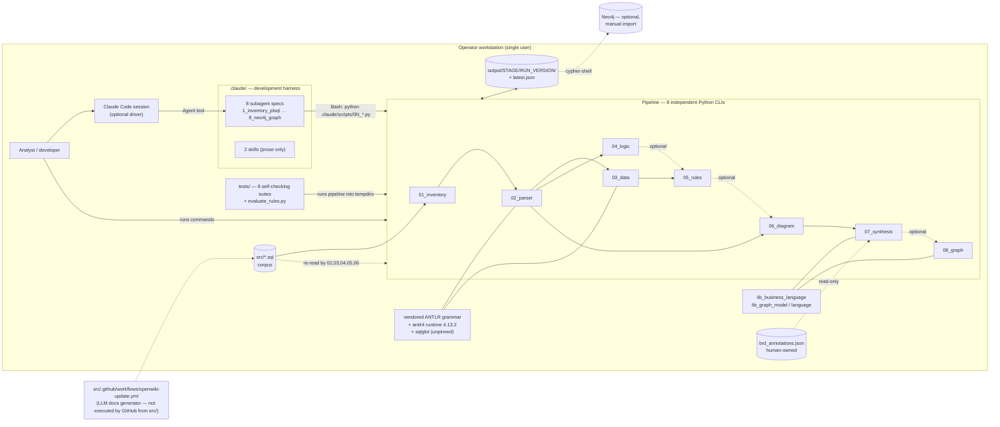
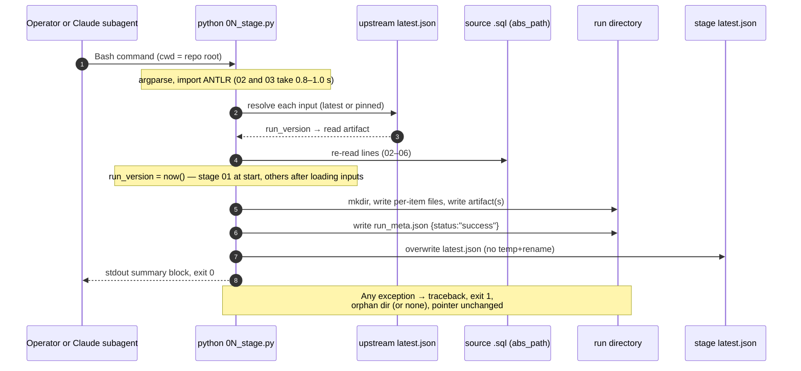
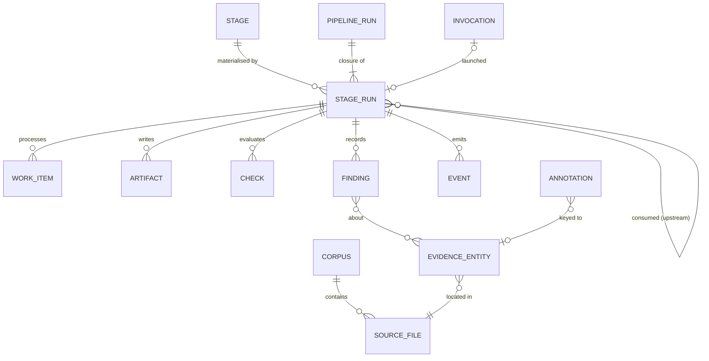
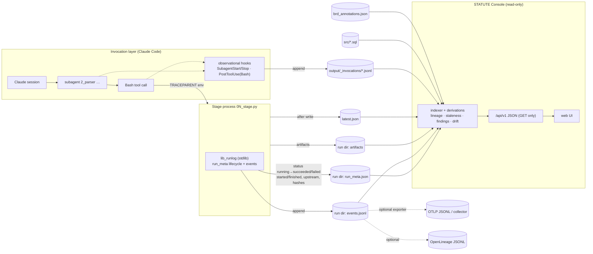
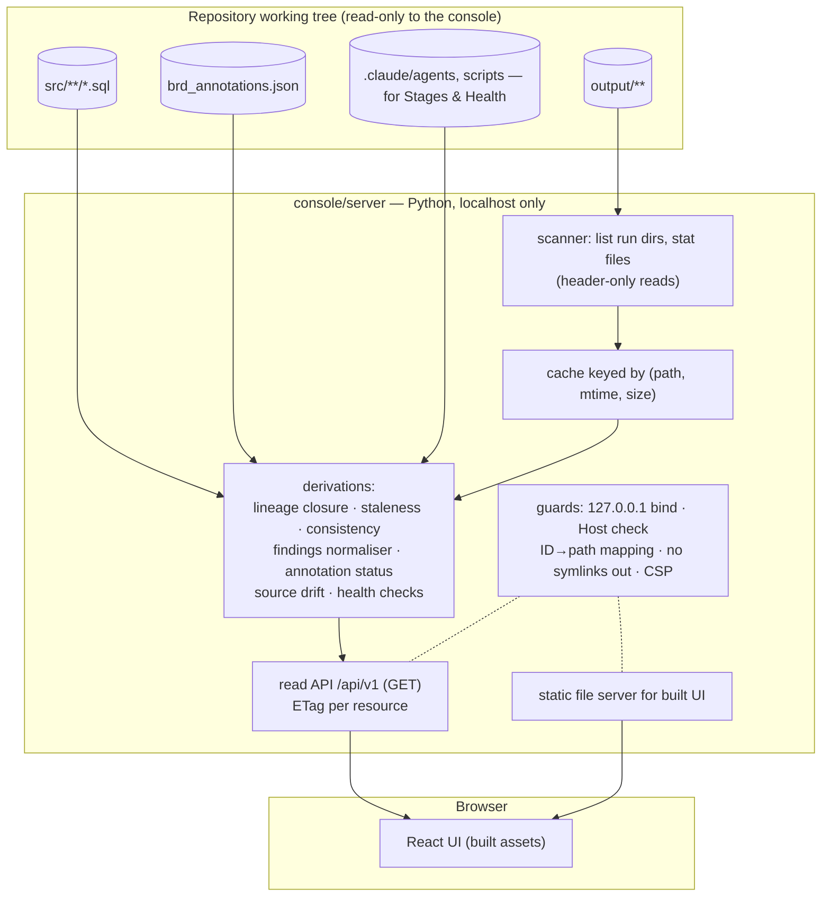
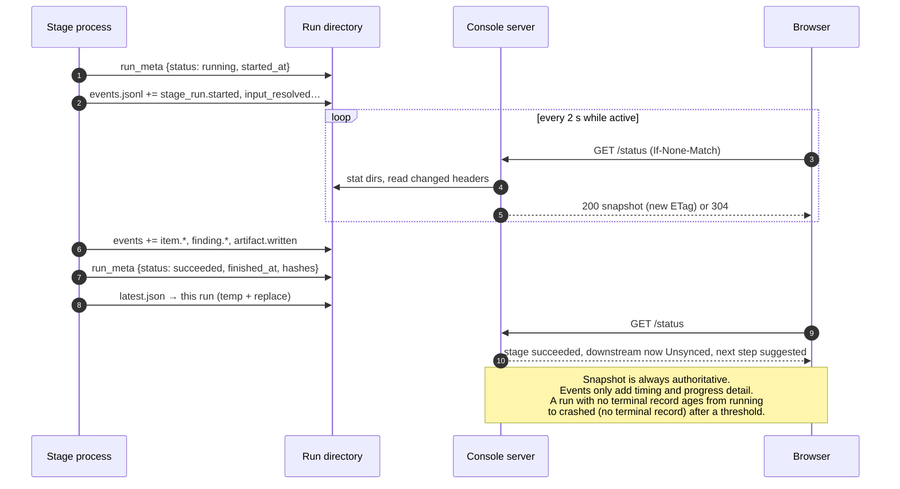
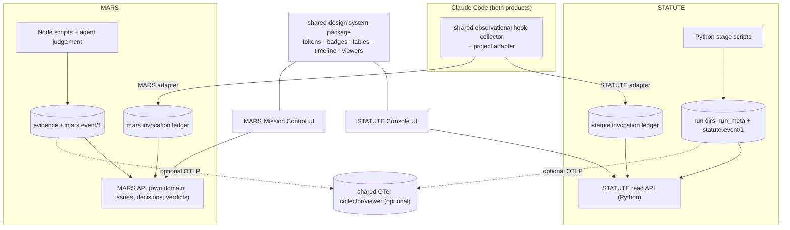
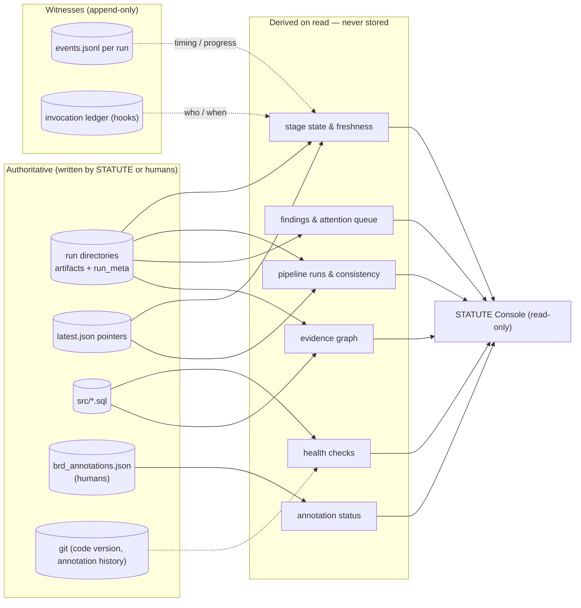

# Statue (STATUTE) — Architecture, Harness, Observability, and Dashboard Research

| | |
|---|---|
| **Repository** | `E:\Virtusa Projects\statute` — GitHub `KrishnaAnnavaram/…`, branch `readme-full-documentation` @ `d0d7fbc` |
| **Project name** | **STATUTE** — *Structured Translation & Analysis Tool for Undocumented Transactional Engines*. Referred to as "Statue" in the brief; the repository, README and every artifact say STATUTE. Earlier working names `plsql_to_brd` / `plsql-to-brd` survive in committed artifacts. |
| **Date** | 2026-09-30 |
| **Status** | Research and architecture proposal. **Nothing in STATUTE was modified.** No dependency, script, agent, skill, workflow or configuration was changed; the only files written are the research documents in `dashboard/`. |
| **Method** | Full repository read (8 stage scripts, 3 libraries, 8 agent specs, 2 skills, archive, tests, docs, committed output); a **real end-to-end run of all eight stages into a scratch directory** with timing and six failure probes; the documented test suites; read-only inspection of the sibling MARS repository; and four external research tracks (agent observability, workflow/lineage, tracing/APM + developer platforms + frontend, Claude Code native telemetry). |
| **Evidence** | [Appendix A — Repository evidence](01-evidence-repository.md) · [Appendix B — External research](02-evidence-external-research.md) |

Evidence labels used throughout: **[V]** verified in code, files or by execution (with `file:line`); **[I]** inferred; **[D]** documented claim not independently verified.

## Contents

1. [Executive Summary](#1-executive-summary)
2. [What Statue Actually Is](#2-what-statue-actually-is)
3. [Repository Findings](#3-repository-findings)
4. [Documentation vs Implementation](#4-documentation-vs-implementation)
5. [Current Architecture](#5-current-architecture)
6. [Runtime Model](#6-runtime-model)
7. [Representative End-to-End Execution](#7-representative-end-to-end-execution)
8. [Component Inventory](#8-component-inventory)
9. [Harness / Workflow Analysis](#9-harness--workflow-analysis)
10. [Current Observability](#10-current-observability)
11. [Observability Gaps](#11-observability-gaps)
12. [External Research](#12-external-research)
13. [Agent/Harness Dashboard Research](#13-agentharness-dashboard-research)
14. [Workflow Dashboard Research](#14-workflow-dashboard-research)
15. [Distributed Tracing Research](#15-distributed-tracing-research)
16. [Developer Platform Research](#16-developer-platform-research)
17. [Comparable Systems Matrix](#17-comparable-systems-matrix)
18. [Patterns Statue Should Adopt](#18-patterns-statue-should-adopt)
19. [Patterns Statue Should Avoid](#19-patterns-statue-should-avoid)
20. [Statue Operational Product Definition](#20-statue-operational-product-definition)
21. [Personas](#21-personas)
22. [Information Architecture](#22-information-architecture)
23. [Live Status](#23-live-status)
24. [Run Explorer](#24-run-explorer)
25. [Runtime Graph](#25-runtime-graph)
26. [Trace / Timeline](#26-trace--timeline)
27. [Event Console](#27-event-console)
28. [Artifact Lineage](#28-artifact-lineage)
29. [Human Approval](#29-human-approval)
30. [Historical Runs](#30-historical-runs)
31. [Analytics](#31-analytics)
32. [Synthetic/Harness Health](#32-syntheticharness-health)
33. [Domain Model](#33-domain-model)
34. [Event Model](#34-event-model)
35. [OpenTelemetry Strategy](#35-opentelemetry-strategy)
36. [Source-of-Truth Matrix](#36-source-of-truth-matrix)
37. [Backend Architecture](#37-backend-architecture)
38. [Real-Time Architecture](#38-real-time-architecture)
39. [Frontend Architecture](#39-frontend-architecture)
40. [Security Architecture](#40-security-architecture)
41. [Enterprise Considerations](#41-enterprise-considerations)
42. [Visual Design System](#42-visual-design-system)
43. [Detailed Screen Specifications](#43-detailed-screen-specifications)
44. [Wireframes](#44-wireframes)
45. [Real Statue Workflow Walkthrough](#45-real-statue-workflow-walkthrough)
46. [MARS vs Statue Comparison](#46-mars-vs-statue-comparison)
47. [Shared Platform Opportunities](#47-shared-platform-opportunities)
48. [What Not to Build](#48-what-not-to-build)
49. [MVP](#49-mvp)
50. [Roadmap](#50-roadmap)
51. [Required Instrumentation Changes](#51-required-instrumentation-changes)
52. [Risks](#52-risks)
53. [Open Questions](#53-open-questions)
54. [Final Architecture Recommendation](#54-final-architecture-recommendation)
55. [Required Final Answers (A–W)](#55-required-final-answers-aw)

---

## 1. Executive Summary

**What STATUTE is.** A deterministic, local, file-mediated reverse-engineering pipeline. It reads a directory of Oracle PL/SQL and produces a Business Requirements Document (`brd.md` + `brd_index.json` + `gaps_register.json`), Mermaid diagrams and a queryable knowledge graph. It is **eight independent Python CLI programs** (`.claude/scripts/01_inventory.py` … `08_graph.py`, ~9,100 lines including three libraries) chained by **versioned JSON artifact directories** (`output/<stage>/<run_version>/` + `run_meta.json`, published through `output/<stage>/latest.json`). The scripts call **no language model, no network, no subprocess and no environment variable** [V].

**What the "agents" are.** The eight `.claude/agents/*.md` files are Claude Code subagents that are deliberately **thin wrappers**: *invoke the script → validate its output → report*. The two skills are documentation the agent reads; nothing executes them [V]. There is **no orchestrator**: a human, or a Claude Code session acting for one, runs the stages in order [V].

**What actually happens at runtime.** A real run of all eight stages took ~50 s of process time in this environment [V]. Two stages (parser, data) account for ~97 % of compute; the other six finish in tens of milliseconds. In the committed run, **59 % of the 51.9 s end-to-end time was idle time between invocations** (five Claude tool-call batches), not computation [V]. Outputs are **byte-for-byte reproducible** after normalising timestamps and paths [V].

**The harness question.** STATUTE has an *agent-wrapper harness* (Claude Code subagents) and a *test/evaluation harness* (eight self-checking suites that run the real pipeline in temp directories, plus a ground-truth rule evaluator). It has **no orchestration harness, workflow engine, scheduler, queue, retry policy or runtime approval gate**. MARS-style concepts (issue, approval, gate, verdict, retry) do not exist here and should not be imposed.

**True runtime hierarchy.**
`Corpus (source files, sha256) → Pipeline run (derived — the upstream closure of a terminal stage run) → Stage run (run_version — the only first-class runtime entity) → Work item (file / object / DDL file / diagram) → Artifact → Finding & evidence entities (statement, rule, requirement, gap …)`.
Above the stage run sits an **invisible invocation layer**: Claude Code session → subagent (`2_parser` …) → Bash tool call → stage run. Nothing links the two today.

**What developers can observe today.** Completed, successful stage runs — their statistics, quality gates, issues, gaps and upstream versions — by opening JSON files; the latest pointer per stage; stdout summaries. That is enough to answer *"what did the last successful run produce?"*.

**What is invisible today** [V, all reproduced by probe]:
- **Failure.** `run_meta.status` is hard-coded `"success"`; a crash leaves an orphan directory with no metadata, or nothing at all. A run can even write `status: "success"` and never be published.
- **In-progress work.** Nothing is written until a stage finishes.
- **Silent degradation.** Stage 5 without its logic input drops 41 → 35 rules with no record anywhere; stages 4 and 8 degrade silently too. A malformed procedure is recorded `parse_status: "success"`; the first visible severity is stage 7's "critical 3".
- **Lineage holes and staleness.** Stage 5 does not record the logic run it consumed; stage 8 records only `run_selector: "latest"`; no stage checks that its upstream runs are mutually consistent; nothing compares source hashes.
- **Annotation drift.** Rule IDs (`BR-nnn`) are renumbered on every rules run (`05_rules.py:1145-1147`) while human annotations are keyed by them — an edited corpus can silently attach an SME's note to a different rule.
- **Who ran what.** No record links a stage run to the subagent, session or command that produced it.

**Correctness defects that no runtime signal reveals** (found during inspection; out of scope to fix here, but they show why contract checks belong in the console): re-running stages 4–5 against the committed artifacts silently drops rules 41 → 18 because the recorded source path no longer exists; the parser chains mutually exclusive IF/ELSIF arms as a sequence, so a published diagram shows "rate 3.0 → 3.5 → 4.0 → 4.5" as consecutive steps; the BRD states "0 lines of code" because two stages disagree on a field name. All 414 test checks pass regardless.

**Does STATUTE need a dashboard?** It does **not** need a real-time "Mission Control": one user, one workstation, ~50-second deterministic runs, no concurrency, no retries, no runtime approvals. It **does** benefit materially from a **read-only operational console over its own artifacts** — one that answers, in seconds and with evidence: *Is every stage current and consistent? Did anything fail, degrade or go stale? What needs a human (gaps, SME-review rules, drifted annotations)? Where does this requirement come from, down to the source line? What changed since the last run?* This report calls it the **STATUTE Console**.

**Recommended architecture.** *Files remain the source of truth.*
1. **Contract first** — a `run_meta` v1 schema, a canonical stage key, a status vocabulary aligned with the OpenTelemetry CI/CD conventions, and a small STATUTE event envelope.
2. **Read-only console over existing artifacts** — a localhost-only Python read API (indexer + derivations: lineage, staleness, findings, annotation status, source drift) serving a React + TypeScript + Tailwind UI built with Vite. Polling, not streaming. It can ship **with zero runtime changes**.
3. **Additive instrumentation** — one shared stdlib helper that writes `status: running|succeeded|failed`, start/end times, complete upstream provenance, artifact hashes and a per-run `events.jsonl`; plus an observational Claude Code hook ledger for the invocation layer.
4. **OpenTelemetry as an optional export**, one bounded trace per stage run with span links to upstream runs — never as the authority.

**MARS.** The current MARS harness is structurally similar (Claude Code subagents wrapping deterministic scripts, no orchestrator, no event log) but its domain is different (issue fan-out, human approval gates, verdicts, LLM calls, in-place overwrites, Markdown contracts). Share **a design system and an event-envelope convention** (and possibly the Claude Code hook collector); keep **domain models, backends and product experiences separate** (Option D + E). A single adapter-driven Mission Control for both would couple two immature products to a lowest-common-denominator model.

**Smallest useful MVP.** Phase 1 console (Pipeline status · Pipeline-run lineage · Stage-run detail · Findings/review queue · Evidence trace · Health) reading `output/` as it exists today, paired with the ~40-line shared run-lifecycle helper so that *running* and *failed* become facts rather than inferences.

---

## 2. What Statue Actually Is

### 2.1 Purpose

Recover the business requirements buried in an undocumented Oracle PL/SQL estate, as a document a sponsor, analyst, build team and machine can all use — with **every statement traceable to a file and line** and **no generative step that could invent a rule** (ADR-001, `docs/architecture-decisions.md:23-47`). Its stance is stated in `README.md`: *"A deterministic pipeline that misses a rule fails visibly; a generative one that invents a rule fails invisibly."*

### 2.2 Primary users and workflows

| User | What they do with STATUTE | Evidence |
|---|---|---|
| Analyst / architect (operator) | Runs the eight stages over a corpus; reads `brd.md`, diagrams, graph; asks `08_graph.py --ask` questions | README §4, §18 |
| Business SME | Reviews flagged rules and gaps; writes `brd_annotations.json` (owner, priority, notes keyed by stable ID) that survives regeneration | README §24, ADR-010 |
| Pipeline developer | Iterates on extractors; measures against ground truth; runs the eight check suites | git history ("measure, then fix what the numbers exposed"), `tests/` |
| Claude Code session | Invokes the stage subagents on the operator's behalf | `.claude/agents/*.md` |

Primary workflow: **source directory → 8 stages in order → BRD + diagrams + graph → SME review via annotations → regenerate.**

### 2.3 Components, inputs, outputs

| Aspect | Reality |
|---|---|
| Inputs | A directory of `*.sql` files (only `rglob("*.sql")` is read — `01_inventory.py:495`) [V]; optional `brd_annotations.json` (CWD) |
| Outputs | Per stage: a timestamped run directory of JSON artifacts + `run_meta.json`; `latest.json` pointer. Deliverables: `brd.md` (~2,550 lines), `brd_index.json`, `gaps_register.json`, 7 `.mmd` diagrams + `erd.mmd`, `import.cypher` + 35 CSVs, an English question interface |
| Runtime model | Short-lived, sequential, single-process-per-stage CLI programs |
| Execution model | Manual or agent-driven invocation; each stage resolves upstream inputs via `latest.json` or a pinned `run_version` |
| Persistence | Local filesystem only; immutable run directories; mutable pointer files; no database |
| External systems | **None at runtime.** Neo4j is an optional *manual* import target. Third-party libraries: `antlr4-python3-runtime` 4.13.2 and `sqlglot` (30.18.0 installed), unpinned — no manifest [V] |
| Automation | None in the pipeline. One LLM-using GitHub workflow (OpenWiki doc generation) exists but is outside the pipeline and in a location GitHub does not execute (§4) |
| Human interaction | Running commands; reading outputs; authoring annotations |
| Security boundary | The operator's workstation; the corpus is proprietary business logic; outputs are as sensitive as the source |
| Deployment | None. Python 3.11+ on one machine |

### 2.4 Documented, implemented and intended architecture

**Documented** (README, `docs/`, agent specs): eight agents in a fixed order with "must run after" constraints; an inventory that builds an `object_registry` and a typed `dependency_graph` with an `issues[]` list and a hard-fail invariant; each stage printing the next command; a deliberately honest system that surfaces everything it cannot know.

**Implemented** (code, verified by execution):
- Eight stage scripts; the real dependency DAG is looser than documented (only 01→02→03→05→06→07 is mandatory; 04 is optional for 05/06 but required by 07; 08 needs only 02) [V].
- The inventory (schema 2.0) produces `summary`, `file_index`, `file_metadata` only — **no** `object_registry`, `dependency_graph` or `issues`; object discovery lives in stage 2 [V].
- Only stage 1 prints a next command [V].
- Honesty is real in stage 6 (declared degradation, validation-failure exit) and stage 7 (gaps register), but **absent at the run level**: failure is never recorded and three stages degrade silently [V].

**Intended / abandoned** (from incomplete code and archives):
- An **LLM enrichment stage** (`02_enrich.py`, "LLM stubs", batches of 25) existed in the archived design (`.claude/scripts/archive/00_discover_parse.py:49-56, 907-911, 1035`); its vestige `summary.stage2_enrich_hint` is still emitted by `01_inventory.py:472-475` [V]. ADR-001 later removed models from the generation path.
- **Inventory-level object discovery** — agent 2's "Known scope limitation (temporary)" says stage 2's discovery should be deleted once inventory builds an `object_registry` (`.claude/agents/2_parser_agent.md:278-285`); still pending [V].
- **`TRANSITIONS_TO` graph edges** — a loop with `pass` (`lib_graph_model.py`, docs GAP-D01) [V].
- The two skills describe the planned (not current) inventory algorithm.

---

## 3. Repository Findings

### 3.1 Structure

| Path | Contents | Role at runtime |
|---|---|---|
| `.claude/scripts/01_inventory.py` … `08_graph.py` | Stage programs (724 / 858 / 1,431 / 917 / 1,198 / 1,207 / 1,308 / 419 lines) | **The pipeline** |
| `.claude/scripts/lib_business_language.py`, `lib_graph_model.py`, `lib_graph_language.py` | Identifier → business language (07, 08); in-memory property graph and 12-intent question catalogue (08) | Libraries |
| `.claude/scripts/vendor/plsql_grammar/` | ANTLR-generated Oracle PL/SQL lexer/parser (6.3 MB `PlSqlParser.py`), NOTICE pinning runtime 4.13.2 | Imported by 02, 03 |
| `.claude/scripts/archive/` | `00_discover_parse.py`, `01_parser.py` — superseded regex/sqlglot design writing `checkpoints/` | Not referenced [V] |
| `.claude/agents/*.md` (8) | Claude Code subagent specs: frontmatter (`name`, `description`, `tools`) + role/execution/constraints prose | Development harness |
| `.claude/skills/file-catalog`, `reference-graph` | Prose skills describing the inventory algorithm | Read by agent 1; stale |
| `tests/test_*.py` (8) + `evaluate_rules.py` + `fixtures/` | Script-style suites (`check(cond, label)`), ground truth for 4 procedures | Test/eval harness |
| `src/` | 7 PL/SQL files (reference banking corpus, 603 code lines) **plus** `openwiki/` (33 generated Markdown pages), `CLAUDE.md`, `AGENTS.md`, `.github/workflows/openwiki-update.yml` | Pipeline input (only `.sql` read) |
| `output/` | Committed latest run of every stage (one run each, 2026-07-29 16:05:30–16:06:21 Z) | Generated artifacts |
| `docs/` | 7 technical documents + 8 per-agent documents (generated 2026-07-30) | Documentation |
| `tools_antlr_build/` | ANTLR jar, `.g4` sources, generated parser identical to `vendor/` | Grammar regeneration only |
| `reference/` | COBOL "legacy-modernization-harness" (gitignored; on disk) with its own agents/skills/output | Design reference only |
| `dashboard/` | This research (new, untracked) | — |

### 3.2 What is absent [V]

No dependency manifest, Dockerfile, root CI workflow, `.claude/settings.json`, hooks, slash commands, MCP configuration, root `CLAUDE.md`, logging framework, timing code, environment-variable reads, database, API, UI, scheduler or queue.

### 3.3 Tests and evaluation

- Eight suites, each a standalone script printing `[PASS]/[FAIL]` and exiting non-zero on failure; they run the real pipeline into temp directories. **Not pytest-compatible**: under pytest, 38 of 50 collected "tests" error on missing fixtures [V]. "414 tests" in the README badge means 414 runtime `check()` calls across 50 test functions.
- Measured in this environment: **all eight suites pass — 414 checks, 0 failures** (inventory 22, parser 31, data 76, logic 46, rules 33, diagram 52, synthesis 86, graph 68). A full pass takes 7–9 minutes because every suite rebuilds the pipeline [V].
- `tests/evaluate_rules.py` scores Agent 5 against hand-annotated ground truth. It currently reports P/R/F1 = 1.000 (34/34) on all four procedures, including the two marked `held_out` — i.e. the held-out sets have since been used to fix the extractor. The README's "blind F1 0.588" is not reproducible from any fixture (`BASELINE.json` records F1 0.5926) [V]. It is the only accuracy evaluation; seven agents have none (docs GAP-E02).

### 3.4 Defects found while inspecting (relevant to observability)

| # | Finding | Evidence |
|---|---|---|
| R1 | Committed BRD states "7 files, **0 lines of code**" — synthesis reads `total_lines_of_code`, inventory writes `total_code_lines` | `07_synthesis.py:1175`, `01_inventory.py:464`, `output/final_report/*/brd.md:84` [V] |
| R2 | Committed artifacts point at `E:\Virtusa Projects\plsql_to_brd\src`, which does not exist; any downstream re-run from committed output crashes (stage 2) or silently degrades (4/5/6) | live probe e1 [V] |
| R3 | `BR-nnn` IDs are reassigned by sort order each run and the stable `raw_key` is deleted; annotations are keyed by `BR-nnn` | `05_rules.py:1145-1147` [V] |
| R4 | Stages 07 and 08 accept one `--run` selector applied to all six/seven upstream roots; since each stage has its own timestamps, only `latest` can ever resolve — they cannot be pinned | `07_synthesis.py:1240,1248-1253`, `08_graph.py:350,125-131` [V] |
| R5 | `08 --ask` returns exit 2 for "question not understood", colliding with argparse usage errors; equivalent Cypher references `[:CONSTRAINS]` while the export emits `CONSTRAINS_TABLE` | live run [V] |
| R6 | Redirected stdout is written in cp1252, so em-dashes become byte 0x97 in captured logs | live run [V] |
| R7 | A 32,557-character ANTLR expected-token message is stored verbatim in `issues[]` | probe c [V] |
| R8 | **Mutually exclusive branches drawn as a sequence.** `02_parser.py:556-558` chains every sibling sharing a `parent_id` without grouping by branch arm; 18 of 86 `SEQUENCE` edges cross IF/ELSIF arms or handlers. The published `flow_SP_PROCESS_MONTHLY_INTEREST_CREDIT.mmd` draws "Set Interest Rate 3.0 → 3.5 → 4.0 → 4.5" as consecutive steps; the same edges become graph `FOLLOWS`. No test asserts branch-arm structure | drift audit [V] |
| R9 | **Silent data loss when source is unreachable.** Running 04 → 05 on the committed artifacts: exit 0, slices 25 → 0, rules 41 → 18, SME-review 3 → 14, no warning (`04_logic.py:96-102`, `05_rules.py:65-71`, `06_diagram.py:192-198` turn `OSError` into empty source) | drift audit [V] |
| R10 | Graph `--ask` and its printed "equivalent Cypher" can disagree (local answer includes `CONSTRAINS_TABLE`/statement rows the Cypher omits); 26 relationship types defined, 22 emitted; all 15 parser `EXCEPTION_EDGE`s (`from: "*"`) are dropped silently | `lib_graph_language.py:107-151, 288-293`, `lib_graph_model.py:192-193` [V] |

---

## 4. Documentation vs Implementation

The documentation package (README + `docs/`, written 2026-07-30) is unusually candid — it already lists most operational gaps. Drift is concentrated in the **agent specifications and skills** (written before the July redesigns) and in claims that were true when written but are no longer.

| # | Category | Documented claim | Actual state | Sev. |
|---|---|---|---|---|
| D1 | Agent ↔ CLI | Agent 1 runs `01_inventory.py REPO_ROOT --output OUTPUT_DIR/inventory-artifact.json`, default `./checkpoints/`; `EXCLUDE_DIRS` comma-separated (`1_inventory_plsql_agent.md:44-54`) | `--output` disables `run_meta` and `latest.json`, so stage 2 cannot find the run or silently consumes a stale one; default is versioned `output/inventory/`; `--exclude` is space-separated `nargs+` (`01_inventory.py:540-586, 616-721`) | **High** |
| D2 | Agent validation pass | Validate `object_registry`, `dependency_graph.edges`, `issues[]`, `meta.total_files_scanned`, a hard-fail file-count invariant (`1_inventory_plsql_agent.md:57-65`) | None of these fields exist; the invariant is computed tautologically (`01_inventory.py:457, 648-661`) | **High** |
| D3 | Skills | `file-catalog` / `reference-graph` describe `object_registry`, `{FILENAME}_L{line}` ids, typed edges (CALLS, READS, WRITES, TRIGGERS_ON …), `issues[]` severity table | Not implemented; `file_id` is `SLUG(path)__SHA256(path)[0:8]`; discovery happens in stage 2 | High |
| D4 | Stage DAG | "Must run after X" chains in agent specs (e.g. 03 before 04; 07 "must run last"; 06 after 2,3,4,5) | 04 never reads 03; 06 requires only 02; 08 consumes 07; 05 treats 04 as optional (`05_rules.py:1126-1130`) | Med |
| D5 | Next-command hint | "Each stage prints where it wrote and the exact next command" (README §4, §18) | Only stage 1 prints a next command (`01_inventory.py:716-721`) | Low |
| D6 | Downstream tables | Agent 1 lists `file_registry`, `start_line`/`terminator_line`, `stats`, `issues` for consumers | None produced | Med |
| D7 | Output location | README §7: "`output/` versioned runs (gitignored)" | `.gitignore` explicitly commits `output/` | Low |
| D8 | CI/CD | README §6/§29, GAP-O02: "No CI", "No `.github/workflows`" | `src/.github/workflows/openwiki-update.yml` (added Aug 5) exists — but under `src/`, where GitHub Actions does not run it; it calls an OpenRouter model (`z-ai/glm-5.2`) and LangSmith tracing to regenerate `src/openwiki/` | Med |
| D9 | "No model / no network" | README §6 "Verified absent: model calls · network calls" | True **for the pipeline**; the repository nevertheless contains LLM automation (D8) and `src/openwiki/` content generated by an LLM | Low |
| D10 | Input hygiene | `src/` is "7 PL/SQL files — the reference corpus" | `src/` also holds OpenWiki pages, `CLAUDE.md`, `AGENTS.md`, a workflow; harmless today only because stage 1 reads `*.sql` exclusively | Low |
| D11 | Error handling | README §22: "Missing optional artefact → degrade + record" | Stage 6 records; **stages 4, 5, 8 degrade silently** (probes d, e6) | **High** |
| D12 | Parse failure | Agent 2: "A malformed object is never allowed to abort the run: it is written with `parse_status: failed`" | Malformed objects are written `parse_status: "success"` with a degenerate tree; `failed` only on a Python exception; Pass A file-level failures abort the run (probe c; `02_parser.py:765-806`) | **High** |
| D13 | Run metadata | README §20 state diagram: "crash before write → orphan; latest.json still points at last good run" | Correct, and additionally: a run can write `run_meta.status:"success"` yet never be published (probe e3); `status` is never anything but `"success"` | Med |
| D14 | Naming | STATUTE vs "Statue" vs `plsql_to_brd`; stage keys `01_inventory` vs `2_parser`; agent `8_neo4j_graph` in `8_graph_agent.md` for `08_graph.py`; "BRD Generator" (agent 2) is now `7_synthesis` | Inconsistent identifiers a dashboard must normalise | Med |
| D15 | Test count | Badge "414 tests" | 414 runtime checks verified (all pass); 50 test functions; pytest invocation fails | Low |
| D20 | Orchestration | "No orchestrator"; "the only trigger is a human running a command" (README §5) | The BRD itself states it was "orchestrated by an AI agent harness" (`07_synthesis.py:516-518`, `brd.md:82`). The model is outside the *generation* path but inside the *run* path | Med |
| D21 | Isolation | "Any stage re-runnable in isolation" (README, ADR-002) | Only after re-running 01 on the current machine; otherwise 02/03 crash and 04/05/06 silently lose content (R9) | **High** |
| D22 | Diagram honesty | "Diagrams never imply an ordering that doesn't exist" (ADR-011) | R8 — cross-arm sequence edges in a published diagram | **High** |
| D23 | Graph equivalence | "Local answers and Neo4j answers cannot disagree" | R10 | Med |
| D24 | Evaluation | "First blind held-out F1 0.588" | Not reproducible; harness now reports 1.000 on all four | Low |
| D25 | Two specifications in one repo | OpenWiki presents BR-01…BR-20 as "stable" rule IDs | Pipeline emits BR-001…BR-041; same-looking IDs denote different rules (OpenWiki BR-14 ≠ pipeline BR-014); gap and orphan-table findings disagree | Med |
| D26 | Line citations | `docs/agents/agent-01-inventory.md` function line numbers; ADR-003 `01_inventory.py:133` | 10 of 11 wrong (e.g. `generate_run_version` cited 401, actual 304) | Low |
| D27 | Traceability | "Every rule cites file and line" | `BR-014` (DDL CHECK) has `line: None` | Low |
| D28 | Branch state | — | Local `main` is 6 commits behind `origin/main`; over `origin/main` this branch adds only `d0d7fbc` (OpenWiki, 36 files) | Info |
| D16 | Agent 4 output | `complexity_score` field | `complexity.{cyclomatic,cognitive}` | Low |
| D17 | Agent 7 annotations | File lives "in the working directory" | Matches code; but generated BRD tells readers to save it "beside the source folder" (`07_synthesis.py:959`) | Low |
| D18 | Graph provenance | "Every artefact records upstream provenance" (README §28 Auditability) | Stage 8 records `run_selector` only; stage 5 omits logic | Med |
| D19 | Docs count | README §7: "`docs/` 16 detailed technical documents" | 15 files (7 + 8) | Low |

**Accurate and valuable documentation** (to keep): the eight per-agent documents' design rationale; ADR-001…011; `known-gaps-and-open-questions.md` (GAP-O04 "no logging framework", GAP-O05 unbounded run growth, GAP-O06 no concurrency control, GAP-O07 no schemas, GAP-S01 unsanitised annotations — all confirmed); README §20 file-system state model; §27 troubleshooting table.

Full drift register with line references: [Appendix A §A2](01-evidence-repository.md#a2-documentation-drift-register).

---

## 5. Current Architecture

Only components that exist or are strongly evidenced are shown. Dashed = optional; dotted = exists but outside the pipeline.

### 5.1 Diagram 1 — Current STATUTE architecture



Component categories requested in the brief, by presence:

| Category | Present? | What exists |
|---|---|---|
| Frontend / user-facing app | No | Markdown, Mermaid and Cypher artifacts read in an editor |
| Backend / API / service | No | — |
| Workers / queues / schedulers / event bus | No | — |
| Agents | Yes (wrapper) | 8 Claude Code subagents |
| Skills | Yes (prose) | 2 |
| Scripts / tools | Yes | 8 stage CLIs + 3 libs; `08 --ask` question tool |
| Databases | No | Filesystem; graph database is an optional export target |
| Graph database | Optional, external | Neo4j via generated `import.cypher` |
| Vector DB / cache | No | — |
| Artifact store | Yes | `output/` run directories |
| Model providers | **Not in pipeline**; Claude (via Claude Code) drives agents; OpenRouter only in the inert OpenWiki workflow |
| AuthN / AuthZ | No | OS file permissions |
| CI/CD / deployment | No (effective) | Workflow file in a non-executing location |
| Observability | Minimal | `run_meta.json`, `latest.json`, stdout/stderr, artifact-embedded issues/gaps |

### 5.2 The actual stage dependency DAG (from code)

| Consumer | Required inputs | Optional inputs (behaviour when absent) | `upstream` recorded |
|---|---|---|---|
| 01_inventory | source dir | — | none |
| 02_parser | 01 + source files (strict UTF-8) | — | 01 |
| 03_data | 01, 02 (+ every `raw_structure` file) + DDL source | — | 01, 02 |
| 04_logic | 01, 02 + source lines | — | 01, 02 — *source read failures swallowed* |
| 05_rules | 01, 02, 03 | **04 — silent; not recorded** | 01, 02, 03 |
| 06_diagram | 02 | 01, 03, 04, 05 — declared in `quality.degraded_inputs` | all five (null when absent) |
| 07_synthesis | 01–06 (+ `.mmd` files, `erd.mmd`) | annotations (errors swallowed → `{}`) | all six |
| 08_graph | 02 | 01, 03–07 — **silent** | `{"run_selector": "latest"}` only |

Minimum valid order: 01 → 02 → 03 → 05 → 06 → 07; 04 anywhere after 02 (required by 07); 08 last.

---

## 6. Runtime Model

### 6.1 Diagram 2 — Execution model of one stage



### 6.2 State model on disk

| State | How it appears | Distinguishable today? |
|---|---|---|
| Never run | no `output/<stage>/` | Yes |
| Running | run directory exists, no `run_meta.json` | **No** — identical to crashed |
| Succeeded and published | `run_meta.json` + `latest.json` points here | Yes |
| Succeeded, not published | `run_meta.json` (`"success"`), pointer elsewhere (probe e3) | Only by cross-checking pointer |
| Crashed after mkdir | orphan directory (possibly partial files) | Only heuristically |
| Crashed before mkdir | nothing (02 missing inventory; 07 any missing input) | **No** |
| Degraded | success, fewer outputs | Only stage 6 declares it |
| Unversioned (`--output`) | files at arbitrary path, no meta/pointer | **No** |

### 6.3 Canonical runtime hierarchy (STATUTE's own vocabulary)

```
Corpus                       source_dir + files (file_id, rel path, sha256)          — inventory artifact
└─ Pipeline run   (derived)  the upstream closure of a terminal stage run
   │                         (07_synthesis, or 08_graph); no ID exists today
   └─ Stage run              stage key + run_version                                 — run directory + run_meta.json
      ├─ Inputs              upstream stage runs consumed (latest | pinned)         — run_meta.upstream
      ├─ Work items          files (01), objects (02, 04), DDL files (03),          — per-item files / index entries
      │                      diagrams (06)
      ├─ Artifacts           files written in the run directory                     — run directory
      ├─ Checks              quality gates, validation (06), counts                 — run_meta.quality / stats
      └─ Findings            issues[], warnings[], hazards, gaps, blind spots       — artifacts
         └─ Evidence entities  statement_id, BR-nnn, requirement, GAP-nnn,          — artifacts (read-through)
                               table/column, diagram node → file:line

Invocation layer (exists, unrecorded):
Claude Code session → subagent (agent_type = 2_parser …) → Bash tool call → stage run
```

Concepts from the brief that **do not exist** in STATUTE and must not appear in its UI: workflow (beyond the fixed stage DAG), job, task, operation, queue, worker, retry, approval, gate, verdict, issue (in the MARS sense), skill invocation, tool call inside a script.

---

## 7. Representative End-to-End Execution

The trace below is the committed run (2026-07-29) cross-checked against a fresh run of the same corpus in a scratch directory (2026-10-01). Line numbers refer to `.claude/scripts/`.

| # | Question | Answer for the committed pipeline run |
|---|---|---|
| 1 | What initiates execution | An operator or Claude session runs `python .claude/scripts/01_inventory.py src`. From timestamp clustering, the committed run was **five separate invocations**: [01] [02+03] [04+05] [06+07] [08], each batch chained within ≤0.7 s, batches separated by 6.9–8.5 s [V] |
| 2 | What receives it | Each script's `argparse` `main()` (e.g. `01_inventory.py:529-586`) |
| 3 | First actor | Stage 1 walks `src` with `rglob("*.sql")`, classifies 7 files (`schema_ddl` 1, `seed_data` 1, `function` 1, `procedure` 4) and assigns `file_id = SLUG(path)__SHA256(path)[0:8]` (`01_inventory.py:130-164`) |
| 4 | State created | `output/inventory/2026-07-29T16.05.30.018Z/` with `inventory-artifact.json` (per-file sha256, role, line counts, `abs_path`) and `run_meta.json`; then `latest.json` |
| 5 | Components executed | 01 → 02 (ANTLR + sqlglot: 5 objects, 124 statements, CFGs) → 03 (15 tables, 105 columns, 7+1 FKs, 1 CHECK) → 04 (151 pseudocode lines, 25 slices, 1 savepoint hazard) → 05 (41 rules, 3 need SME review) → 06 (7 diagrams, 100 % tier-1 labels, one 45-node oversize) → 07 (41 requirements, 21 gaps) → 08 (353 nodes, 769 relationships) |
| 6 | Scripts/tools called | Only the eight scripts; inside 02/03 the vendored ANTLR parser and sqlglot. No subprocess |
| 7 | External systems | None |
| 8 | Data read | `src/*.sql` (by 01, re-read by 02–06 via `abs_path`); each upstream artifact via `latest.json`; `brd_annotations.json` (absent → `annotations_applied: 0`) |
| 9 | Data written | 73 files across 8 run directories plus 8 `latest.json` pointers — 81 files, ≈ 1.0 MB, dominated by `import.cypher` 260 KB, `data_artifact.json` 131 KB, `brd.md` 122 KB) |
| 10 | Artifacts generated | Inventory, raw structures, data dictionary + ERD, logic, rules, diagrams, BRD trio, graph export |
| 11 | Errors that can occur | Missing upstream (exit 1, traceback, no directory); missing/non-UTF-8 source (02 aborts; 04–06 silently degrade); ANTLR syntax errors (recorded, run "succeeds"); stage-6 validation failure (exit 1 after `.mmd` writes → orphan); pointer write failure (meta says success, pointer stale) |
| 12 | Retries | None anywhere. Recovery = fix and re-run (a new run directory) |
| 13 | Human participation | Starting each batch; later SME annotations. No approval inside the run |
| 14 | Completion | Per stage: exit 0 + `latest.json` updated. There is no pipeline-level completion signal; "done" is the operator noticing stage 7/8 finished |
| 15 | Final result | `brd.md` "PL/SQL Banking System" (41 requirements in 4 parts, 21 open matters: 4 high, 8 medium, 9 low), 7 diagrams + ERD, graph export, `--ask` interface |

**Timing** (fresh run, measured around each process; committed run in parentheses):

| Stage | Wall (s) | In-script (s) | Start-up (s) | Committed in-script (s) |
|---|---:|---:|---:|---:|
| 01 inventory | 0.43 | n/a (no end stamp) | 0.23 | n/a |
| 02 parser | 33.80 | 32.39 | 0.82 | 14.58 |
| 03 data | 14.21 | 12.84 | 1.00 | 5.60 |
| 04 logic | 0.27 | 0.015 | 0.17 | 0.014 |
| 05 rules | 0.27 | 0.016 | 0.18 | 0.017 |
| 06 diagram | 0.43 | 0.026 | 0.23 | 0.001 |
| 07 synthesis | 0.39 | −0.028 (stamps inverted) | 0.30 | ≈0 |
| 08 graph | 0.31 | 0.033 | 0.18 | 0.010 |

In the committed run, end-to-end was **51.9 s**, in-script compute **~20.2 s**, and the four long inter-batch gaps **30.8 s (59 %)** — consistent with agent tool-call round-trips (the fresh run's own separate calls showed 5.3–7.2 s gaps). This is inferred: no record of the invocation layer exists [I].

**The same flow, failing.** With one malformed procedure added (`CREATE OR REPLACE PROCEDURE broken AS BEGIN IF x THEN END;`), every stage exits 0. Stage 2 records 3 `syntax_error` issues at run level (one message is 32,557 characters) but writes the object as `parse_status: "success"`; stage 5 invents `BR-042 "Validate Create"` from the raw line; the first human-visible severity is stage 7's `Open matters : critical 3, high 5 …`; `brd.md` still documents the broken procedure. A dashboard that only reads exit codes or `run_meta.status` would show this run as entirely green.

---

## 8. Component Inventory

### 8.1 Stage scripts (the runtime)

| ID | Purpose | Inputs | Outputs | Persistence | Error behaviour | Logging | Tests | Observability today |
|---|---|---|---|---|---|---|---|---|
| `01_inventory` | Catalogue `.sql` files; stable `file_id`; role/complexity; sha256 | source dir | `inventory-artifact.json` | run dir + pointer | exit 1 on bad dir; empty dir = success with 0 files | `-v` per-file stderr; summary + next command | 22 checks + golden diff | `summary`, per-file `status`/`warnings` (unseveritied) |
| `02_parser` | ANTLR structural parse; statement trees; CFG; sqlglot DML detail | 01, source | `raw_structure/{object}.json`, `parser_artifact.json` | same | per-object try (only on exception); Pass A not isolated | `-v` `[discovering]`, `[parsing]` | 31 | `stats`, `issues[]` (severity/type/file/line), `parse_status` |
| `03_data` | DDL → data dictionary with enforcement state; ERD; cross-validation | 01, 02, source | `data_artifact.json`, `erd.mmd` | same | per-file DDL not isolated | `-v` `[parsing DDL]` | 76 | 23-key stats; `issues[]` (constraint_not_enforced …) |
| `04_logic` | Pseudocode, complexity, slices, CRUD, transaction hazards | 01, 02, source | `program_logic/*_logic.json`, `logic_artifact.json` | same | source read errors swallowed | `-v` `[analysing]` | 46 | stats; hazards; thresholds |
| `05_rules` | Mine/name/dedupe/classify business rules from 9 sources | 01, 02, 03, (04) | `rules_artifact.json` | same | logic absence swallowed | none | 33 + ground-truth evaluator | stats by category/confidence; `requires_sme_review` |
| `06_diagram` | DiagramSpec → Mermaid; quality gates; validation | 02, (01, 03, 04, 05) | `diagrams/*.mmd`, `diagrams_artifact.json` | same | validation failure → stderr + exit 1 after `.mmd` writes | always: FAILED block | 52 | `quality`, `warnings[]`, `degraded_inputs` |
| `07_synthesis` | Assemble BRD, index, gaps register; merge annotations | 01–06, annotations | `brd.md`, `brd_index.json`, `gaps_register.json` | same | any missing input → traceback, no dir | none | 86 | `counts`; `gaps[]` with severity |
| `08_graph` | Property graph → Cypher/CSV; English Q&A | 02, (01, 03–07) | `import.cypher`, `nodes/`, `rels/`, `README.md`, `graph_artifact.json` | same | optional inputs silent; dangling and `*`-sourced edges dropped silently; `--ask` exit 2 | none | 68 | `stats`, `blind_spots[]` |

### 8.2 Libraries, agents, skills, tools

| ID | Type | Purpose | Callers | Notes |
|---|---|---|---|---|
| `lib_business_language` | library | single translation point identifier → business prose | 07, 08 | — |
| `lib_graph_model` | library | in-memory property graph (13 labels / 22 rel types) | 08 | drops dangling edges silently (GAP-D03); `TRANSITIONS_TO` unimplemented |
| `lib_graph_language` | library | 12 deterministic intents → resolver + Cypher | 08 `--ask` | refuses unmatched questions (total precision) |
| `vendor/plsql_grammar` | generated code | ANTLR Oracle PL/SQL parser | 02, 03 | requires runtime 4.13.2 exactly |
| `1_inventory_plsql` … `8_neo4j_graph` | Claude subagents | invoke → validate → report | operator / Claude session | tools: Read, Grep, Glob, Bash (1); Read, Bash (2–8). Agent 1's commands are wrong (D1/D2) |
| `file-catalog`, `reference-graph` | skills | prose algorithm description | agent 1 | stale (D3) |
| `tests/test_*.py` | test harness | integration checks into temp dirs | developer | 7–9 min full pass; not pytest |
| `tests/evaluate_rules.py` | eval harness | P/R/F1 vs ground truth | developer | `--baseline` writes fixtures |
| `tools_antlr_build/` | build tool | regenerate grammar (Java) | developer | not a runtime dependency |
| OpenWiki workflow | automation (inert) | LLM-regenerated wiki under `src/openwiki/` | none (wrong path) | secrets: `OPENROUTER_API_KEY`, `LANGSMITH_API_KEY` |

### 8.3 Generated artifacts and identifiers

| Artifact / ID | Format | Stable across runs? | Correlation use |
|---|---|---|---|
| `run_version` | `YYYY-MM-DDThh.mm.ss.mmmZ` (UTC, folder-safe) | per run | stage-run identity; lineage joins |
| `file_id` | `SLUG(rel_path)__SHA256(rel_path)[0:8]` (+`_2` on collision) | yes (path-based) | join everything to a source file |
| `object_id` | `PROC-OWNER.NAME`, package member `…::MEMBER` | yes | object pages |
| `statement_id` | `{file_id}__{object_id}__STMT_{seq:04d}` | yes if source unchanged | rule → line traceability |
| `BR-nnn` | sequential after sort | **no** | annotations (fragile) |
| `GAP-nnn` | detection order | **no** | — |
| internal `raw_key` (e.g. `IF::{oid}::{line}`) | stable | yes — **deleted before output** | would be the correct rule identity |
| `column_id` | `TABLE.COLUMN` | yes | lineage, impact |
| diagram ids / `node_origins` | `flow_{name}`, node → statement | yes | diagram ↔ evidence |

---

## 9. Harness / Workflow Analysis

| Mechanism asked about | Present? | What STATUTE has |
|---|---|---|
| Agent harness | **Thin** | Claude Code subagents that wrap one script each. They add operator convenience and a natural-language report; they add no state, retries or decisions. Agent 1's instructions are out of date and, if followed literally, break the chain (D1) |
| Workflow engine / orchestration layer | **No** | ADR-002 chose "independent CLI programs chained by artefacts on disk". Ordering is the operator's responsibility |
| Task runner / job scheduler / queue | No | — |
| Event-driven workflow | No | — |
| Pipeline system | **Yes, implicit** | A fixed stage DAG realised through pointer files — closer to a build system (Make-like) or an asset graph (Dagster/dbt-like) than to a workflow engine |
| Multi-agent system | No | The agents never call each other and hold no shared state; "agent" means *pipeline stage* (`docs/system-overview.md` §2) |
| Remediation harness | No | STATUTE stops at documentation (ADR-008) |
| Testing harness | **Yes** | Suites run the real pipeline into temp dirs; `tests/evaluate_rules.py` and `tests/test_diagram.py` are the only code that chains stages (hand-writing `latest.json` with `run_version: "run"`) |
| Evaluation harness | **Yes, narrow** | Rule extraction vs ground truth (4 procedures); quality gates in 06/07 |
| Human-in-the-loop | **Curation, not gating** | `brd_annotations.json` sidecar (ADR-010), `requires_sme_review`, gaps register |
| Reference harness | Design input | `reference/` — the COBOL "legacy-modernization-harness" that inspired the eight-agent layout |

**Conclusion.** STATUTE's real runtime abstraction is a **versioned artifact build**: stages *materialise* immutable, versioned outputs from named versions of their inputs. The right mental model is an **asset graph with materialisations** (Dagster/dbt), with Claude Code as an optional *driver*, not a workflow engine with tasks. The dashboard should therefore be **asset- and evidence-centric**, with a thin live layer.

---

## 10. Current Observability

| Surface | Contents | Who can use it today |
|---|---|---|
| `output/<stage>/` listing | Every run directory, timestamped by `run_version` | Anyone with a file browser |
| `latest.json` | `run_version`, `path`, `updated_at` | Operator; downstream stages |
| `run_meta.json` | `stage`, `run_version`, `status` (always `success`), `generated_at`, `upstream`, and a stage-specific summary (`stats_summary` / `quality` / `counts` / `stats`); stage 1 also `source_dir`, `cli_args` | Developer |
| Artifacts | `issues[]` (02, 03), `warnings[]` (06), hazards (04), confidence/SME flags (05), `quality` (06), `gaps[]` (07), `blind_spots[]` (08), per-file `sha256` (01) | Developer, SME (via BRD) |
| stdout | One summary block per stage (`=== … Complete ===`); stage 1's `Next step:` | Operator in terminal |
| stderr | `--verbose` per-item progress (01–04 only); tracebacks; stage 6 FAILED block | Operator in terminal |
| Exit codes | 0 success (incl. degraded and parse-error runs), 1 crash/validation, 2 `--ask` unmatched | Calling agent |
| Claude Code | `/tasks` in the driving session; transcripts (internal format) | The session's user only |
| Tests | `[PASS]/[FAIL]` and exit code | Developer |

Explicitly absent [V]: `logging`, structured logs, metrics, traces, health endpoints, status commands, correlation IDs beyond `run_version`, timing fields, failure records, progress percentages, audit events, dashboards.

**Can a developer answer "what is STATUTE doing right now?"** Only if they are watching the terminal or the Claude session that is running it. From the filesystem alone, a run in progress is indistinguishable from a crashed one, and a crash before `mkdir` leaves no trace at all.

---

## 11. Observability Gaps

Ordered by how badly each one misleads a human.

| # | Gap | Consequence | Evidence | Fix class |
|---|---|---|---|---|
| G1 | No failure record; `status` always `success` | Failures invisible after the terminal closes; "success" is not proof of publication | all 8 scripts; probe e3 | small instrumentation |
| G2 | No in-progress marker | "Running" vs "crashed" indistinguishable | §6.2 | small instrumentation |
| G3 | Silent degradation (04, 05, 06 on unreadable source; 05 without logic; 08 without optional inputs) | Fewer rules/edges with green status — e.g. 41 → 18 rules when source paths are stale | probes d, e6; drift R9 | small instrumentation |
| G4 | Malformed objects marked `success`; run-level errors not surfaced until stage 7 | Parse defects travel through four stages unflagged | probe c | small instrumentation (+ stage logic) |
| G5 | Lineage holes: 05←04 missing; 08 unrecorded; 07/08 cannot pin | Staleness undetectable for rules and graph; reproducibility claims weakened | `05_rules.py:1167`, `08_graph.py:378` | small instrumentation |
| G6 | No cross-stage consistency check | A BRD can be assembled from rules and diagrams built on different parser runs | no reader of `upstream` exists | **derivable today** |
| G7 | Source drift never checked (sha256 recorded, never compared); stale `abs_path` | Output silently describes old code; committed output is unusable on this machine | probe e1 | **derivable today** |
| G8 | Unstable `BR-nnn` with annotations keyed by it | Human knowledge attached to the wrong rule after any change | `05_rules.py:1145-1147` | derivable today (detect) / small instrumentation (fix) |
| G9 | No invocation record (who/what/which agent/session) | Cannot audit or time the agent layer (59 % of wall time) | §7 | config (hooks) |
| G10 | No timing fields; stage 1 has no end; stage 7 stamps inverted | No reliable durations or timeline | §7 | small instrumentation |
| G11 | Inconsistent identifiers and summary keys across stages | Every consumer must special-case | D14, `run_meta` key variants | contract |
| G12 | Non-atomic writes; concurrent runs race on `latest.json` | Torn reads possible (only 08 tolerates JSON errors) | §A5 | small instrumentation |
| G13 | Unbounded run directories; no retention | Operators open stale runs ("previously observed" — README §4) | GAP-O05 | policy + console |
| G14 | No schema for artifacts | Shape enforced only by tests and `.get()` | GAP-O07 | contract |
| G15 | Verbose output not available for 05–08; cp1252 stdout | Inconsistent diagnostics | §A4 | small |

**Questions from the brief that are relevant to STATUTE, and whether they can be answered:**

| Question | Relevant? | Answerable today | After small instrumentation |
|---|---|---|---|
| What is currently running? | Yes (briefly) | No | Yes |
| Why is it running / what triggered it? | Yes | No | Yes with hook ledger (session, agent, command) |
| Which component owns it? | Yes — the stage | Inferable | Yes |
| What operation is executing? | Yes — item level for 02/03 | No | Yes (item events) |
| What happened immediately before / next? | Yes | Partly (previous stage runs) | Yes; "next" = DAG-derived recommendation |
| Inputs consumed / outputs produced | Yes | Mostly (holes G5) | Fully |
| External tools/services called | Barely — none exist | Yes (trivially: none) | — |
| Artifacts generated | Yes | Yes | With hashes |
| What failed? | Yes | No (G1) | Yes |
| What is retrying? | **No** — no retries exist | — | — |
| What is waiting / blocked? | Partly — "blocked" = required upstream missing or stale | Derivable | Yes |
| Waiting for a human? | Not at runtime; yes for *review* (SME rules, gaps, annotations) | Derivable | Yes |
| How long has it been running? | Yes | No | Yes |
| Where in the code did this originate? | Yes — and STATUTE is excellent at this for *findings* (statement_id → line) | Yes for findings | Plus `where` for errors |

---

## 12. External Research

Four independent research tracks were run on 2026-09-30 against primary documentation (full citations in [Appendix B](02-evidence-external-research.md)):

| Track | Systems | Headline for STATUTE |
|---|---|---|
| Agent / LLM observability | LangSmith, Langfuse, Phoenix/OpenInference, Braintrust, Weave, AgentOps, Helicone, OpenLLMetry, OpenAI Agents SDK, Logfire, MLflow, **Inspect AI**, trajectory viewers, OTel GenAI semconv | Most patterns target LLM conversations. What transfers: typed run kinds, three-pane detail, **write "started" early** (Logfire pending spans, Inspect `status: started`), artifacts by reference, baseline diffs. The closest analogue is **Inspect AI's file-based eval-log viewer** |
| Claude Code native telemetry | OTel metrics/events/traces (beta), hooks, transcripts, `stream-json`, Agent SDK | The invocation layer can be captured **without changing STATUTE**: `SubagentStart/Stop` + `PostToolUse(Bash)` hooks; Claude Code injects **`TRACEPARENT` into every Bash subprocess**; transcripts are not a stable interface |
| Workflow / CI / lineage | Dagster, dbt, OpenLineage/Marquez, Prefect, Temporal, Airflow 3, Argo, GitHub Actions, GitLab, Jenkins, Kubeflow/MLflow, Great Expectations/Monte Carlo; HITL patterns | **Asset/materialisation model fits best**; Dagster's *Unsynced* staleness with cause; dbt's schema'd artifacts and static docs site; OpenLineage as an export format; curation records (DataHub, PR "Outdated") rather than runtime gates |
| Tracing / APM, developer platforms, frontend | OTel (links, logs, CI/CD semconv, env-carrier propagation, file exporter), Jaeger, Tempo, Honeycomb, Datadog, New Relic, Elastic; Backstage, Vercel, Cloudflare, GitHub, GitLab, Linear, Headlamp/k9s; React ecosystem; transport; design systems; rendering security | **One bounded trace per stage run + span links**, not one trace per pipeline; polling before SSE; rendering generated content is a **stored-XSS surface** (Mermaid ~10 advisories in 12 months) |

---

## 13. Agent/Harness Dashboard Research

| Pattern | Where seen | Applies to STATUTE? |
|---|---|---|
| Run → trace → nested typed spans (agent, tool, LLM, chain, evaluator) | LangSmith, Langfuse, Phoenix, Braintrust, MLflow | **Adapted**: pipeline run → stage run → work item; plus an agent-invocation layer above the stage run. No LLM spans in scripts |
| Tree / timeline / graph views of one execution | Langfuse, Braintrust, Weave, AgentOps | Timeline and lineage graph yes; agent-graph inference no (STATUTE's DAG is declared, not inferred) |
| Aggregated vs expanded graph | Langfuse | Yes: latest-per-stage vs all runs |
| Token / cost / TTFT columns | all LLM tools | **Only on agent wrappers**, from Claude Code OTel (`query_source=subagent`); scripts show "model-free" |
| Scores attached to runs; experiments vs baselines | Braintrust, Phoenix, Inspect, Weave | Yes, as **deterministic checks** (gate %, counts, F1 from `evaluate_rules.py`); determinism makes every diff meaningful |
| Live "pending" spans / `status: started` | Logfire, Inspect | **Yes — STATUTE's biggest blind spot** |
| File-based viewer, header-only reads, static bundle | Inspect AI, SWE-agent, OpenHands | **Yes — the MVP architecture** |
| Content capture off by default; client-side masking | Claude Code, OTel GenAI, LangSmith, Logfire | Yes: never ship source text, prompts or agent messages by default |
| Chat / trajectory / thread views; prompt playgrounds | LangSmith, Langfuse, Braintrust | **No** (MARS-relevant) |

How mature harness viewers avoid overwhelming users, and what STATUTE should copy: default to a **summary row per unit** (Inspect sample list, Braintrust experiment table); **severity/log-level filters** (Langfuse); **focus/zoom on a subtree** (Datadog "Focus", Weave scrubbers); **find-in-trace**; **collapse repeated steps** (Langfuse aggregated graph). STATUTE adds its own: *structure first, detail on demand* — the stage strip and findings queue first; statements and raw JSON only on drill-down.

---

## 14. Workflow Dashboard Research

| Concern | Best-in-class pattern | STATUTE adaptation |
|---|---|---|
| Definition vs instance | Airflow DAG vs DagRun; Dagster asset vs materialisation; dbt manifest vs invocation | Stage definition (script + agent + declared inputs) vs stage run (`run_version`) |
| DAG | Dagster global asset lineage; dbt lineage with **lenses** | Stage DAG coloured by lens: status / freshness / worst finding / needs-review |
| States | Prefect typed + named states (**Crashed ≠ Failed**); Airflow `upstream_failed` | `succeeded`, `failed`, `crashed` (process died without terminal record), `running`, `degraded`, `blocked` (required upstream missing) |
| Staleness | Dagster **Unsynced** with cause; code_version + data_version | *Unsynced: newer 02_parser run exists*; *Upstream unsynced*; *Pinned*; *Source changed* — computed, never stored |
| Checks | Dagster asset checks (WARN/ERROR, blocking) | Quality gates of 06/07 and new contract checks as named checks per stage run |
| History | Airflow grid (tasks × runs); k9s pulses | Stage × run-version grid |
| Duration | Dagster run Gantt; dbt `timing[]` | Pipeline-run timeline with explicit inter-invocation gaps |
| Artifacts | Argo artifacts as DAG nodes with sandboxed previews; Prefect keyed artifact history | Run directory file list; sandboxed previews of `.md`/`.mmd`; artifact history by stage |
| Logs | Dagster structured events separate from raw compute logs | `events.jsonl` (structured) separate from captured stdout/stderr |
| Re-run | Dagster re-execute from failure; Jenkins restart from stage; dbt `retry` | **Copyable** command "re-run stage X against pinned inputs" (once 07/08 can be pinned) — the console does not execute |
| Comparison | dbt `state:modified`; MLflow/Kubeflow compare tables | Compare two pipeline runs by **stable keys** (statement_id / constraint), never by `BR-nnn` |

---

## 15. Distributed Tracing Research

- **Concepts that fit:** trace/span vocabulary for stage-internal timing; **span links** for "consumed pinned run X" (OTel: for causality where "we cannot predict when the subsequent operations will start"); logs correlated by trace/span IDs for findings; CI/CD semconv result vocabulary (`success`, `failure`, `error`, `timeout`, `skip`, `cancellation`); W3C `TRACEPARENT` env-var propagation (Release Candidate).
- **Concepts that mislead:** one trace per pipeline run (no owner for the root span, re-runs mutate finished traces, Tempo splits long traces — it recommends links instead); critical-path analysis (trivial in an eight-stage chain — replace with a **provenance path**); span events (being deprecated); service maps (there are no services).
- **Waterfall UX worth copying:** Honeycomb's header + minimap + waterfall + tabbed sidebar (Fields / Events / Links); Jaeger's **trace diff** colouring; Tempo's comparison of attributes against a baseline; Datadog's "Focus" re-rooting.
- **Verdict:** STATUTE benefits from tracing *concepts* in its own model and from an *optional* OTel export; it does not need a tracing backend to be useful.

---

## 16. Developer Platform Research

| Product | Pattern | STATUTE use |
|---|---|---|
| Backstage | Typed entity catalogue, entity pages with tabs, relations panel | **Evidence pages** for object, table, column, rule, requirement, gap |
| Vercel | Deployment list → immutable deployment page; stated log truncation | Stage-run pages with immutable URLs (`/stages/02_parser/runs/2026-07-29T16.05.37.101Z`) |
| GitHub Actions | Run graph, attempts dropdown, line-level log links, annotations, job summaries | Stage-run summary rendered from `run_meta`; findings as file:line annotations |
| GitLab | Hover a job → highlight prerequisites | Hover a stage run → highlight the upstream runs it consumed |
| Cloudflare / Linear | ⌘K palette, keyboard chords, dense lists, dimmed chrome | Later: ⌘K over stages, runs, objects, rules, gaps |
| Headlamp / k9s | Health grid (`:pulses`), dependency x-ray | Stage × recent runs grid; "why is this stale" x-ray |

---

## 17. Comparable Systems Matrix

| System | Primary use | Runtime model | Live status | Trace model | Workflow viz | Logs | Metrics | Artifacts | Approvals | Debugging | History | Replay | Arch/dep viz | Strengths | Weaknesses | STATUTE adopts | STATUTE avoids |
|---|---|---|---|---|---|---|---|---|---|---|---|---|---|---|---|---|---|
| Dagster | Asset orchestration | run materialises assets | typed run/step events | run Gantt | global asset lineage | structured + compute | metadata time series | first-class assets | — | re-execute from failure | timeline | re-execute | lineage | **Unsynced semantics, asset checks, event vocabulary** | needs daemon/webserver | staleness, checks, lineage home | running Dagster |
| dbt | Transformation | invocation over nodes | per-node status | `timing[]` | lineage + lenses | CLI | — | schema'd JSON | — | `result:error` | `state:modified` | `retry` | lineage | **artifact discipline, static docs** | staleness via selectors | schemas, static/served docs, lenses | cloud-only features |
| OpenLineage / Marquez | Lineage standard | job / run / dataset | START…FAIL | parent facet | job↔dataset graph | — | — | dataset versions | — | — | versions | — | lineage | vendor-neutral | Marquez stale (2024) | export format | Marquez as UI |
| Temporal | Durable execution | workflow history | event history | timeline | relationships | history | — | payloads | signals | history | per-execution | deterministic replay | — | audit-grade history | overkill | append-only per-run events | replay engine |
| Airflow 3 | Scheduled DAGs | DagRun/TaskInstance | 14 states | Gantt in grid | grid + graph | per try | — | XCom/assets | HITL operators | logs | grid | clear | asset graph | grid view | scheduler-centric | run × stage grid | scheduler model |
| GitHub Actions | CI/CD | run/job/step | status+conclusion | — | job graph | live, grouped | — | uploaded | env reviewers | annotations | attempts | re-run failed | — | summaries, annotations | no lineage | summaries, annotations, immutable URLs | gate semantics |
| Langfuse | LLM observability | session/trace/observation | live | typed tree/timeline/graph | agent graph | levels | tokens/cost | media | — | find, filters | sessions | — | — | typed kinds, aggregated graph | LLM-centric | three panes, levels, aggregated/expanded | chat views |
| Braintrust | Evals | logs/experiments | live | typed spans | — | — | scores | external attachments | review | timeline | experiments | — | — | **baseline diff** | SaaS control plane | regression diffs | hosting corpus data externally |
| Inspect AI | Eval harness | eval log → samples | `status: started` | span begin/end events | — | events | scores | attachments | — | sample viewer | log dir | `eval_retry` | — | **file-based, header-only, static bundle** | eval-specific | MVP architecture | its schema verbatim |
| Logfire | OTel APM | trace | **pending spans** | spans + SQL | — | logs | metrics | — | — | live view | — | — | — | crash visibility | paid self-host | write-started-early | — |
| Jaeger / Tempo / Honeycomb | Tracing | trace/span | — | waterfall | service map | correlated | RED | — | — | **diff, BubbleUp, comparison** | search | — | service map | mature waterfall UX | needs backend | waterfall + diff UX | one trace per pipeline |
| Backstage / Vercel / GitHub UI | Dev platform | entities / deployments | deployment status | — | — | build logs | — | — | — | — | deployment list | redeploy | catalog relations | entity pages, immutable URLs | heavy (Backstage) | entity pages, URLs | adopting Backstage itself |
| Claude Code native | Agent runtime | session/prompt | hooks real-time | beta spans; subagents nest | — | OTLP logs | tokens/cost | transcript paths | permission prompts | — | sessions | resume | — | **zero-code invocation telemetry** | traces beta; names redacted by default | hooks ledger, `TRACEPARENT` | transcript parsing |
| MARS Control Center (prev. gen.) | Remediation console | run (ULID) → 31 phases | SSE events | spans rebuilt from events | pipeline projector | logs page | Micrometer | evidence chain | HMAC decisions | evidence | runs | resume | graph page | **events-as-witnesses, snapshot+delta** | engine-specific, Java | envelope ideas, client pattern | its domain model |

---

## 18. Patterns Statue Should Adopt

1. **Asset-centric home** (Dagster/dbt): eight stage nodes with status, freshness and worst finding — not a task log.
2. **Staleness with a stated cause**, computed from `upstream` vs `latest`, separate from age.
3. **Write "started" first** (Logfire, Inspect) so crashes leave evidence.
4. **Schema'd, versioned run metadata** (dbt artifacts) with timing (`started_at`, `finished_at`).
5. **Checks as first-class results** (Dagster asset checks, GX data docs): quality gates, contract checks.
6. **Findings as file:line annotations** (GitHub Actions), reusing STATUTE's exact `statement_id → line` traceability.
7. **Evidence/entity pages** (Backstage) for requirement, rule, object, table, column, gap.
8. **Pipeline-run timeline** with inter-invocation gaps drawn explicitly (Dagster Gantt, Honeycomb waterfall).
9. **Baseline diff by stable key** (Braintrust, Jaeger diff, dbt `state:modified`).
10. **Curation records with Applied / Outdated / Orphaned** status (DataHub, GitHub PR comments) for annotations.
11. **Artifacts by reference with hashes**; previews sandboxed (Argo CSP).
12. **One bounded trace per stage run + links** for any OTel export (Tempo, Workflow SDK).
13. **Polling with ETag**; files are truth; SSE only for later log tailing.
14. **File-based viewer, header-only list reads** (Inspect).
15. **Content capture off by default** (Claude Code, OTel GenAI).

## 19. Patterns Statue Should Avoid

1. Chat/trajectory transcript views and "agent thinking" panels — STATUTE's agents add no reasoning to the output.
2. Token/cost dashboards for scripts that call no model.
3. Runtime approval gates or paused runs — they would tie deterministic output to wall-clock and add failure modes.
4. One OTel trace per pipeline run; critical-path views; service maps.
5. Retry/attempt machinery — STATUTE has no retries; "re-run" is a new, immutable run.
6. A raw-log homepage or an endless event stream as the source of state.
7. A whole-knowledge-graph render (353 nodes / 769 relationships today) as a navigation device.
8. Parsing Claude Code transcript JSONL (unstable by Anthropic's own documentation).
9. Hosting corpus-derived data in a SaaS observability tool by default.
10. Workflow-engine features (scheduling, queues, a "Run pipeline" button that bypasses the agents) — they contradict ADR-002 and would create a second state machine.

---

## 20. Statue Operational Product Definition

### 20.1 Would a dedicated operational dashboard materially improve STATUTE?

| Factor | STATUTE today | Weight toward a dashboard |
|---|---|---|
| Concurrent operations | One stage at a time; one user | Low |
| Execution complexity / depth | 8 stages, 2 levels (stage → item) | Low–medium |
| Debugging difficulty | **High**: failures unrecorded, silent degradation, cross-stage inconsistency, stale paths, malformed-object "success" | **High** |
| Human approvals | None at runtime; SME review of 3+ rules and 21 gaps per corpus; annotation drift risk | **Medium–high** |
| Artifacts | 73 artifact files per full pipeline run, densely cross-referenced | **High** |
| Failures / retries | Failures invisible; no retries | High (failures) |
| Historical analysis | Developers iterate extractors and compare outputs; runs accumulate without pruning | **Medium–high** |
| Multiple users / environments | Not today | Low |
| System complexity | Moderate code, very high *evidence* density | Medium |

**Verdict.** A *live operations* dashboard ("Mission Control") is **not** justified: the live window is ~50 seconds and the operator is already watching the terminal or Claude session. A **read-only console over STATUTE's runs, lineage, findings and evidence** **is** justified — the hard problems are *"is what I'm looking at current, consistent and complete?"* and *"what needs a human, and where does it come from?"*, which no terminal answers.

### 20.2 Product definition

> **STATUTE Console** — a local, read-only console that shows the state of every pipeline stage, how the latest outputs were derived, what went wrong or went stale, what needs human review, and the evidence behind every requirement — computed from STATUTE's own files, never from a second state machine.

Purposes, ranked:

1. **Pipeline state & lineage** — current, consistent, stale, failed, degraded, running.
2. **Attention & review queue** — run problems, contract problems, gaps, SME-review rules, annotation drift.
3. **Evidence browser** — requirement / rule / gap → statement → object → file:line, plus artifacts and diagrams.
4. **Developer debugging** — stage-run detail, timeline, inputs/outputs, events, compare.
5. **Harness health** — environment, dependency versions, source reachability, output-tree integrity.

Not its purpose: running the pipeline, approving anything, LLM-cost analytics, generic KPIs.

**Name.** "Mission Control" implies live command over many moving parts; STATUTE has neither. "Console" signals an operational, evidence-first tool. The home page is called **Pipeline**.

---

## 21. Personas

| Persona | Primary questions | Primary screens | Must not be burdened with |
|---|---|---|---|
| **Pipeline developer** (maintains extractors; primary) | Did my change alter outputs? Which stage failed or degraded, and why? Is the chain consistent? How long did each stage take? | Pipeline, Stage run, Compare, Timeline, Events, Health | — |
| **Analyst-operator** (runs STATUTE over a corpus, possibly via Claude) | Is the BRD current with the latest parse? What should I run next? Did anything fail? Where are the outputs? | Pipeline, Pipeline run | Statement-level detail |
| **Business SME / reviewer** | Which rules and gaps need my judgement? Is my annotation still attached to the right rule? What does the code actually say? | Findings (review lens), Evidence pages | Run IDs, stage internals |
| **Delivery lead / manager** (only when several corpora exist) | Which corpora have current BRDs? How many high-severity open matters? Is review progressing? | Pipeline (summary), Findings counts | Logs, traces |
| **Claude Code session** (non-human) | What is stale? What should run next, with which pinned inputs? | JSON read API (`/api/v1/status`) | UI |

**Metrics policy.** Every number on screen must answer one of the questions above. Rejected as vanity: total statements parsed, total files ever processed, "agent activity", lines of code processed per minute.

---

## 22. Information Architecture

```
STATUTE Console
├── Pipeline                /                         home — live status (§23)
├── Runs                    /runs                     pipeline-run list + stage × run grid (§24, §30)
│   ├── Pipeline run        /runs/:pipelineRunId      lineage graph · timeline · stage runs · deliverables · findings
│   └── Stage run           /stages/:stage/runs/:rv   Summary · Inputs · Outputs · Findings · Checks · Events · Invocation · Raw
├── Findings                /findings                 attention + review queue with lenses (§27-adjacent, §29)
├── Evidence                /evidence                 search → entity pages
│   └── Entity              /evidence/:kind/:id       requirement · rule · gap · object · statement · table · column · file · diagram
├── Compare                 /compare?a=&b=            two pipeline runs or two stage runs (§30)
├── Events                  /events                   structured event console (Phase 2+) (§27)
├── Health                  /health                   environment & harness self-checks (§32)
└── Stages                  /stages                   reference: stage definitions & dependency graph (§25)
```

Navigation principles: left rail (8 items, collapsible); every view deep-linkable with filters, tabs and selections in the URL; a breadcrumb that always shows **Pipeline run › Stage run › Item/Entity**; one right-hand detail drawer pattern for quick looks (artifact preview, finding detail, event JSON) without losing context; ⌘K palette in a later phase.

Drill-down hierarchy (STATUTE-native):

```
Pipeline (now) → Pipeline run → Stage run → Work item / Finding / Artifact → Evidence entity → Source line
                                    ↑
                         Invocation (session → subagent → Bash call)   [Phase 3]
```

| Level | Summary | Status | Inputs | Outputs | Timing | Dependencies | Errors | Logs/Events | Artifacts | Source refs | Downstream effects |
|---|---|---|---|---|---|---|---|---|---|---|---|
| Pipeline run | terminal stage, deliverables, counts | consistency verdict + worst stage | source corpus + sha | BRD, diagrams, graph | span of member runs; gaps | member stage runs | failing/degraded members | — | deliverables | corpus | what is now stale because of newer runs |
| Stage run | stats summary in plain words | run state + freshness + checks | upstream runs (latest/pinned, present/absent) | artifact list | start, end, duration, start-up | upstream/downstream runs | error class/message/where | events.jsonl (Ph 2) | files + hashes | script + code version | consumers of this run |
| Work item | object/file id, type | parse_status, issue count | source file + lines | per-item JSON | item duration (Ph 2) | calls/reads/writes | item issues | item events | per-item file | file:line | rules/diagram nodes derived |
| Finding | kind, severity, plain text | open / acknowledged-by-annotation | — | — | detected in run | producing stage | — | — | — | file:line, statement_id | BRD section, graph node |
| Evidence entity | name, type, business wording | confidence / enforcement / needs review | — | — | — | relations (2 hops) | — | — | appears in | file:line | requirements, diagrams that cite it |

---

## 23. Live Status

The home screen answers, in this order: **Is anything running? Did anything fail or go stale? What needs a human? What is the latest output and can I trust it? What just happened?**

Information hierarchy (top to bottom):

1. **Header bar** — corpus name and source path (relative), console freshness ("updated 2 s ago · polling 2 s"), Health indicator.
2. **Stage strip** — eight stage cells in DAG order, each showing: stage name; run state icon + label (*Running 00:12*, *Succeeded*, *Failed*, *Crashed?*, *Degraded*, *Never run*); freshness badge (*Current*, *Unsynced – newer 02_parser*, *Pinned*, *Source changed*); age of latest run; one key statistic in plain words ("124 statements", "41 rules · 3 need review"); worst finding severity. While running (Phase 2): current item ("parsing SP_TRANSFER_FUNDS · 4/5") and elapsed time.
3. **Needs attention** — a ranked list, each row *what · why · evidence link · suggested next step*:
   - run problems (failed, crashed, degraded, unpublished success);
   - consistency problems (unsynced stages, mixed upstream versions, unrecorded provenance);
   - source problems (changed sha256, unreachable `abs_path`);
   - content problems (critical/high gaps, parse errors, SME-review rules, oversize diagrams);
   - human-knowledge problems (orphaned or re-pointed annotations).
4. **Latest pipeline run** — the newest consistent BRD: deliverable links (BRD, 7 diagrams, ERD, graph), counts that matter (requirements, open matters by severity, rules needing review, annotations applied), consistency verdict with the member run versions.
5. **What happens next** — DAG-derived recommendations, never a scheduler: "Re-run `05_rules` → `06_diagram` → `07_synthesis` (newer `04_logic` run exists)", with a **copyable** command pinned to the exact upstream versions (once pinning is fixed for 07/08).
6. **Recent activity** — reverse-chronological stage runs (and, from Phase 3, agent invocations): time, stage, run, outcome, duration, invoked by.

Real-time behaviour: poll `/api/v1/status` every 2 s while any stage is running or the tab is focused and activity occurred in the last 5 min; 15–30 s otherwise; pause when hidden. The page never animates "thinking"; a running cell shows elapsed time and the last event, nothing more.

Explicitly excluded from the home screen: KPI tiles, raw logs, the knowledge graph, token/cost figures.

---

## 24. Run Explorer

- **Runs list** (`/runs`): pipeline runs (derived) newest first — terminal run, consistency verdict, member count, open matters, duration span, invoked by (Phase 3). Filters: status, consistency, date, corpus.
- **Stage × run grid**: rows = stages, columns = time-ordered runs, cells = state icon; hovering a cell highlights the upstream cells it consumed (GitLab-style) and greys unrelated cells. This is where orphan and failed runs become obvious.
- **Pipeline run page**: lineage graph (§25), timeline (§26), member stage-run table, deliverables, findings introduced/resolved vs the previous pipeline run.
- **Stage run page**: tabs *Summary* (stats in plain language + checks) · *Inputs* (upstream runs, resolution, presence, data version) · *Outputs* (files, sizes, hashes, previews) · *Findings* (issues/warnings/hazards/gaps from this run with file:line) · *Items* (objects/files with status) · *Events* (Phase 2) · *Invocation* (Phase 3: session, agent, command, exit, duration) · *Raw* (`run_meta.json`, read-only JSON viewer).

---

## 25. Runtime Graph

Three separate graph experiences, never merged:

| Graph | Question | Nodes / edges | Size | Where |
|---|---|---|---|---|
| **Stage dependency graph** (architecture) | How is STATUTE structured? Which inputs are required vs optional? | 8 stages + source + annotations; edges typed required / optional / re-reads-source | 10 nodes | `/stages` |
| **Run lineage graph** (runtime) | Which exact runs produced this output; is anything stale or mixed? | stage runs (with `run_version`), edges = consumed version; mismatches highlighted; lens selector (status / freshness / worst finding / review) | 8 nodes (aggregated); 8 × N (expanded, time-windowed) | Pipeline run page; home strip is its compact form |
| **Evidence graph** (data lineage) | Where does this requirement/rule/gap come from; what else touches this column? | ego network ≤ 2 hops around one entity: requirement ↔ rule ↔ statement ↔ object ↔ file line; table/column; diagram node | ≤ 50 nodes | Evidence entity page, shown first as a **provenance path list**, graph optional |

A "what is executing right now" runtime graph is unnecessary: STATUTE runs one stage at a time, so the stage strip *is* the runtime graph. The whole knowledge graph (353 nodes) stays in Neo4j / `08 --ask`.

---

## 26. Trace / Timeline

Pipeline-run timeline (waterfall), one row per stage run on a real time axis:

- **Bar** = in-script duration (today: `run_version → generated_at`, labelled *partial* because it excludes start-up and input loading; Phase 2: `started_at → finished_at`).
- **Hatched gap** between bars = time between invocations, labelled "between invocations (agent / operator)"; 30.8 s of 51.9 s in the committed run.
- **Phase 2 children**: per-item spans for 02 and 03 (e.g. one bar per object parsed) and phase spans (load inputs → process → write).
- **Phase 3 parents**: an agent row above each stage — `SubagentStart → SubagentStop` — containing the Bash call containing the stage run, making wrapper overhead visible.
- Markers: findings at their emission time; failure at the failing item; degraded inputs as a warning glyph on the bar.
- Interactions: click a bar → stage-run drawer; hover shows exact timestamps; zoom to a stage; compare to previous pipeline run (ghost bars).

What a developer can identify: slow stage (02/03), failed item, blocked stage (required upstream missing), degraded stage, parent invocation, artifacts written. "Retry" and "external call" do not exist and are not drawn.

---

## 27. Event Console

Available from Phase 2 (when `events.jsonl` exists); before that the page shows *what would be here* and links to stage runs.

| Feature | Behaviour |
|---|---|
| Columns | time · seq · type · severity · stage · run · item · message · refs |
| Filters | stage, run, type family (lifecycle / item / finding / check / artifact / invocation), severity, item kind, free text; saved in URL |
| Follow live | on by default while a run is active; tails each active run's `events.jsonl` by byte offset |
| Pause / resume | pausing buffers new events and shows "N new"; resume appends |
| Detail | JSON drawer (sanitised), with links to stage run, item, artifact, source line |
| Correlation | click a `run_version` / `traceparent` / `item` to filter by it |
| Export | filtered events as JSONL |
| Redaction | messages never contain source text or absolute paths; error messages truncated (e.g. 2,000 chars — ANTLR messages reach 32 KB) |
| Retention | events live inside run directories, so they follow run retention; the console never stores its own copy |

The home page shows only *Recent activity* (one line per stage run), never the raw stream.

---

## 28. Artifact Lineage

Artifacts are first-class and cheap to make so, because they are already immutable files in versioned directories.

Per artifact: path (relative to run dir), kind (artifact / per-item / diagram / document / export), producing stage run, created time, size, sha256 (computed by the console today; recorded by the producer in Phase 2), schema version, downstream consumers (stage runs whose `upstream` names this run), preview (JSON tree, Markdown, Mermaid in sandbox, CSV head), related findings.

Lineage views:
- **Run level:** `src/*.sql (sha256)` → `inventory run` → `parser run (raw_structure/*.json)` → … → `brd.md`. Available today except the 04→05 and →08 hops.
- **Entity level:** `brd.md §5 BR-002` ← `rules_artifact.json BR-002` ← `statement …__STMT_0022` ← `05_medium_fund_transfer_with_validation.sql:79`; plus `diagrams/flow_SP_TRANSFER_FUNDS.mmd` decision node and `graph IMPLEMENTED_AT` edge. Available today because STATUTE's identifiers are exact.

This materially improves debugging: the most common real defects (wrong routing, stale run opened, missing table downstream) are lineage questions.

---

## 29. Human Approval

**STATUTE does not need human approval as a runtime entity.** Nothing in the pipeline waits for a person, and adding a wait would couple deterministic output to wall-clock time and introduce timeouts and partial runs. What STATUTE has is a **curation loop**, and that does deserve first-class visibility:

| Element | Today | Console treatment |
|---|---|---|
| SME-review rules (`requires_sme_review`, 3 in the committed run) | in rules artifact + gaps | Review lens in Findings, with evidence and source |
| Gaps register (21: 4 high, 8 medium, 9 low) | `gaps_register.json` | Findings with severity, type, related rules |
| Annotations (`brd_annotations.json`) | read by 07; parse errors swallowed | Status per key: **Applied**, **Orphaned** (key not found), **Re-pointed** (BR-id now names a different rule than in the previous rules run — detectable today by matching rule sources), **Outdated** (Phase 5: anchor fingerprint changed) |
| BRD sign-off | not modelled | Optional Phase 5+: append-only sign-off record bound to the BRD's content hash; invalid when content changes (snapshot-testing semantics) |

Editing annotations from the UI is deliberately out of scope until identity, concurrency (expected-hash writes) and audit exist; ADR-010 assigns that file to humans, not the pipeline.

---

## 30. Historical Runs

| Capability | Value | Telemetry needed | Available |
|---|---|---|---|
| Run history list + filters | High | run directories + `run_meta` | Today |
| Stage × run grid | High | same | Today |
| Pipeline-run comparison (counts, rules, requirements, gaps, artifact hashes) | **High** for developers | artifacts; stable rule key | Today with source-based matching; robust after `raw_key` is kept |
| Failure comparison | Medium | failure records | Phase 2 |
| Duration comparison | Medium | timing fields | Phase 2 (partial today) |
| Code-version comparison ("what changed in the extractor") | High | `code_version` per run | Phase 2 |
| Corpus/environment comparison | Low now | corpus id, Python/deps versions | Phase 2 |
| Search across runs | Medium | indexer | Today |

Retention: STATUTE never prunes runs (GAP-O05). The console should show disk usage per stage and *recommend* a policy (e.g. keep last N per stage + every run referenced by a kept pipeline run), but must not delete.

---

## 31. Analytics

Kept deliberately small; each item answers a question:

| Metric | Question | Source |
|---|---|---|
| Open matters by severity per pipeline run | Is the BRD getting better or worse? | `gaps_register.json` |
| Rules by confidence; SME-review count | How much human review remains? | rules artifact |
| Quality gates over runs (tier-1 label %, traceability %, oversize count) | Did an extractor change regress quality? | `run_meta.quality` |
| Stage duration over runs (02, 03) | Is parsing getting slower as corpora grow? | Phase 2 timing |
| Agent overhead share | How much wall time is wrapper/round-trip overhead? | Phase 3 hooks |
| Rule-extraction F1 vs ground truth | Is extraction accuracy holding? | `evaluate_rules.py` (if its results are persisted) |

No throughput, "AI activity" or token charts for scripts. Charts are sparklines inside tables until history volume justifies more.

---

## 32. Synthetic/Harness Health

STATUTE should check its own operating conditions, read-only, on demand and on each console start:

| Check | What it verifies | Today? |
|---|---|---|
| H1 Interpreter & dependencies | Python ≥ 3.11; `antlr4-python3-runtime == 4.13.2` (vendored NOTICE); `sqlglot` importable + version | Yes (console's own interpreter; warn if different from the pipeline's) |
| H2 Vendored grammar | expected files present; hashes match `tools_antlr_build` output | Yes |
| H3 Source reachability | inventory `source_dir` exists; every `abs_path` exists | Yes — **fails on committed output today** |
| H4 Source drift | current sha256 vs inventory sha256 per file | Yes |
| H5 Output-tree integrity | every `latest.json` parses and points at a directory with `run_meta.json`; orphan directories; unpublished successes; unknown `schema_version` | Yes |
| H6 Lineage consistency | latest chain mutually consistent; provenance holes declared | Yes |
| H7 Annotations file | parses; keys resolve | Yes (07 swallows these errors) |
| H8 Harness definitions | each stage has an agent spec and script; agent spec flags exist in argparse (catches D1-type drift) | Yes (static) |
| H9 Event & invocation pipeline | last event/ledger write; parse errors | Phase 2/3 |
| H10 Test & evaluation results | last suite results and F1, if persisted | Requires results to be written |
| H11 Disk & retention | run directories and bytes per stage | Yes |

A *synthetic pipeline run* (re-running the sample corpus and comparing with golden output) is what `tests/` already does; the console should display its results, not perform it.

---

## 33. Domain Model

Minimum entities, in STATUTE's vocabulary. Entities the brief listed but STATUTE does not need are excluded: Workflow, Task, Operation, Skill (runtime), ToolInvocation (inside scripts), Approval, Environment, Repository (single repo), User (single local user, until hosting).



| Entity | Purpose | ID | Key fields | Relationships | Source of truth | Lifecycle |
|---|---|---|---|---|---|---|
| **Corpus** | The analysed source tree | `corpus_id` = hash of normalised `source_dir` (derived) | source_dir (relative display), file count, fingerprint (hash of file sha256s) | has SourceFiles; inventory runs reference it | inventory artifact | changes when files change |
| **SourceFile** | One `.sql` file | `file_id` | rel path, sha256, role, line counts, status | in Corpus; located-in for entities | inventory `file_metadata` + live file | current vs recorded sha |
| **Stage** | Definition of a stage | canonical key `01_inventory` … `08_graph` | script, agent name, required/optional inputs, outputs, schema version | has StageRuns | stage registry (derived from code; Phase 0 contract) | changes with code |
| **StageRun** | One materialisation | `(stage, run_version)` | state, started/finished, duration, upstream[], stats, quality, code_version, published (pointer?), invocation ref | consumes StageRuns; writes Artifacts | run directory + `run_meta.json` + `latest.json` | running → succeeded / failed / crashed; published or not |
| **PipelineRun** | A coherent set of stage runs producing deliverables | `pipeline_run_id` (Phase 3) else `synthesis@<run_version>` | terminal run, members, consistency verdict, deliverables, counts | closure of StageRuns | **derived** | immutable once members fixed |
| **WorkItem** | File / object / DDL file / diagram processed in a run | `(stage_run, item_kind, item_id)` | status (`success`, `failed`, `skipped_wrapped`, degraded), issue count, duration (Ph 2) | in StageRun; maps to SourceFile | per-item files / index | per run |
| **Artifact** | File written by a run | `(stage_run, rel_path)` | kind, bytes, sha256, schema_version, preview type | written by StageRun; consumed by StageRuns | run directory | immutable |
| **Check** | Named quality/contract evaluation | `(stage_run, check_name)` | value, threshold, passed, severity | in StageRun | `run_meta.quality` / derived contract checks | per run |
| **Finding** | Issue, warning, hazard, gap, blind spot | `(stage_run, kind, code, subject)`; GAP-nnn as display | severity (critical/high/medium/low/info), message, subject refs, source ref, detected_in | about EvidenceEntities | artifacts | per run; compared across runs by stable key |
| **EvidenceEntity** | Requirement, rule, statement, object, table, column, diagram, parameter | native IDs (`statement_id`, `object_id`, `TABLE.COLUMN`, `BR-nnn` + stable rule key) | type-specific | 2-hop relations; located in SourceFile | artifacts (read-through; console never stores) | per run |
| **Event** | Timestamped witness of runtime activity | `event_id` (ULID) + `(run, seq)` | type, time, item, status, refs, error | in StageRun | `events.jsonl` (Phase 2) | append-only |
| **Invocation** | Who/what launched a stage run | `tool_use_id` / `agent_id` | session id, agent type, command (sanitised), exit, duration, traceparent | launched StageRun | hook ledger (Phase 3) | append-only |
| **Annotation** | Human knowledge keyed by stable ID | annotation key | note, owner, priority, anchor fingerprint (Ph 5), status (derived) | keyed to EvidenceEntity | `brd_annotations.json` (human-owned) | edited by humans only |

---

## 34. Event Model

### 34.1 Principles

1. **Artifacts and `run_meta` are authority; events are witnesses.** (Shared with MARS's own Control Center ADR.) If an event and `run_meta` disagree, `run_meta` wins and the console flags the disagreement.
2. Events exist to make **time, progress and failure** observable — not to duplicate artifact content.
3. Append-only, per stage run, co-located: `output/<stage>/<run_version>/events.jsonl`. No global log (avoids the concurrency race STATUTE already has on `latest.json`).
4. Small: tens to hundreds of lines per run; findings summarised (errors/warnings individually, info as counts).

### 34.2 Envelope (`statute.event/1`)

```json
{
  "schema": "statute.event/1",
  "event_id": "01J9ZK6Q8T3W5R2M7X4C1B0A9D",
  "seq": 17,
  "time": "2026-07-29T16:05:44.311Z",
  "type": "item.failed",
  "severity": "error",
  "stage": "02_parser",
  "run_version": "2026-07-29T16.05.37.101Z",
  "pipeline_run_id": null,
  "item": { "kind": "object", "id": "PROC-.BROKEN" },
  "status": "failed",
  "progress": { "done": 4, "total": 6, "unit": "objects" },
  "message": "Syntax error at 06_broken.sql:1:52 (message truncated)",
  "refs": {
    "upstream":  [ { "stage": "01_inventory", "run_version": "2026-07-29T16.05.30.018Z", "resolved": "latest" } ],
    "artifacts": [ { "path": "raw_structure/PROC-.BROKEN.json", "sha256": "…", "bytes": 912 } ],
    "source":    [ { "file_id": "06_BROKEN__1A2B3C4D", "line": 1 } ],
    "entities":  [ { "kind": "object", "id": "PROC-.BROKEN" } ]
  },
  "error": { "class": "SyntaxError", "message": "…", "where": "02_parser.py:776" },
  "duration_ms": 412,
  "trace": { "traceparent": "00-4bf92f3577b34da6a3ce929d0e0e4736-00f067aa0ba902b7-01" },
  "producer": { "script": "02_parser.py", "code_version": "git:d0d7fbc" }
}
```

Fields retained from the brief's candidate list, and why: `event_id`, `event_type`→`type`, `timestamp`→`time`, `stage` (STATUTE's unit of work), `run_version` (native stage-run id), `pipeline_run_id` (optional grouping), `status`, `progress`, `description`→`message`, `input_refs`/`output_refs`/`artifact_refs`→`refs`, `error`, `duration`, `trace_id`/`span_id` (via `traceparent`), `metadata`→`producer`.
Dropped: `project_id`, `repository_id`, `environment` (single local repo; add `corpus_id` only when multi-corpus), `workflow_id`, `agent_id`, `skill_id`, `task_id`, `operation_id`, `tool_id`, `script_id` (agent identity belongs to the Invocation ledger; skills are documentation; the script *is* the stage), `parent_span_id` (hierarchy is explicit: run → item), `retry` (no retries exist).

### 34.3 STATUTE event vocabulary

| Family | Type | Emitted by | When / payload |
|---|---|---|---|
| Lifecycle | `stage_run.started` | stage (shared helper) | after argparse: cli args (sanitised), code_version, traceparent |
| | `stage_run.input_resolved` | stage | per upstream: stage, run_version, `latest`/`pinned`, present/absent, optional? |
| | `stage_run.degraded` | stage | optional input absent (05, 06, 08) or source unreadable (04–06) — makes G3 visible |
| | `stage_run.succeeded` | stage | duration, summary counts, published = true |
| | `stage_run.failed` | stage (except/finally) | error class, sanitised message, `where`; whether a directory/partial files remain |
| | `pointer.published` | stage | `latest.json` now names this run |
| Work items | `item.started` / `item.succeeded` / `item.failed` / `item.skipped` | 01 (files), 02 (objects), 03 (DDL files), 04 (objects), 06 (diagrams) | item kind/id, progress, duration; `skipped` carries reason (`wrapped`, `empty`, `non_utf8`) |
| Findings | `finding.recorded` | 02, 03, 04, 06, 07 | errors and warnings individually (code, severity, subject, source ref); info as one summary event |
| Checks | `check.evaluated` | 06, 07; new contract checks | name, value, threshold, passed |
| Artifacts | `artifact.written` | stage | rel path, bytes, sha256 |
| Invocation *(ledger, not stage files)* | `agent.started` / `agent.stopped` | Claude Code hook | session id, agent type, agent id, duration; report length/hash only |
| | `script.invoked` / `script.exited` | Claude Code hook (Bash matching `.claude/scripts/0[1-8]_`) | stage, sanitised command, exit status, duration, tool_use_id |
| Derived *(console only; never persisted as authority)* | `run.crashed?`, `lineage.unsynced`, `source.changed`, `annotation.orphaned`, `annotation.repointed` | console | shown in Needs attention with evidence links |

Status vocabulary aligned with OTel CI/CD semconv `cicd.pipeline.task.run.result`: `success`, `failure` (stage reported failure), `error` (process crashed), `skip`, `cancellation`, `timeout` — plus STATUTE-specific `running` and `degraded` modifiers.

Mapping to standards: each event is an OTel **log record** (trace/span IDs from `traceparent`); `stage_run.started/succeeded/failed` map to OpenLineage `START/COMPLETE/FAIL` with `inputs[]` = upstream runs and `outputs[]` = artifacts.

---

## 35. OpenTelemetry Strategy

**Recommendation: option 3 with a STATUTE-specific domain model as the authority — "STATUTE events and run metadata on disk, with an optional OTel export; Claude Code's native OTel for the agent layer."**

| Option | Assessment |
|---|---|
| 1. OTel directly as the model | Rejected: needs a collector and backend to be useful; trace/span cannot express artifact versions, staleness, checks or findings; span events deprecated; GenAI conventions unstable; contradicts STATUTE's zero-network, files-only design |
| 2. STATUTE model exported to OTel | **Adopted** as an optional exporter (Phase 6) |
| 3. OTel traces + domain events | **Adopted in spirit**: domain events are primary; OTel is a projection |
| 4. Other (OpenLineage) | Adopted as a *second* optional export for lineage tooling |

Mapping (export only):

| STATUTE | OTel |
|---|---|
| Stage run | **Root span of its own trace** `statute.stage_run {stage}` (INTERNAL); `cicd.pipeline.task.name = stage`, `cicd.pipeline.task.run.id = run_version`, `cicd.pipeline.task.run.result`. If invoked under Claude Code, the inherited `TRACEPARENT` makes it a child of `claude_code.tool.execution` |
| Upstream consumption | **Span links** to upstream stage-run spans (requires upstream trace/span IDs in `run_meta` — Phase 2), attributes `statute.upstream.stage`, `statute.upstream.run_version` |
| Work item / phase | child spans (02, 03 only, where time is spent) |
| Findings, lifecycle events | log records with trace/span context (not span events) |
| Counts (`stats_summary`) | span attributes; trends computed from the ledger, not OTel metrics |
| Resource | `service.name=statute`, `service.version=<git sha>`, `statute.corpus.id` |
| Pipeline run | attribute `statute.pipeline_run_id` (grouping), **not** a trace |
| Claude Code agent layer | Claude Code's own OTel (env/managed settings), `OTEL_LOG_TOOL_DETAILS=1` to see agent names; **no** prompt/response/tool-content flags |

Not adopted: GenAI semantic conventions for the scripts (they are not GenAI operations); OTel metrics (no operational need yet); a required collector.

Trade-off accepted: the OTel view will not show cross-stage staleness or findings semantics — that is what the console is for.

### Diagram 3 — Proposed observability architecture



---

## 36. Source-of-Truth Matrix

| Entity | Authoritative source | Derived source | Live representation | Historical representation |
|---|---|---|---|---|
| Stage run (completed) | `output/<stage>/<rv>/run_meta.json` + artifacts | console index | polled snapshot | the same immutable directory |
| Stage run (running / failed) | **Today: none** (orphan-dir heuristic, labelled *inferred*); Phase 2: `run_meta.status` written at start and in `finally` | `events.jsonl` (witness) | polled snapshot + event tail | run directory |
| Published ("current") run per stage | `output/<stage>/latest.json` | — | polled | pointer history is not kept (console shows only current) |
| Upstream consumption | `run_meta.upstream` (holes: 05←04, 08) | — | — | run directory |
| Pipeline run | **derived** from upstream closure; Phase 3+ optional `pipeline_run_id` recorded in `run_meta` | console | polled | recomputable at any time |
| Staleness / consistency | **derived only** (never stored) | console | polled | recomputable |
| Run status (overall) | `run_meta.status` + pointer + presence of terminal event | console reconciliation | polled | run directory |
| Artifact | file in run directory | console hash (today) / producer hash (Ph 2) | — | immutable file |
| Finding (issue, warning, gap, blind spot) | producing stage artifact | console normalisation | — | artifact |
| Evidence entity (rule, requirement, statement …) | stage artifacts | console read-through | — | artifact |
| Error | Phase 2: `run_meta.error` + `stage_run.failed` event; today: terminal only | — | event tail | run directory |
| Agent invocation | Phase 3: hook ledger (witness) | Claude Code OTel (optional) | ledger tail | ledger files |
| Human decision (annotation) | `brd_annotations.json` (human-owned; git history for audit) | annotation status (derived) | polled | git |
| BRD sign-off (optional, Ph 5+) | append-only sign-off record bound to content hash | validity (derived) | — | record file |
| Configuration | CLI args (recorded only by stage 1 today; Phase 2 all) + module constants in code | — | — | `run_meta.cli_args`, git |
| Code version | git | `run_meta.code_version` (Ph 2) | — | git |
| Deployment | n/a (local tool) | — | — | — |
| Test / evaluation results | test process output (not persisted today) | — | — | requires a results file |

Rule of thumb: the console **never writes** to `output/`, `src/` or the annotations file, and **never persists** a derived state.

---

## 37. Backend Architecture

### Diagram 4 — Proposed console architecture



| Component | Responsibility | Notes |
|---|---|---|
| Scanner | list `output/<stage>/` directories; read `latest.json`, `run_meta.json`; detect orphans; stat files | header-only reads (Inspect pattern); full artifacts loaded lazily per request |
| Cache | memoise parsed JSON by (path, mtime, size) | in-memory; no on-disk cache in MVP |
| Derivations | pure functions over the index; unit-tested with fixture trees | the only "logic"; every derived status carries its evidence pointers |
| Read API | versioned JSON, GET-only, ETag | also consumable by a Claude session |
| Static server | serves prebuilt UI | never the Vite dev server |

Server technology: **Python** (the repository's only runtime). MVP choice: standard library `http.server` (`ThreadingHTTPServer`) with explicit hardening, matching STATUTE's zero-dependency ethos; move to Starlette only if streaming or more routes justify a dependency. Location: a new top-level `console/` (server + web), not `dashboard/` (research-only, disposable).

### API (observational; no state-changing endpoints in MVP)

| Endpoint | Returns |
|---|---|
| `GET /api/v1/status` | stage strip, needs-attention list, latest pipeline run, next-step recommendations, `generated_at` |
| `GET /api/v1/stages` · `/stages/:stage` | stage registry (definition, inputs, outputs, agent, script) |
| `GET /api/v1/stages/:stage/runs?status=&limit=&cursor=` | stage runs (paginated) |
| `GET /api/v1/stages/:stage/runs/:rv` | stage-run detail (summary, inputs, outputs, checks, findings counts) |
| `GET /api/v1/stages/:stage/runs/:rv/items?status=&cursor=` | work items |
| `GET /api/v1/stages/:stage/runs/:rv/findings?severity=&cursor=` | findings |
| `GET /api/v1/stages/:stage/runs/:rv/events?after=` | events (Phase 2) |
| `GET /api/v1/stages/:stage/runs/:rv/artifacts` · `/artifacts/:artifactId` | artifact list; content by opaque ID, typed and size-capped |
| `GET /api/v1/pipeline-runs` · `/pipeline-runs/:id` | derived pipeline runs; lineage + timeline data |
| `GET /api/v1/findings?lens=&severity=&stage=&cursor=` | cross-run attention queue |
| `GET /api/v1/evidence/search?q=` · `/evidence/:kind/:id` | entity lookup + 2-hop relations + source window |
| `GET /api/v1/compare?a=&b=` | diff of two pipeline/stage runs by stable keys |
| `GET /api/v1/health` | H1–H11 results |
| `GET /api/v1/invocations?since=` | hook ledger (Phase 3) |
| `GET /api/v1/events/stream` | SSE (later phase only) |

Future state-changing endpoints (only with identity, audit and expected-hash concurrency, never bypassing ADR-010): `PUT /api/v1/annotations/:key`, `POST /api/v1/signoffs`. A "run stage" endpoint is **not** recommended; the console offers copyable commands.

### 37.1 Performance and scale

Today's scale is tiny (8 stage runs, 81 files including pointers, ≈ 1.0 MB). Realistic growth comes from three directions: run accumulation (17 `final_report` runs were observed in one development session — GAP-O05), larger corpora (thousands of objects → thousands of `raw_structure` files, 10⁵ statements, 10³–10⁴ rules) and per-run events.

| Scenario | Pressure point | Design response |
|---|---|---|
| 1 run | none | full read |
| 10 runs per stage | directory listing | header-only reads (`run_meta`, `latest.json`); cache by (path, mtime, size) |
| 1,000 runs per stage | listing + lineage closure | paginate run lists (cursor by `run_version`); compute closures lazily for the requested pipeline run; retention recommendation |
| 10 events / run | none | full read |
| 100,000 events (large corpus, item-level) | browser memory, tailing | server-side filtering and cursors; byte-offset tailing; findings summarised (info as counts); virtualise only above ~2,000 rows |
| Large artifacts (`data_artifact.json` 131 KB today → tens of MB) | parse cost, transfer | lazy per-request load; server-side projection (return only requested fields); preview caps; never send whole artifacts to the browser |
| Large logs / messages | DOM size | truncate (2,000 chars) with "show full" fetch; stdout capture not stored by default |
| Large graphs | layout, readability | lineage graph fixed at 8 nodes aggregated; expanded mode time-windowed; evidence graph capped at 2 hops / 50 nodes; whole graph stays in Neo4j / `--ask` |
| Long-running stages (parser on a big corpus) | stale UI | progress from item events; elapsed time; "last event N s ago" |
| Concurrent users | n/a locally | single-user localhost; stateless GET API would scale horizontally if ever hosted |
| Many corpora | cross-root scans | one output root per corpus; corpus selector; per-root index |

Budgets for the MVP: `/status` ≤ 200 ms warm on 1,000 runs; any list endpoint ≤ 500 items per page; no response > 2 MB; UI interactive in ≤ 2 s on a cold load.

---

## 38. Real-Time Architecture

| Option | Verdict for STATUTE |
|---|---|
| **Polling with ETag** | **MVP.** Files are the truth; every poll reads full state, so nothing can be missed, duplicated or reordered. 2 s while active, 15–30 s idle, paused when hidden |
| SSE | Phase 4, only for event-log tailing during a run; `id` = per-run `seq` (or byte offset) so `Last-Event-ID` resumes; heartbeat comments; snapshot re-fetch on any gap |
| WebSockets | Not justified (no client→server messages; extra CSWSH risk) |
| Event broker / queue | Not justified (single process per stage, single user) |
| File watching | Optional accelerator only; lossy on Windows (`ReadDirectoryChangesW` drops the buffer on overflow) — always reconciled by rescans |

### Diagram 5 — Event flow and reconciliation



Edge cases the design must handle (and the implementation must test): process killed (no terminal record) → *crashed?* after threshold; pointer write failure → *succeeded, not published*; torn `latest.json` read → retry next poll; clock skew irrelevant (single machine); duplicate/out-of-order events → impossible within a file (single writer, `seq`), tolerated across files (ordered by time then seq); console restart → full rescan.

---

## 39. Frontend Architecture

**Recommendation.** React + TypeScript + Tailwind CSS, built with Vite (build-time only) and served as static assets by the Python read API — with a strict dependency budget. Rationale: the user's stated direction; interactive drill-down, filtering, URL state and later graph/timeline interaction; and the existing MARS Control Center stack (React 19, Vite, Tailwind 4, TanStack), which makes a shared design system possible later. **Honest alternative:** for STATUTE alone, a Python-rendered page set (stdlib/Jinja + htmx) would cover ~80 % of the MVP with no Node toolchain; the versioned JSON API keeps that option open.

| Dependency | Purpose | Advantages | Disadvantages | Scale | Accessibility | Maintenance risk | Alternatives | MVP? |
|---|---|---|---|---|---|---|---|---|
| Vite 8 | build | fast, standard | dev-server file-read CVE history → never serve with it | n/a | n/a | low | esbuild | **Yes (build only)** |
| React 19 + TypeScript | UI | ecosystem, MARS alignment | toolchain | fine | depends on markup | low | Preact, server-rendered | **Yes** |
| Tailwind CSS 4.3 | styling via tokens | consistency, small CSS | short minor support windows | n/a | n/a | low | CSS variables only | **Yes** |
| TanStack Router | routing with typed search params | URL-encoded filters/tabs | another lib to learn | fine | n/a | low | React Router 8 (MARS uses 7) | **Yes** |
| TanStack Query 5 | fetching, polling, ETag-friendly cache | built-in refetch intervals, focus handling | — | fine | n/a | low | SWR, fetch | **Yes** |
| shadcn/ui (Base UI or Radix) | tabs, dialog/drawer, tooltip, popover | accessible primitives, copy-in (owned code) | copy maintenance | n/a | **good** (ARIA, focus) | low | React Aria | **Yes (few components)** |
| TanStack Table 9 | sortable/filterable tables | headless, semantic `<table>` | v9 only stable since Aug 2026 | 10⁴ rows with server paging | yours to do right | low–med | hand-rolled | **Yes** |
| TanStack Virtual | virtualisation | tiny | breaks Ctrl+F, screen readers | 10⁵ rows | weaker | low | server pagination | No (until > ~1–2k rows) |
| React Flow 12 + dagre | expanded lineage / evidence graphs | DOM nodes, keyboard focus, `ariaLabelConfig` | attribution; bundle | ≤ few hundred nodes | good | low | Cytoscape (canvas, weak a11y) | No (MVP lineage is 8 fixed nodes → hand-drawn SVG) |
| Mermaid (pinned, lazy) | preview STATUTE's `.mmd` artifacts | renders native outputs | **~10 advisories / 12 months**; large | n/a | needs alt text | **high** | show `.mmd` source; pre-rendered SVG via `` | Yes, **sandboxed iframe, `securityLevel: 'sandbox'`, timeout** |
| react-markdown 10 | preview `brd.md`, agent reports | escapes raw HTML by default | must not add `rehype-raw` | large docs → paginate by section | semantic | low | markdown-it (server) | **Yes** |
| Shiki (fine-grained) | highlight source line windows | small JS engine | — | n/a | static HTML | low | plain `<pre>` | Later |
| CodeMirror 6 (read-only) | very large JSON | virtualised text | size | MBs | good | low | Monaco (overkill) | Later |
| Recharts / visx / Cytoscape / Monaco / ELK | charts, big graphs, editor, layout | — | not needed; ELK is EPL/GPL | — | — | — | — | **No** |

Testing: Vitest + Testing Library for components and derivation rendering; Playwright for end-to-end against fixture output trees; Python `unittest` for the server and derivations (matching the repository's stdlib style).

---

## 40. Security Architecture

| Threat | Vector in STATUTE's context | Protection |
|---|---|---|
| Stored XSS from generated content | PL/SQL comments, `COMMENT ON` text, identifiers and **unsanitised annotations (GAP-S01)** flow into `brd.md`, Mermaid labels, JSON | Escape everything; react-markdown without raw HTML; link allow-list (http/https/mailto/relative) with `rel="noopener noreferrer"`; Mermaid in sandboxed iframe, pinned, `%%{init}%%` ignored, render timeout; CSP `default-src 'self'; script-src 'self'; object-src 'none'; base-uri 'none'; frame-ancestors 'none'; form-action 'none'` |
| Malicious Markdown / unsafe links | annotations, artifact text | as above; no `javascript:`/`data:` links |
| Path traversal / arbitrary file read | artifact endpoint | never accept paths; opaque artifact IDs mapped server-side; `resolve()` + `is_relative_to(root)`; reject absolute, drive, UNC, backslash, NUL; refuse symlinks out of root; `nosniff`; serve `.md/.mmd/.json` as text/JSON |
| DNS rebinding / LAN exposure | local server | bind `127.0.0.1` only; validate `Host` header; GET only; no CORS |
| Source-code leakage | evidence pages show source lines | source window off by default or ±3 lines, configurable; never in events or ledger |
| Secret leakage | hooks capture commands; Claude OTel identity attributes | ledger stores sanitised command (script + flags), never env; no Claude content flags; drop `user.email` via OTel settings where possible |
| Prompt / agent-message leakage | `SubagentStop.last_assistant_message` | store length + hash by default; text only by explicit opt-in, labelled *agent report* |
| Local path / identity leakage | `abs_path` contains user directories (GAP-S03) | API returns repo- or corpus-relative paths only |
| Forged or tampered events | any local process can append `events.jsonl` | events are witnesses; reconcile with `run_meta`; flag disagreement; optional per-run hash chain later |
| Stale status shown as current | polling failures, crashed runs | "updated N s ago" always visible; status ages (running → crashed?) with explicit threshold; ETag mismatch refresh |
| Artifact tampering | edited JSON in a run dir | Phase 2 producer hashes; Health reports mismatch |
| Cross-project leakage | multiple corpora later | one output root per corpus; corpus-scoped API |
| Unauthorised actions / approval forgery / privilege escalation | none exist (read-only) | keep it that way until identity and audit exist |
| Supply chain | npm + unpinned Python deps | lockfiles; pinned versions; minimal dependency list; build offline-capable |
| Denial of service | huge artifacts (Mermaid DoS advisories, 32 KB messages) | size caps, pagination, render timeouts |

---

## 41. Enterprise Considerations

| Requirement | MVP (local, single user) | If STATUTE is ever hosted for a team |
|---|---|---|
| Authentication / SSO | none (localhost) | OIDC SSO |
| Authorisation / RBAC | none | viewer · reviewer (annotations, sign-off) · maintainer |
| Project / repository / environment isolation | single output root | one corpus = one project; separate storage roots; per-project permissions |
| Audit | git history of annotations | append-only audit of annotation edits and sign-offs, identity-bound |
| Retention | recommend, never delete | policy per project (keep last N + referenced runs) |
| Sensitive data | source window off by default; relative paths | classification marking on BRD/graph exports (docs GAP-S02, Q8); redaction of literals |
| Secrets | none in pipeline | hook ledger and OTel exports scrubbed |
| Exports | file downloads from local disk | controlled, logged exports |
| Multi-project / multi-repo | no | corpus selector; cross-corpus summary for managers |

None of the right-hand column should be built until a hosting decision is made.

---

## 42. Visual Design System

**Character:** engineering infrastructure — calm, dense, exact. Reference points: Linear (dimmed chrome), GitHub Primer (labels with words), IBM Carbon (status indicators, data tables), Honeycomb/Grafana (waterfalls, status grids). Avoid: gradients, glassmorphism, gradient text, neon, decorative backgrounds, rows of identical KPI cards, bouncing or "thinking" animations.

| Element | Specification |
|---|---|
| Typography | One sans for UI (e.g. IBM Plex Sans, bundled — no runtime font CDN); one mono with tabular numerals (IBM Plex Mono) for `run_version`, `statement_id`, hashes, durations, counts. Body 13–14 px; tables 13 px |
| Density | Table rows 32 px default, 24 px compact; header row same height; numbers right-aligned; sticky headers; long IDs middle-truncated with copy button |
| Spacing | 4 px base grid; panels separated by 1 px borders, not shadows |
| Status semantics | Always icon + text + colour (WCAG 1.4.1): Succeeded (green, check) · Failed (red, ×) · Crashed? (red outline, ⚠ "no terminal record") · Running (blue, ring; static if `prefers-reduced-motion`) · Degraded (orange, half-filled) · Unsynced (amber, clock "newer upstream") · Pinned (gray, pin) · Never run (gray, dash) · Unknown provenance (purple, ?) |
| Severity | critical (red, filled) · high (red-orange) · medium (amber) · low (blue-gray) · info (gray) — reusing STATUTE's own gap vocabulary |
| Contrast | text ≥ 4.5:1; icons, borders, graph edges ≥ 3:1 (WCAG 1.4.11) in both themes |
| Colour tokens | defined on `:root` with light/dark variants (`prefers-color-scheme` + user override); 10-step scales (Geist-style) designed in OKLCH so status hues share perceived lightness |
| Tables | the primary component; sortable; column chooser; row → drawer |
| Timelines | horizontal waterfall; gaps hatched; markers for findings/failure |
| Graphs | layered left→right in stage order; edge labels are run versions; mismatched edges dashed + labelled, never colour-only |
| Drawers / panels | right drawer for quick detail; full page for deep work |
| Code / log views | mono, line numbers, wrap toggle, copy; error messages truncated with "show full" |
| Artifact views | JSON tree; Markdown preview; Mermaid sandbox; CSV head |
| Motion | none decorative; 150 ms state transitions; respect reduced motion |
| Keyboard | full keyboard navigation; visible focus rings; `g p` / `g f` chords and ⌘K later |

---

## 43. Detailed Screen Specifications

Ten screens are recommended. Agents, Skills, Tasks, Approvals, Audit and Analytics pages are **not** recommended as separate screens (agents are invocation metadata on a stage run; skills are documentation; tasks and approvals do not exist; analytics are sparklines inside Runs).

### 43.1 Pipeline (home) — `/`

| Aspect | Specification |
|---|---|
| Purpose | Answer within 5 s: running? failed? stale? needs a human? latest trustworthy output? what next? |
| Persona | All; primary operator and developer |
| Widgets | Header (corpus, freshness, Health dot) · Stage strip (8 cells) · Needs attention list · Latest pipeline run card · What happens next · Recent activity |
| Fields | per stage: state, freshness, age, key statistic, worst severity, running item + elapsed (Ph 2). Attention rows: category, title, why, evidence link, next step |
| Filters | attention by category (run · lineage · source · content · review); hide acknowledged-by-annotation |
| Interactions | click stage → latest stage run; hover stage → highlight its upstream runs; click attention row → evidence; copy suggested command |
| Drill-downs | stage run, pipeline run, finding, entity, Health |
| Real-time | 2 s polling while active; "updated N s ago"; running cell shows elapsed and last event |
| Empty state | "No runs found under `output/`. Run `python .claude/scripts/01_inventory.py src` to start." + Health link |
| Error state | API unreachable → banner "Console server not reachable — last data from HH:MM:SS"; malformed `run_meta` → stage cell "Unreadable metadata" with file link |

### 43.2 Runs — `/runs`

| Aspect | Specification |
|---|---|
| Purpose | History: which pipeline runs exist, which stage runs failed/crashed/were orphaned |
| Persona | Developer, operator |
| Widgets | Pipeline-run table · Stage × run grid · disk usage per stage |
| Fields | pipeline run id, terminal stage, consistency verdict, member count, open matters (by severity), span, invoked by (Ph 3) |
| Filters | status, consistency, date range, stage, corpus |
| Interactions | select two rows → Compare; hover grid cell → highlight consumed upstream cells |
| Real-time | poll 15 s; new runs prepend |
| Empty / error | "No pipeline run yet — stages exist but no 07_synthesis run" / per-row "unreadable" |

### 43.3 Pipeline run — `/runs/:id`

| Aspect | Specification |
|---|---|
| Purpose | One coherent output set: how it was derived, how long it took, what it found |
| Widgets | Summary header · Lineage graph (aggregated; toggle expanded) with lenses · Timeline · Member stage runs table · Deliverables · Findings introduced/resolved vs previous pipeline run |
| Fields | member `stage` + `run_version`, state, duration, consumed versions, mismatches |
| Interactions | graph node → stage-run drawer; edge → "consumed `02_parser@…` (latest)"; timeline bar → stage run |
| Real-time | static once terminal run exists; banner if a newer run makes it *superseded* |
| Empty / error | inferred membership (08) labelled "inferred — no upstream recorded" |

### 43.4 Stage run — `/stages/:stage/runs/:rv`

| Aspect | Specification |
|---|---|
| Purpose | Everything about one materialisation |
| Widgets | Header (stage, run_version, state, freshness, duration, published?, code version) · tabs Summary / Inputs / Outputs / Items / Findings / Checks / Events / Invocation / Raw |
| Fields | Summary: stats in plain language; Inputs: upstream stage, run, resolved (latest/pinned/unknown), present/absent, current latest for comparison; Outputs: path, kind, bytes, sha256, consumers; Items: id, status, issues, duration; Findings: severity, code, message, file:line; Checks: name, value, threshold, result |
| Filters | per tab (severity, status, text) |
| Interactions | artifact preview drawer; "open source line"; copy re-run command (pinned) |
| Real-time | while running: Items and Events tabs live; header elapsed |
| Empty / error | no `run_meta` → "Incomplete run: directory created HH:MM, no terminal record (crashed or still running)"; artifact too large → "preview capped at N MB — download" |

### 43.5 Findings — `/findings`

| Aspect | Specification |
|---|---|
| Purpose | Single attention and review queue across the latest pipeline run (or a selected one) |
| Persona | SME (review lens), developer (run/contract lens), operator |
| Widgets | lens tabs: All · Run & lineage · Source · Content (gaps, issues, hazards) · Review (SME rules, medium-confidence, annotations) · counts by severity · findings table · detail drawer |
| Fields | severity, category/type, title, plain explanation, subject (entity), location (file:line), detected in (stage run), related rules, annotation status |
| Filters | severity, type, stage, object, has-annotation, text |
| Interactions | row → drawer with evidence path; "open in BRD section"; group by object/capability |
| Real-time | poll 15 s |
| Empty / error | "No open matters in the latest pipeline run" (with what was checked) |

### 43.6 Evidence — `/evidence`, `/evidence/:kind/:id`

| Aspect | Specification |
|---|---|
| Purpose | Trace any requirement, rule, gap, object, table, column or statement to its source and its consumers |
| Persona | SME, analyst, developer |
| Widgets | search box (IDs and business names) · entity header (business name + machine ID side by side) · **provenance path** (requirement → rule → statement → object → file:line) · relations (≤ 2 hops) · source window (opt-in) · appears in (BRD section, diagram node, graph labels) · annotation panel (status) |
| Interactions | each hop clickable; "view in diagram" opens sandboxed `.mmd` with the node highlighted |
| Empty / error | entity not in the selected run → "Not present in pipeline run X; last seen in Y" |

### 43.7 Compare — `/compare?a=&b=`

| Aspect | Specification |
|---|---|
| Purpose | What changed between two pipeline runs (or two runs of one stage) |
| Widgets | per-stage stats delta table · rules added/removed/changed (stable key) · requirements/gaps delta · artifact hash changes · annotation re-pointing warnings · timing delta (Ph 2) |
| Interactions | click a changed rule → side-by-side; filter to "changed only" |
| Empty / error | identical → "Byte-identical except timestamps" (STATUTE is deterministic) |

### 43.8 Events — `/events` (Phase 2+)

As §27: virtualised only above ~2,000 rows; server-side filtering; follow/pause; JSON drawer; export. Empty state before Phase 2: explains that stages do not yet emit events and links to stage runs.

### 43.9 Health — `/health`

Checks H1–H11 (§32) as a table: check, status (pass / warn / fail / not applicable), evidence, remediation. Re-run on demand. Error state shows which check could not execute.

### 43.10 Stages (reference) — `/stages`

Stage dependency graph (required vs optional edges), per stage: script, agent spec, inputs/outputs, artifact schema version, CLI flags, known limitations (from agent docs), latest run link. Static; reflects code, not runs.

---

## 44. Wireframes

All values below are **real**, taken from the committed run (2026-07-29) and this research's probes.

### 44.1 Pipeline (home) — committed output, viewed on this machine today

```
┌─ STATUTE Console ───────────────────────────────────────────────────────────────────────────────┐
│ Corpus  src/ (7 files · 603 code lines)          Updated 2 s ago · idle (polling 30 s)   Health ▲2 │
├──────┬──────────────────────────────────────────────────────────────────────────────────────────┤
│ ▣ Pipeline │ STAGES                                                                              │
│ ▤ Runs     │ ┌──────────┐┌──────────┐┌──────────┐┌──────────┐┌──────────┐┌──────────┐┌──────────┐┌──────────┐
│ ⚑ Findings │ │01 Invent.││02 Parser ││03 Data   ││04 Logic  ││05 Rules  ││06 Diagram││07 Synth. ││08 Graph  │
│ ⌕ Evidence │ │✓ Succeed.││✓ Succeed.││✓ Succeed.││✓ Succeed.││✓ Succeed.││✓ Succeed.││✓ Succeed.││✓ Succeed.│
│ ⇄ Compare  │ │● Current ││● Current ││● Current ││● Current ││? Logic   ││● Current ││● Current ││? No      │
│ ≡ Events   │ │ 63 d ago ││ 14.6 s   ││ 5.6 s    ││ 0.01 s   ││ unrecord.││ <0.01 s  ││ 0.00 s   ││ upstream │
│ ♥ Health   │ │7 files   ││124 stmts ││15 tables ││1 hazard  ││41 rules  ││7 figures ││41 reqs   ││353 nodes │
│ ◇ Stages   │ │          ││0 errors  ││6 enums ! ││1 complex ││3 review !││1 oversize││4 high !! ││4 blind   │
│            │ └──────────┘└──────────┘└──────────┘└──────────┘└──────────┘└──────────┘└──────────┘└──────────┘
│            │                                                                                     │
│            │ NEEDS ATTENTION (7)                                         [All][Run][Source][Content][Review]
│            │ ▲ Source   Inventory source path not found: …\plsql_to_brd\src (7/7 files).            │
│            │            Matched by relative path under src/ — sha256 identical.                     │
│            │            Next: re-run 01_inventory before re-running any downstream stage.  [copy]   │
│            │ ? Lineage  08_graph records no upstream versions — pipeline membership inferred.        │
│            │ ? Lineage  05_rules does not record the 04_logic run it consumed.                       │
│            │ ‼ Content  GAP-016 high · Transfer Funds uses SAVEPOINT partial rollback        →04_logic│
│            │ ‼ Review   GAP-010/011/012 high · confirm balance thresholds BR-041/039/040      →05_rules│
│            │ ! Content  GAP-021 medium · Transfer Funds diagram 45 nodes > budget 40          →06    │
│            │ ! Content  6 permitted-value lists exist only in comments (GAP-001…006)          →03    │
│            │                                                                                     │
│            │ LATEST PIPELINE RUN  synthesis@2026-07-29T16.06.14.998Z     Consistent ✓ (6/6 inputs agree)
│            │ BRD · 41 requirements · open matters 4 high · 8 medium · 9 low · annotations 0 applied  │
│            │ [brd.md] [7 diagrams] [erd.mmd] [graph export]                                      │
│            │                                                                                     │
│            │ WHAT HAPPENS NEXT   Nothing is stale. Last activity 63 days ago.                     │
│            │                                                                                     │
│            │ RECENT ACTIVITY                                                                     │
│            │ 16:06:21  08_graph      ✓  0.01 s   (invoked by: unknown — no invocation record)     │
│            │ 16:06:14  07_synthesis  ✓  —        gap 0.1 s after 06 (same invocation)            │
│            │ 16:06:14  06_diagram    ✓  <0.01 s  gap 8.3 s                                        │
│            │ 16:06:06  05_rules      ✓  0.02 s   gap 0.1 s                                        │
│            │ …                                                                                   │
└────────────┴─────────────────────────────────────────────────────────────────────────────────────┘
```

### 44.2 Pipeline (home) — a stage running (Phase 2 instrumentation)

```
│ STAGES                                                                                           │
│ 01 ✓ Current │ 02 ◌ Running 00:14  parsing PROC-.SP_TRANSFER_FUNDS  4/5 objects │ 03 ✓ Unsynced  │
│              │    last event 0.8 s ago                                          │  (02 running)  │
│ …                                                                                                │
│ NEEDS ATTENTION                                                                                  │
│ ✕ Run      02_parser@2026-10-01T04.07.25.677Z crashed — no terminal record after 10 min.          │
│            Directory has 0 of 5 object files. Last event: item.started PROC-.SP_TRANSFER_FUNDS   │
│            (02_parser.py:765 FileNotFoundError …\01_simple_calculate_simple_interest.sql)        │
│            latest.json still points at 2026-10-01T04.01.19.926Z.                                 │
```

### 44.3 Pipeline run — `synthesis@2026-07-29T16.06.14.998Z`

```
┌ Pipeline run synthesis@2026-07-29T16.06.14.998Z ──────────── Consistent ✓  · 8 stage runs · 51.9 s ┐
│ LINEAGE  [lens: status ▾]                                                                          │
│  src (7, sha ✓) ─▶ 01@16.05.30 ─▶ 02@16.05.37 ─┬▶ 03@16.05.52 ─▶ 05@16.06.06 ─▶ 06@16.06.14 ─▶ 07@16.06.14 ┄▶ 08@16.06.21
│                          │                   └▶ 04@16.06.06 ┄┄(unrecorded)┄┄┘                    (inferred)
│                                                                                                    │
│ TIMELINE (UTC)  16:05:30            :40              :50            16:06:00            :10        :20
│ 01 inventory    ▏(no end stamp)                                                                     │
│ 02 parser              ███████████████ 14.6 s                                                       │
│ 03 data                                 ██████ 5.6 s                                                │
│ 04 logic        ░░░░░░░░░ between invocations 8.5 s ░░░░░░░░░ ▏0.01 s                               │
│ 05 rules                                                         ▏0.02 s                            │
│ 06 diagram      ░░░░░ 8.3 s ░░░░░                                          ▏                        │
│ 07 synthesis                                                               ▏                        │
│ 08 graph                                                     ░░ 6.9 s ░░            ▏               │
│ In-script 20.2 s (39 %) · between invocations 30.8 s (59 %) · start-up/load (rest)                 │
│                                                                                                    │
│ MEMBER STAGE RUNS                                                                                  │
│ stage        run_version                state   duration  consumed                     findings    │
│ 01_inventory 2026-07-29T16.05.30.018Z    ✓      —         src/ (7 files)                0          │
│ 02_parser    2026-07-29T16.05.37.101Z    ✓      14.58 s   01@…30.018Z                   0 issues   │
│ 05_rules     2026-07-29T16.06.06.566Z    ✓      0.02 s    01, 02, 03 (04 unrecorded)    3 review   │
│ …                                                                                                  │
└────────────────────────────────────────────────────────────────────────────────────────────────────┘
```

### 44.4 Stage run — `02_parser@2026-07-29T16.05.37.101Z`

```
┌ 02_parser · 2026-07-29T16.05.37.101Z ──── ✓ Succeeded · Current · published · 14.58 s (partial) ─┐
│ [Summary] [Inputs] [Outputs] [Items 5] [Findings 0] [Checks] [Events —] [Invocation —] [Raw]       │
│ SUMMARY  Parsed 5 objects (0 package members) into 124 statements with control-flow graphs.        │
│          0 dynamic SQL blocks · 0 unresolved calls · 0 parse errors.                               │
│          2 files passed through to 03_data (schema_ddl, seed_data).                                │
│ ITEMS                                                                                              │
│ object                                   file                                   status   stmts     │
│ FUNC-.FN_CALCULATE_SIMPLE_INTEREST       01_simple_calculate_simple_interest   success    —        │
│ PROC-.SP_UPDATE_DORMANT_ACCOUNT_STATUS   02_simple_update_dormant_account…     success    —        │
│ PROC-.SP_CHECK_MINIMUM_BALANCE           03_simple_check_minimum_balance       success    —        │
│ PROC-.SP_PROCESS_MONTHLY_INTEREST_CREDIT 04_medium_process_monthly_interest…   success    —        │
│ PROC-.SP_TRANSFER_FUNDS                  05_medium_fund_transfer_with_valid…   success    —        │
│ INPUTS   01_inventory@2026-07-29T16.05.30.018Z (latest at run time · still latest ✓)               │
│ OUTPUTS  parser_artifact.json 992 B · raw_structure/ 5 files (13.5–51.2 KB) · run_meta.json        │
│ CONSUMED BY  03_data@…52.383Z · 04_logic@…06.468Z · 05_rules@…06.566Z · 06_diagram · 07 · 08(?)    │
└────────────────────────────────────────────────────────────────────────────────────────────────────┘
```

### 44.5 Findings — review lens

```
┌ Findings · synthesis@2026-07-29T16.06.14.998Z ─ [All 21+][Run & lineage 3][Source 1][Content 15][Review 7] ┐
│ Severity ▾  Type ▾  Stage ▾  Object ▾   search…                                    4 high · 8 med · 9 low │
│ sev   id       type                  title                                          where            ann. │
│ ‼high GAP-010  SME_REVIEW_REQUIRED   Enforce Balance below 100,000 (BR-041)         04_medium…:?   —  │
│ ‼high GAP-011  SME_REVIEW_REQUIRED   Enforce Balance below 1,000,000 (BR-039)       04_medium…:41  —  │
│ ‼high GAP-012  SME_REVIEW_REQUIRED   Enforce Balance below 10,000,000 (BR-040)      04_medium…     —  │
│ ‼high GAP-016  TRANSACTION_HAZARD    Savepoint partial rollback — Transfer Funds    05_medium…     —  │
│ ! med GAP-017  HIGH_COMPLEXITY       16 decision paths vs threshold 10              05_medium…     —  │
│ · low GAP-007  MEDIUM_CONFIDENCE     Apply default Day Count Basis (BR-038)         …              —  │
│ ─────────────────────────────────────────────────────────────────────────────────────────────────────── │
│ ▸ GAP-011  Needs business confirmation: Enforce Balance below 1,000,000 (BR-039)                       │
│   Rule BR-039 · LIMIT_CHECK · confidence low · condition `rec.balance < 1000000`                        │
│   Source  04_medium_process_monthly_interest_credit.sql:41  (statement …__STMT_0006)                    │
│   Appears in  BRD §5 (Process Monthly Interest Credit) · flow_SP_PROCESS_MONTHLY_INTEREST_CREDIT        │
│   Annotation  none — add "BR-039" to brd_annotations.json  ⚠ BR ids are renumbered when rules change    │
└──────────────────────────────────────────────────────────────────────────────────────────────────────────┘
```

### 44.6 Evidence — `BR-002`

```
┌ Requirement BR-002 · Enforce From Balance at or above Amount ──────── confirmed · deontic · Test ┐
│ "The operation must not proceed when v_from_balance < Amount. Violation raises Insufficient Balance."
│ Formal: It is obligatory that the operation is rejected when v_from_balance < p_amount,          │
│         raising e_insufficient_balance.                                                          │
│ PROVENANCE PATH                                                                                  │
│  brd.md §5 · Figure 4.3                                                                          │
│   └ rule BR-002 (LIMIT_CHECK, named_exception)              rules@2026-07-29T16.06.06.566Z       │
│      └ statement …__PROC-.SP_TRANSFER_FUNDS__STMT_0022       parser@2026-07-29T16.05.37.101Z      │
│         └ object PROC-.SP_TRANSFER_FUNDS (procedure, cyclomatic 16 > 10)                         │
│            └ src/05_medium_fund_transfer_with_validation.sql : line 79   [show ±3 lines]          │
│ RELATED   records: Accounts, Transaction Ledger · decision node in flow_SP_TRANSFER_FUNDS         │
│ ANNOTATION  none                                                                                 │
└──────────────────────────────────────────────────────────────────────────────────────────────────┘
```

---

## 45. Real Statue Workflow Walkthrough

**Scenario A — today's committed output, opened on this machine (Phase 1, no runtime changes).**
1. *Pipeline* shows all eight stages *Succeeded*, but two lineage badges are "?" (05 does not record logic; 08 records no upstream) and Health shows ▲ because the inventory's `source_dir` (`…\plsql_to_brd\src`) does not exist. The console resolves files by relative path under `src/` and confirms all 7 sha256 values match — so the outputs still describe the current source, but **any downstream re-run would crash** (probe e1). The first attention item tells the operator exactly that and offers the corrective command.
2. *Latest pipeline run* is consistent: every member agrees on `01@…30.018Z` and `02@…37.101Z`.
3. The SME opens *Findings → Review*: four high-severity matters, three of which are threshold rules in *Process Monthly Interest Credit* (BR-039/040/041, low confidence). Clicking GAP-011 shows the condition `rec.balance < 1000000`, line 41, the BRD section and the diagram that cite it.
4. The developer opens the *Pipeline run* timeline: 59 % of wall time sits between invocations; parser and data are the only meaningful compute.

**Scenario B — developer changes `05_rules.py` and re-runs only stage 5.**
1. A new `05_rules` run appears; *Pipeline* marks 06, 07 and 08 **Unsynced — newer 05_rules run exists**, and *What happens next* recommends `06 → 07 → 08` with pinned commands.
2. *Needs attention* adds **Annotations re-pointed**: if `brd_annotations.json` contains `BR-039`, the console matches rules between the old and new rules runs by their source (`conditional_branch`, statement `…STMT_0006`, line 41) and warns when `BR-039` now names a different rule.
3. After re-running 06–08, *Compare* (old vs new pipeline run) lists rules added/removed/changed by stable key, gap deltas, and which artifacts changed hash — everything else is reported byte-identical, because STATUTE is deterministic.

**Scenario C — malformed procedure added (probe c).**
- *Today* every stage exits 0; the only surfaced signal is stage 7's "critical 3".
- *Phase 1 console*: the parser stage cell already shows **3 errors** from `parser_artifact.json → issues[]` (message truncated from 32,557 characters), and *Needs attention* raises "3 syntax errors in 06_broken.sql — object PROC-.BROKEN recorded as success with a degenerate tree" right after stage 2, before stages 3–8 propagate it.
- *Phase 2*: `item.failed` events for the object and a *degraded* marker make it unambiguous.

**Scenario D — crash mid-parse (probe e2).**
- *Today*: an empty `raw_structure/` orphan directory; `latest.json` unchanged; nothing else.
- *Phase 1*: the Runs grid shows the orphan as **Crashed? (no terminal record)**, labelled *inferred*.
- *Phase 2*: **Failed** with `FileNotFoundError` at `02_parser.py:765`, the file being processed, 3 of 5 objects completed, 17.8 s elapsed, and "latest still points at the previous run".

---

## 46. MARS vs Statue Comparison

STATUTE was analysed first and independently. MARS (`E:\Virtusa Projects\MARS`, branch `feature/04d-version-migration-v2`) was then inspected read-only. MARS exists in **two generations**, and both matter:

| Dimension | STATUTE | MARS — current harness | MARS — previous generation (`feature/control-center`, `older-project/`) |
|---|---|---|---|
| Purpose | Recover requirements from PL/SQL as a traceable BRD | Fix reported security vulnerabilities in a Java estate, human-gated | Same problem, deterministic Java engine |
| Unit of work | **Stage run** (versioned materialisation) | **Issue** (`ISSUE-NNN`) fanned out across stages | **Run** (`RUN-<ULID>`) with 31-state `RunPhase` |
| Driver | Claude Code subagents → Python scripts (thin wrappers) | Claude Code / Copilot subagents → Node scripts; Collect → **Author (LLM judgement JSON)** → Render | Java CLI `harness`; no model in the engine |
| LLM in output path | **No** (ADR-001) | **Yes** (agents author judgement; some direct API calls) | No (judgement is a validated input artifact) |
| Orchestrator | None | None | Engine state machine |
| Persistence | Immutable versioned run dirs + pointers | Overwrite-in-place Markdown + gitignored JSON; no run IDs | Run dirs, hash-chained evidence, ledgers, checkpoints |
| Inter-stage contract | JSON artifacts + `upstream` versions | Regex over Markdown `Status`/`Verdict` cells | Typed artifacts, schemas v1 |
| Human-in-the-loop | Curation (annotations sidecar, SME review) | **Approval gate** (hand-edited plan `Status`), PR publication by chat request — unrecorded | Write-once HMAC-signed, hash-bound decisions; gates A/A2/B |
| Outcome | Document + findings with severity | Deterministic **verdict** (Cleared / Blocked) from scoring | Verdict (CLEARED … BLOCKED) |
| Events | None | None (04d skill has a state ledger) | `events.jsonl`, ~60 types, gap-free sequence, file lock; SSE with `Last-Event-ID` |
| Dashboard | None | Proposal in progress (`docs/mission-control/…Proposal.md`, untracked, Part I only, modified 2026-09-30) | Built Control Center: React 19, Vite 7, Tailwind 4, TanStack Query/Virtual, XYFlow, Cytoscape, Mermaid; Spring Boot read API + command API; OIDC roles |
| Language | Python | Node.js | Java 21 + TypeScript UI |

Concepts side by side:

| Concept | STATUTE | MARS (current) | Shareable? |
|---|---|---|---|
| Run | Stage run (native); pipeline run (derived) | none (proposal: session/agent run) | **Envelope field conventions only** |
| Stage | Fixed 8-stage DAG | 16 stage IDs (proposal), per-issue | Display primitives only |
| Agent / skill | Thin wrappers / prose | Agents author judgement; 18 skills as toolboxes | Hook capture of the agent layer |
| Task / operation | none | step types (proposal) | No |
| Artifact | immutable, versioned | overwritten Markdown | Artifact viewer component |
| Approval / gate / verdict | none / quality gates / none | central | **No** — MARS-specific |
| Event | proposed `statute.event/1` | proposed MARS-native log; previous `ExecutionEvent` | **Shared conventions** |
| Trace | optional OTel export, bounded per stage run | OTel GenAI `invoke_agent`/`execute_tool` appropriate | Same OTel collector/viewer if ever deployed |
| Evidence | statement_id → file:line | Markdown reports with provenance footers; previous gen hash chain | "Evidence is authority" principle |

---

## 47. Shared Platform Opportunities

### What should be shared
- **Principles:** artifacts are authority, events are witnesses; derived state is never persisted; content capture off by default; console is read-only until identity exists.
- **Event envelope conventions:** ULID `event_id`, per-run `seq`, RFC 3339 `time`, dotted `type` families, CI/CD-aligned result vocabulary, `refs` (artifacts/entities/source), `error {class, message, where}`, `producer {script, code_version}`, optional `traceparent`. Each product keeps its **own** vocabulary (`statute.event/1`, `mars.event/1`).
- **Claude Code hook collector:** both products run as Claude Code subagents wrapping scripts; one small, observational hook script with a per-project adapter (path pattern → stage/step) can write each project's invocation ledger.
- **Design system and UI primitives:** tokens (light/dark), status and severity badges, dense table, drawer, timeline/waterfall, JSON viewer, safe Markdown renderer, sandboxed Mermaid viewer, empty/error states, layout shell.
- **Client data layer pattern:** snapshot + polling (and later SSE with resume), ETag handling.
- **Security guardrails:** localhost binding, Host validation, path mapping, CSP, sanitisation helpers.

### What should remain STATUTE-specific
Stage registry and lineage closure; staleness/consistency derivation; findings normalisation (issues, gaps, blind spots, quality gates); evidence model (`statement_id`, rules, requirements, tables, columns); annotation status; Compare-by-stable-key; the read API's resource model.

### What should remain MARS-specific
Issue lifecycle; approval and decision records (hash-bound, attributed); gates, scoring and verdicts; worktree/patch evidence; LLM call telemetry (tokens, cost, model, content policy); PR publication; command API.

### Options

| Option | Description | Pros | Cons | Verdict |
|---|---|---|---|---|
| A | STATUTE-specific dashboard | fits domain exactly; ships soonest | duplicate UI work later | **Yes, for the product** |
| B | MARS-specific dashboard | — | not relevant to STATUTE | n/a |
| C | Common harness observability platform with adapters | one console, one backend | different languages (Python vs Node), authority models (versioned vs overwrite), IAs (stage/asset vs issue/approval); couples two immature products; lowest-common-denominator UX | **No (premature)** |
| D | Shared design system, separate backends/domain models | reuse where it is cheap and safe; independent release cycles | needs a small package and discipline | **Yes** |
| E | Common telemetry/event conventions + hook collector, separate product experiences | consistent tooling, one way to capture the agent layer; future cross-product views possible | coordination on conventions | **Yes** |

**Recommendation: A + D + E.** Build the STATUTE Console as its own product; extract shared UI primitives and event conventions **after** both consoles exist (two real consumers), not before. A single adapter-driven Mission Control would create excessive coupling today; revisit only if operators routinely need to see both systems at once.

### Diagram 7 — Optional MARS + STATUTE shared observability



---

## 48. What Not to Build

STATUTE-specific anti-patterns:

1. **A "Mission Control" with live agent animations** — runs last ~50 s and are deterministic; there is nothing to watch.
2. **A chat/transcript or "agent thoughts" panel** — the agents add no reasoning to the outputs; transcripts are unstable and sensitive.
3. **Token/cost dashboards for the pipeline** — the scripts call no model. (Agent-wrapper overhead can be one column, later.)
4. **A "Run pipeline" button** that executes stages from the browser — duplicates the operator/Claude path, needs auth and locking, violates ADR-002, and creates a second state machine.
5. **Runtime approval gates** inside generation.
6. **Persisted derived state** (a database of statuses, staleness flags or pipeline runs) — always recompute from files.
7. **A raw-log homepage**, or an endless client-side event stream treated as truth.
8. **A whole-knowledge-graph visualisation** (353 nodes / 769 relationships) as navigation.
9. **A hard-coded stage graph in the UI** — derive the registry from the scripts/contract so it cannot drift (the very problem §4 documents).
10. **One OTel trace per pipeline run**, service maps, critical-path views, retry UIs.
11. **KPI tiles** ("124 statements parsed!") — numbers appear only where they answer a question.
12. **Annotation editing in the UI** before identity, concurrency control and audit exist.
13. **A shared MARS/STATUTE backend** now.
14. **Parsing Claude Code transcripts** for the invocation layer.
15. **Serving the UI with the Vite dev server** or binding beyond `127.0.0.1`.

---

## 49. MVP

**Goal:** answer *what is STATUTE doing, what just happened, what happens next, and what needs attention* — truthfully, with evidence, for one operator on one machine.

**MVP = Phase 0 (contract) + Phase 1 (read-only console) + the minimal Phase 2a helper (run lifecycle only).**

| In scope | Detail |
|---|---|
| Read API (Python, stdlib, localhost) | `/status`, `/stages`, stage runs, stage-run detail, findings, pipeline runs, evidence lookup (rules, requirements, gaps, objects, statements), health |
| Derivations | lineage closure; consistency; staleness with cause; orphan/unpublished detection; findings normalisation across 02/03/04/05/06/07/08; annotation status (applied / orphaned / re-pointed); source drift and reachability; agent-spec vs argparse check |
| UI screens | Pipeline (home), Pipeline run (lineage + timeline), Stage run (Summary, Inputs, Outputs, Items, Findings, Checks, Raw), Findings (lenses), Evidence (provenance path), Health |
| Phase 2a instrumentation | shared `lib_runlog.py` used by all 8 scripts: write `run_meta` with `status: running` + `started_at` at start; `succeeded`/`failed` + `finished_at` + `error` in `finally`; record pinned vs latest per input; fix the 05←04 and 08 provenance holes; write files via temp + `os.replace` |
| Tests | Python unit tests for derivations over fixture output trees (success, crashed, failed, degraded, unsynced, unpublished, source-missing, annotation re-pointed); UI component tests; Playwright smoke over fixtures and over the real committed `output/` |

| Out of MVP | Phase |
|---|---|
| `events.jsonl`, item-level progress, Event console | 2b, 4 |
| Claude Code hook ledger (invocation layer) | 3 |
| Compare page | 4 |
| SSE | 4 |
| Annotation fingerprints ("Outdated"), sign-off | 5 |
| OTel / OpenLineage export | 6 |
| Auth, RBAC, multi-corpus | 7 |

**Why include Phase 2a in the MVP:** without it, "running" and "failed" remain inferences from orphan directories. The change is additive (~40 lines in one shared module plus a 3–5 line call site per script), does not alter any artifact content, and is covered by the existing 414 checks plus new lifecycle tests.

### 49.1 Success criteria

| # | Criterion | How it is verified |
|---|---|---|
| S1 | A developer identifies, within **5 s** of opening the console, whether any stage is running, failed, degraded or stale, and which pipeline run is current | Moderated task test; Playwright check that the strip and first attention item render above the fold |
| S2 | Every displayed status links to the file and field that justify it; inferred statuses are labelled *inferred* | Automated: each status object in `/status` carries `evidence[]`; UI test |
| S3 | A stale or inconsistent chain is flagged **every** time it exists | Fixture trees: re-run 02 only → 03–08 *Unsynced*; mixed upstream → *Inconsistent*; 05 without logic → *Unknown provenance* |
| S4 | From any requirement, rule or gap, the source file and line are reached in **≤ 3 clicks** | UI test on BR-002, GAP-011, BR-014 (DDL, no line → constraint name shown) |
| S5 | A failed or crashed stage run shows error class, message, location and the last item processed (Phase 2a/2b), and "latest still points at …" | Probes a–e re-run against instrumented scripts |
| S6 | With polling, a newly started or finished stage appears in the console within **≤ 4 s** | Timed integration test |
| S7 | The console never writes to `output/`, `src/` or the annotations file | Test: hash the tree before/after a full UI session (as done in this research) |
| S8 | Default views contain no absolute paths, source text beyond the opt-in window, prompts or agent messages | Automated scan of API responses for drive letters, `abs_path`, source snippets |
| S9 | Annotation re-pointing is detected whenever a `BR-nnn` key changes meaning between rules runs | Fixture with a reordered rule set |
| S10 | A manager can count open high-severity matters and outstanding SME reviews without opening a log or JSON file | Findings lens counts |

---

## 50. Roadmap

| Phase | Name | Content | Category | Exit criteria |
|---|---|---|---|---|
| 0 | Contract | `run_meta` v1 JSON Schema (common keys: `stage` canonical key, `run_version`, `status`, `started_at`, `finished_at`, `upstream[{stage, run_version, resolved, present}]`, `summary`, `quality`, `error`, `code_version`, `cli_args`); stage registry; status vocabulary; `statute.event/1` schema; stable rule key decision | docs + tiny fixes | Schemas committed; the console validates committed output against them |
| 1 | Read-only console | Server, derivations, six screens over existing `output/` | dashboard-only | Success criteria S1–S4, S6–S10 (§49.1) met on committed output and fixtures |
| 2a | Run lifecycle | `lib_runlog.py`; provenance holes fixed; atomic writes | additive instrumentation | crash, failure, degraded and unpublished states are facts, verified by probes |
| 2b | Events | `events.jsonl` per run: lifecycle, input resolution, degraded, item, finding (error/warning), check, artifact (sha256) | additive instrumentation | timeline and Items tab live during a run |
| 3 | Invocation layer + live | Observational Claude Code hooks (`SubagentStart/Stop`, `PostToolUse(Bash)` for `.claude/scripts/0[1-8]_*`) → `output/_invocations/*.jsonl`; `TRACEPARENT` captured in `run_meta`; live polling tuned | config + additive | every stage run shows who/what invoked it and the agent overhead |
| 4 | Trace, events & compare | Event console; SSE tail with resume; Compare by stable key; expanded lineage graph; ⌘K | dashboard + backend | developer can diff two pipeline runs in ≤ 3 clicks |
| 5 | Review loop | stable rule identity retained in output (`raw_key`); annotation anchor fingerprints (Applied/Outdated/Orphaned); optional BRD sign-off records | runtime-sensitive (05, 07) | no annotation can silently re-point |
| 6 | Interop exports | OTLP JSONL exporter (bounded trace per stage run + links); OpenLineage JSONL | additive | runs open in otel-tui / a lineage tool |
| 7 | History & analytics | quality-gate and duration trends; retention recommendations; persisted test/eval results | backend | trends answer §31 questions |
| 8 | Enterprise (only if hosted) | OIDC, RBAC, per-corpus isolation, audit, classification markings | significant | hosting decision made |
| — | Shared with MARS | extract design-system package and event conventions once both consoles exist | shared | two consumers |

---

## 51. Required Instrumentation Changes

Every change below is **proposed, not made**. None alters artifact content.

| # | Change | Where | Size | Category | Closes |
|---|---|---|---|---|---|
| I1 | Shared helper `lib_runlog.py`: `begin(stage, args)` → writes `run_meta {status: running, started_at, cli_args, code_version, traceparent}`; `end(status, summary, error)` in `finally`; `publish()` writes `latest.json` via temp + `os.replace` | new `.claude/scripts/lib_runlog.py`; call sites in all 8 `main()`s | ~40 + 8×5 lines | additive | G1, G2, G10, G12 |
| I2 | Record every resolved input: `{stage, run_version, resolved: latest|pinned, present}` | `load_run` call sites (02–08) | small | additive | G5 |
| I3 | Record `logic_run_version` in 05; concrete upstream versions in 08 | `05_rules.py:1166-1168`, `08_graph.py:378` | 2–6 lines | additive | G5 |
| I4 | Declare degradation: `degraded_inputs` / `degraded_sources` in `run_meta` for 04, 05, 08 (as 06 already does) | `04_logic.py` source reads, `05_rules.py:1126-1130`, `08_graph.py:120-131` | small | additive (status semantics) | G3 |
| I5 | Canonical stage key in `run_meta.stage` (`02_parser`, not `2_parser`) — add `stage_key`, keep old field for compatibility | all 8 | 1 line each | additive | G11 |
| I6 | Per-run `events.jsonl` via the helper (lifecycle, item, finding, check, artifact) | helper + item loops in 01, 02, 03, 04, 06 | moderate | additive | G2 detail, G4 visibility |
| I7 | Artifact hashes in `run_meta.artifacts[]` | helper | small | additive | tampering, compare |
| I8 | Claude Code observational hooks → invocation ledger | `.claude/settings.json` (project) + `.claude/hooks/statute_ledger.py` | small | config | G9 |
| I9 | Per-stage `--run` pinning for 07 and 08 (`--parser-run` …) | `07_synthesis.py:1233-1253`, `08_graph.py:342-356` | small | runtime-sensitive (CLI) | reproducible re-runs |
| I10 | Keep stable rule identity (`rule_key` from `raw_key`) alongside `BR-nnn` | `05_rules.py:1145-1147` | small | runtime-sensitive (artifact field added) | G8 |
| I11 | Item status for malformed objects (`parse_status: "degraded"` when ANTLR reports syntax errors inside the object span) | `02_parser.py` Pass B | small | runtime-sensitive (status semantics) | G4 |
| I12 | `PYTHONIOENCODING`-independent UTF-8 stdout | each script's entry | 1 line | additive | G15 |

Not instrumentation but worth scheduling alongside (from §3.4/§4): fix R1 (field name), R8 (branch-arm sequencing), R9 (fail loudly when source is unreachable), and Agent 1's spec (D1/D2).

---

## 52. Risks

| Risk | Likelihood | Impact | Mitigation |
|---|---|---|---|
| Console derives a status that is wrong (e.g. false "crashed") | Medium | Misleads operators | every status carries its evidence and an *inferred* label until Phase 2a; fixture tests per state |
| Second source of truth creeps in (cached statuses, DB) | Medium | Drift between console and disk | rule: no persisted derived state; recompute on read |
| Rendering untrusted generated content | Medium | Stored XSS on a machine holding proprietary code | sandboxed Mermaid, escaped Markdown, CSP, link allow-list |
| Instrumentation changes artifact bytes and breaks golden tests | Low | Test churn | helper writes only `run_meta`/`events`; artifacts untouched; run full 414-check suite |
| Node toolchain in a Python repo | Medium | Supply-chain and maintenance cost | build-time only; lockfile; minimal deps; prebuilt assets |
| Scope creep toward Mission Control / orchestration | Medium | Effort without value | §48 list as a review gate |
| Claude Code hook/OTel surfaces change (traces are beta) | Medium | Ledger breaks | hooks only for coarse events; tolerate missing fields; never parse transcripts |
| MARS coupling | Low–medium | Slows both | share conventions and UI package only |
| Large corpora (thousands of objects) | Medium (future) | Slow scans, heavy pages | header-only reads, pagination, lazy artifacts, virtualisation thresholds (§37.1) |
| Evidence pages expose source code | Medium | Leakage when screen-sharing | source window off by default; relative paths |

---

## 53. Open Questions

| # | Question | Why it matters |
|---|---|---|
| Q1 | Where should the console live — new top-level `console/`? (`dashboard/` is research-only and disposable) | Repository layout |
| Q2 | May the additive run-lifecycle helper (I1–I5) be added to the eight scripts as part of the MVP? | Without it, *running/failed* stay inferred |
| Q3 | React + Vite + Tailwind (aligns with MARS) or a Python-rendered MVP first? | Toolchain and dependency budget |
| Q4 | Is a Claude Code project `.claude/settings.json` with observational hooks acceptable? | Invocation layer; affects every Claude session in the repo |
| Q5 | Should `BR-nnn` become stable, or should annotations move to a stable rule key? | Correctness of the human loop |
| Q6 | Will STATUTE ever run on shared infrastructure or for multiple corpora? | Decides whether §41 matters |
| Q7 | Retention policy for run directories? | Disk growth; stale-run confusion |
| Q8 | Should the console display source lines at all, and with what window? | Sensitivity of client code |
| Q9 | Does the BRD require formal sign-off? | Whether a sign-off record is needed |
| Q10 | Should the inert OpenWiki workflow and `src/openwiki/` remain in the corpus directory? | Conflicting rule IDs; input hygiene |
| Q11 | Is the MARS Mission Control proposal (in progress) intended to converge with this one? | Shared conventions timing |

---

## 54. Final Architecture Recommendation

Build a **STATUTE Console**: a local, read-only, evidence-first operational console that treats STATUTE's run directories as the single source of truth, derives lineage, staleness, consistency and findings on read, and presents them through six focused screens. Pair it with a **small, additive run-lifecycle helper** so that running and failed become recorded facts, then add **per-run events** and an **observational Claude Code hook ledger**. Keep OpenTelemetry and OpenLineage as optional exports with a bounded-trace-per-stage-run mapping. Use React + TypeScript + Tailwind (Vite build-time only) behind a hardened stdlib Python read API, polling rather than streaming. Share a design system and event conventions with MARS, not a backend or domain model.

### Diagram 6 — Data and source-of-truth architecture



---

## 55. Required Final Answers (A–W)

**A. What is Statue actually doing today?**
Running eight deterministic Python programs, in order, over a directory of PL/SQL, each writing an immutable timestamped run directory and a `latest.json` pointer, to produce a BRD, diagrams and a knowledge graph. Claude Code subagents optionally invoke the programs; no model generates content. A full run takes ~50 s of process time, dominated by parsing.

**B. What is Statue's true runtime hierarchy?**
Corpus → (derived) Pipeline run → **Stage run** (`stage` + `run_version`) → Work item (file/object/DDL file/diagram) → Artifact / Check / Finding → Evidence entity → source line. Above it, an unrecorded invocation layer: Claude session → subagent → Bash call → stage run.

**C. Does Statue have a harness/orchestration layer?**
It has an agent-*wrapper* harness (Claude Code subagents) and a test/evaluation harness. It has **no** orchestration layer, workflow engine, scheduler, queue, retries or runtime approvals — by design (ADR-002).

**D. What can developers observe today?**
Completed successful stage runs: `run_meta` (stats, quality, counts, upstream), artifacts (issues, warnings, hazards, rules with confidence, gaps, blind spots, per-file sha256), `latest.json`, stdout summaries, `--verbose` stderr for stages 1–4, exit codes.

**E. What important runtime state is currently invisible?**
Failures; in-progress runs; silent degradation (04, 05, 08); malformed objects marked success; lineage holes (05←04, 08) and cross-stage inconsistency; source drift and unreachable source paths; annotation re-pointing from unstable `BR-nnn`; durations; and who/what invoked each run.

**F. Does Statue need a dedicated Live Status / Mission Control dashboard?**
Not a live Mission Control. It does need a read-only **STATUTE Console** focused on state, lineage, findings and evidence, with a thin live layer.

**G. If yes, what should its main screen show?**
The eight-stage strip (state, freshness with cause, age, key statistic, worst finding; current item and elapsed time when running), a ranked *Needs attention* list with evidence and next steps, the latest consistent pipeline run with deliverables and open-matter counts, DAG-derived *what happens next*, and recent activity.

**H. What should its primary screens be?**
Pipeline (home), Pipeline run, Stage run, Findings, Evidence, Health — then Runs history, Compare, Events and Stages reference.

**I. What should its canonical event model be?**
`statute.event/1`: `event_id` (ULID), `seq`, `time`, `type`, `severity`, `stage`, `run_version`, optional `pipeline_run_id`, `item`, `status`, `progress`, `message`, `refs` (upstream, artifacts, source, entities), `error {class, message, where}`, `duration_ms`, `trace.traceparent`, `producer {script, code_version}` — written per stage run to `events.jsonl`, with vocabulary `stage_run.{started,input_resolved,degraded,succeeded,failed}`, `pointer.published`, `item.{started,succeeded,failed,skipped}`, `finding.recorded`, `check.evaluated`, `artifact.written`; plus a separate invocation ledger (`agent.started/stopped`, `script.invoked/exited`).

**J. Should Statue use OpenTelemetry?**
Not as its model or source of truth. Yes as an optional export (one bounded trace per stage run, span links to consumed upstream runs, findings as correlated log records, CI/CD result vocabulary), and yes for Claude Code's own native telemetry of the agent layer, with content capture off.

**K. How should live updates work?**
ETag polling of a snapshot endpoint (2 s while active, 15–30 s idle, paused when hidden); the snapshot is always authoritative. SSE with `Last-Event-ID` resume only later, for tailing per-run event files. No WebSockets, no broker.

**L. What should be the source of truth?**
The run directories (`run_meta.json` + artifacts) and `latest.json` pointers; source files; the human-owned annotations file; git. Events and the invocation ledger are witnesses. Every status in the console is derived on read and never persisted.

**M. What should never be exposed in telemetry?**
Source code text and literals (beyond an opt-in line window in the UI), absolute paths and user names, agent prompts, responses and thinking, `last_assistant_message` text (length/hash only by default), environment variables and secrets, Claude account identity attributes, full ANTLR error dumps, and anything from the annotations file outside the review screens.

**N. What can be built immediately without changing Statue?**
The whole Phase 1 console: stage strip, lineage and consistency, staleness with cause, orphan and unpublished-run detection (labelled inferred), findings and review queue across all stages, evidence provenance paths, annotation orphan/re-pointing detection, source drift and reachability, approximate durations and inter-invocation gaps, health checks, artifact previews.

**O. What instrumentation changes are required?**
I1–I5 for the MVP (run lifecycle helper, input resolution, 05/08 provenance, declared degradation, canonical stage key); I6–I8 next (events, artifact hashes, hook ledger); I9–I11 to make pinning, rule identity and malformed-object status trustworthy (§51).

**P. Which existing dashboards/tools provide the best patterns for Statue?**
Dagster (asset lineage, Unsynced staleness, asset checks, event vocabulary), dbt (schema'd artifacts, static/served docs, lineage lenses), Inspect AI (file-based log viewer with header-only reads), Honeycomb/Jaeger (waterfall, diff), GitHub Actions (summaries, file:line annotations, immutable run URLs), Backstage (entity pages), Logfire (pending spans), DataHub/GitHub PR comments (curation records with Outdated/Orphaned).

**Q. What should Statue copy conceptually from those systems?**
Materialisation-centric home; staleness with a cause; write-started-first; checks as first-class results; findings as source annotations; entity pages; timelines with explicit gaps; diff by stable key; artifacts by reference with hashes; curation records that survive regeneration; content capture off by default.

**R. What should Statue explicitly avoid copying?**
Chat/trajectory views, token/cost panels for scripts, runtime approval gates, retry UIs, one-trace-per-pipeline, service maps and critical paths, raw-log homepages, whole-graph visualisations, KPI walls, orchestration controls, transcript parsing, SaaS hosting of corpus data.

**S. Should MARS and Statue share observability infrastructure?**
Share **conventions** (event envelope shape, principles, status vocabulary) and possibly a small **Claude Code hook collector** with per-project adapters. Do not share an event store or backend now.

**T. Should they share a frontend/design system?**
Yes — a design system and generic UI primitives (tokens, badges, tables, timeline, viewers, layout), extracted once both consoles exist.

**U. Should they remain completely independent?**
No — independent products, domain models and backends, but not isolated: shared conventions and a shared component package are cheap and safe. A single adapter-driven console would be excessive coupling today.

**V. What is the smallest useful MVP?**
Phase 0 contract + Phase 1 read-only console (Pipeline, Pipeline run, Stage run, Findings, Evidence, Health) over today's `output/` + the Phase 2a run-lifecycle helper so *running* and *failed* are recorded facts.

**W. What is the recommended implementation sequence?**
0 Contract → 1 Read-only console → 2a Run lifecycle helper → 2b Per-run events → 3 Hook ledger + live tuning → 4 Event console, SSE, Compare → 5 Stable rule identity, annotation anchoring, optional sign-off → 6 OTel/OpenLineage exports → 7 History/analytics → 8 Enterprise only if hosted; extract shared MARS/STATUTE UI package and conventions when both consoles exist.

---

*Research only. No STATUTE code, configuration, agent, skill, workflow or dependency was changed. Evidence: [Appendix A](01-evidence-repository.md), [Appendix B](02-evidence-external-research.md).*
